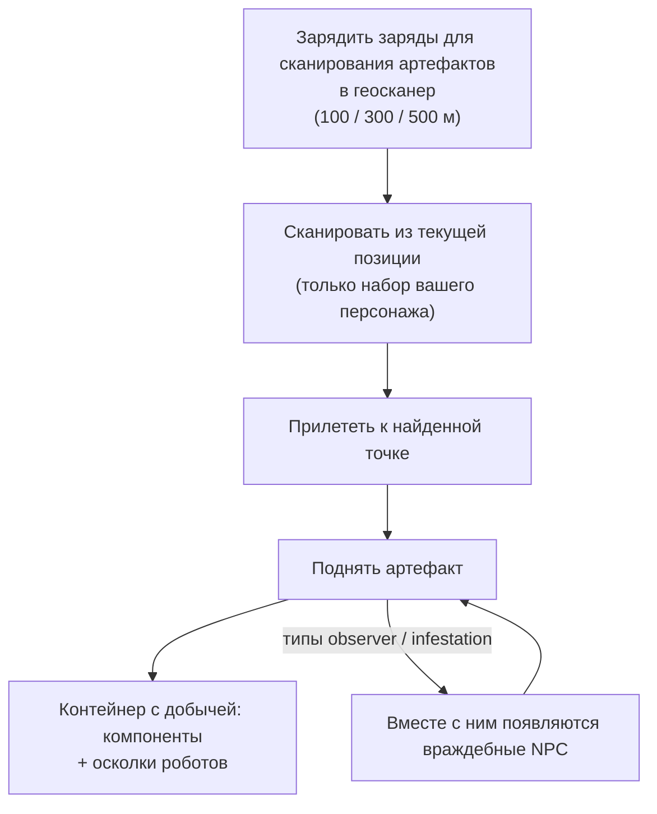

# Исследование (артефакты и реликвии)

Исследование — это поиск скрытых ценностей на местности, отличное занятие для
соло-игрока на любом уровне развития. Оно делится на два типа: **артефакты**
(персональные и скрытые) и **реликвии** (общедоступные и являющиеся предметом
соперничества).

## Поиск артефактов (Artifacting)

Артефакты — это точки, существующие **индивидуально для каждого персонажа**:
сервер хранит отдельный набор артефактов для каждого персонажа на каждом
острове, поэтому найденное принадлежит только вам. Они невидимы, пока вы их не
просканируете.

1. Зарядите **заряды для сканирования артефактов** в модуль геосканера.
   Существует три типа зарядов с разным радиусом действия (100 / 300 / 500 м).
2. Выполните сканирование из позиции вашего робота — сканер покажет координаты
   артефактов в пределах радиуса действия (параметр точности геосканера сужает
   область отображаемой позиции).
3. Прилетите к обнаруженной точке и поднимите артефакт; на этом месте появится
   **контейнер с добычей**.

Два фактора делают поиск артефактов не только собирательством, но и боевым
занятием:

- Некоторые типы артефактов **призывают NPC рядом с вами** — разновидности
  «observer» и «infestation» спавнят врагов в момент обнаружения артефакта,
  поэтому используйте робота, способного дать отпор.
- Добыча случайна для каждого типа артефакта: компоненты модулей (бронепластины,
  укрепители, генераторы, ремонтные модули…) и **осколки роботов** —
  специфичные для фракций ингредиенты для исследований и производства, что
  делает поиск артефактов ключевым направлением для промышленников.

Типы артефактов разделены по уровням (уровни 1–3, больше добычи на высоких
уровнях) и существуют в нейтральных и фракционных вариантах.

## Охота за реликвиями

Реликвии **находятся в открытом мире**: зона спавнит их в случайных точках
(с циклом возрождения примерно в 90 минут со случайным разбросом), они
представляют собой видимые объекты с лучом света, и добычу забирает тот, кто
поднимет их первым. Награда включает в себя сумму в NIC, а также **осколки
роботов**, масштабируемые в зависимости от уровня реликвии и ценности острова —
те же самые осколки, которые добываются при поиске артефактов.

Типы реликвий ранжируются по уровням островов (уровни 1–3, с разным количеством
очков EP в зависимости от уровня) и бывают нейтральными, фракционными и
промышленными. Некоторые реликвии привязаны к [аванпостам](/ru/features/outposts/) —
активность SAP порождает собственные реликвии, существующие до 12 часов, а на
островах с открытым PvP точки их появления расположены в спорных зонах, так что
будьте готовы встретить других охотников.

## Миссии тоже оплачивают эту работу

В рамках [миссий](/ru/features/missions/) вам также могут поручить поиск
артефактов, где вы получаете прямую оплату за выполнение, а найденные предметы
отправляются работодателю, а не в ваш инвентарь.

<!--
Written from scratch against the server backend, 2026-09-27:
Zones/Artifacts/Repositories/ZoneArtifactRepository.cs (per-character artifact
rows), Zones/Scanning/Scanners/Scanner.Artifact.cs (scan range + accuracy),
Zones/Artifacts/Generators/Loot/ (random loot per type),
Services/Relics/RelicManagers/ZoneRelicManager.cs (~1.5 h respawn + random
window) and SAPRelic.cs (12 h lifespan),
artifacttypes/artifactloot/relictypes/relicloot tables,
ammo_artifact_scan_a/b/c (scan ranges 100/300/500).
An earlier version of this page was adapted from the Open Perpetuum
community wiki (perpetuum.miraheze.org) and has been fully rewritten from
backend sources; no text was reused.
-->