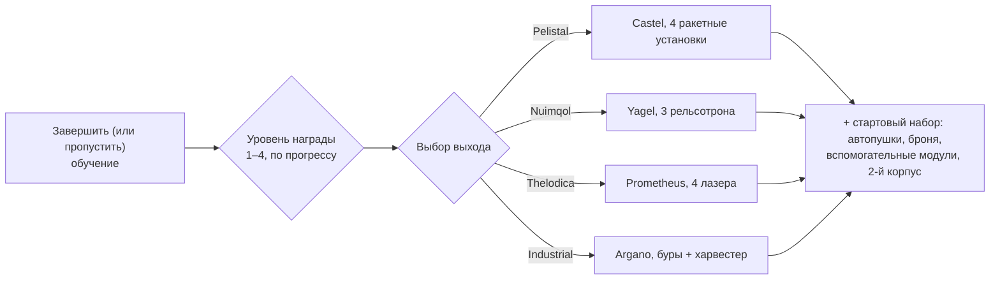

# FAQ

## Можно ли пропустить обучение?

Вы можете покинуть тренировочную зону раньше времени, но при этом потеряете
награду за ее завершение. Когда персонаж выходит из обучения, сервер:

- выплачивает **начальные NIC** плюс бонус **за каждый достигнутый уровень награды** в
  обучении (всего четыре уровня наград),
- зачисляет вас в **корпорацию по умолчанию** для выбранной расы и школы,
- выдает **начальные расширения** (навыки) и вашу **искру**,
- создает вашего **стартового робота**, размещает вас на базе New Virginia и
  устанавливает ее вашей **домашней базой** — местом, где вы возрождаетесь после
  уничтожения робота,
- помещает **наградные предметы** в общественный контейнер на этой базе и
  отправляет приветственное письмо.

## Как завершить обучение?

Выполняйте задания по порядку; **Список задач новичка** (Rookie Checklist в меню
«Справка» на верхней панели) отслеживает их и может быть закреплен на нижней панели.
То, насколько далеко вы продвинетесь, определяет ваш уровень награды, от которого
зависят уровни наград при выходе: выход на 1-м уровне дает только первый набор, а
полное прохождение — все четыре.

## Что дает каждый выход?

Ваш выбор определяет три вещи: **стартового робота**, которым вы управляете, **наградные
предметы**, которые вы получаете, а также **корпорацию по умолчанию и начальные навыки**.
Все остальное — любой навык, любой робот, снаряжение любой фракции — можно изучить
и купить позже за EP и NIC, поэтому выбор является лишь стартовым набором, а не жестким ограничением.

| Выход | Стартовый робот (с оснащением) | Тематика награды |
|---|---|---|
| **Pelistal** | Castel — четыре ракетные установки | ракеты + автопушки |
| **Nuimqol** | Yagel — три рельсотрона | боеприпасы для рельсотронов + автопушки |
| **Thelodica** | Prometheus — четыре лазера | лазерные кристаллы + автопушки |
| **Industrial** | Argano — два бура, харвестер, геологоразведочный зонд | боеприпасы для бурения, сбора и поиска артефактов |

Каждый выход также включает набор малых автопушек со снарядами, броню и
вспомогательные модули (модуль ремонта брони, усилитель сенсоров или снижатель массы,
перезарядчик ядра, модификаторы урона), второй (пустой) корпус и капсулу со стенной бомбой
(wall-bomb) на высших уровнях наград.

## Что делать после выхода в мир?

Практически любая активность приносит EP для навыков и NIC для снаряжения:

- Занимайтесь добычей руды, сбором растений, поиском артефактов — и продавайте добычу на [рынках](/ru/features/market/).
- Уничтожайте NPC и продавайте [добычу](/ru/features/npcs/).
- Собирайте или покупайте материалы и [производите](/ru/features/production/) предметы.
- Выполняйте [миссии](/ru/features/missions/) — любые задания, предлагаемые в терминале или
  на аванпосте, можно выполнить в одиночку.

Впервые в открытом PvP? Ознакомьтесь с [советами по выживанию в Начале игры](/ru/features/getting-started/#survival).

## Можно ли вернуться в тренировочную зону?

Нет. Тренировочная зона предназначена только для новых персонажей, и повторный вход туда
после выхода невозможен. Список задач новичка остается доступным в меню «Справка», если вы
захотите перечитать задачи, и вы всегда можете создать еще одного персонажа и оставить его
в обучении как тестовую песочницу.

## Сокращения

Распространенный сленг и аббревиатуры в чате, на рынке и в описаниях фитов. Для большинства терминов
есть отдельные страницы (на них даны ссылки) — названия предметов ищутся через общий поиск по сайту.

| Термин | Значение |
|---|---|
| **EP** | [Очки расширений (Extension Points)](/ru/features/research/#ep-sources) — валюта навыков уровня аккаунта, расходуемая на прокачку [расширений](/ru/features/character/#extensions) (правила получения описаны на [странице исследований](/ru/features/research/#ep-sources)). |
| **NIC** | Нианские кредиты (Nian Credit) — внутриигровая валюта (баланс `credit` вашего персонажа). |
| **CT** | [CPRG — Калибровочная программа](/ru/features/production/#cprg-calibration-programs) — программа, по которой калибруется производственная линия перед началом работы (по одной на предмет, с показателями эффективности по материалам и времени). |
| **Proto** | Прототип — высокоуровневый вариант модуля или робота, создаваемый на [заводе прототипов](/ru/features/production/#the-item-lifecycle-the-circular-process) (требует образец предыдущего уровня; см. [прогрессию уровней](/ru/features/production/#tier-progression)). |
| **LWF** | Облегченный корпус (Lightweight frame) — модуль брони, снижающий массу (в клиенте называется «… lightweight frame», например *Niani lightweight frame*). Делает робота легче ценой снижения запаса брони. |
| **TP / tele** | [Телепорт](/ru/features/movement/) — быстрое перемещение между фиксированными точками или к развернутому мобильному телепорту. |
| **SAP** | Точка доступа к сервисам (Service Access Point) — активность по изменению [стабильности](/ru/features/outposts/) аванпоста. |
| **Stab** | Стабилизатор оружия (Weapon Stabilizer) — повышает точность стрельбы оружия. |
| **Demob** | Демобилизатор (Demobilizer) — модуль, замедляющий целевого робота (и скорость работы его модулей). |
| **EWar** | Модули радиоэлектронной борьбы (Electronic Warfare) (глушение, подавление сенсоров, маскировка). |
| **EnWar** | Модули энергетической войны (Energy Warfare) (инжекторы ядра, вампиры/дрейнеры, нейтрализаторы, передатчики). |
| **Tuning** | Тюнинг — название в клиенте для модулей, усиливающих другие модули: модификаторы урона для оружия, *промышленный тюнинг* для буров и харвестеров, тюнинг ремонта брони и т. д. |
| **MK2** | Улучшенная модификация робота (корпуса `_mk2`) — увеличенные характеристики, отдельная ветка исследований. |

Классы роботов соответствуют группам в игровом клиенте — см. примечание в разделе
[Классы роботов](/ru/content/robots/#robot-classes).

<!--
Written from scratch against the server backend, 2026-09-27:
Zones/Teleporting/Strategies/TrainingExitStrategy.cs (exit rewards, NIC,
corporation, extensions, spark, starter robot, home base, reward items),
Zones/Training/Reward/TrainingReward*.cs + trainingrewards/robottemplates
(reward levels 1-4, per-race starter packs and items),
Robots/Robot.Properties.cs (race ids 1=Pelistal, 2=Nuimqol, 3=Thelodica, 5=industrial).
An earlier version of this page was adapted from the Open Perpetuum
community wiki (perpetuum.miraheze.org) and has been fully rewritten from
backend sources; no text was reused.
-->
