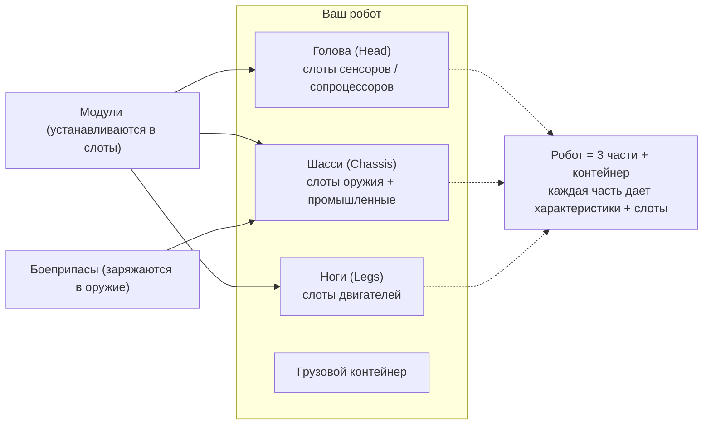

# Оснащение

Оснащение (фиттинг) означает установку **модулей** в слоты компонентов робота и зарядку **боеприпасов** в
ваше оружие. Любое оснащение возможно **только в доке** — снарядить робота в открытой зоне нельзя.

> Расположение элементов интерфейса описано в [обзоре интерфейса клиента](/ru/features/ui/) (категория **Equip** на
> верхней панели). Приведенные ниже механики сверены с работой сервера.

## Установка модулей

Робот состоит из нескольких **компонентов** (оружие, щиты, броня, двигатели, сенсоры и т. д.), каждый
из которых обладает набором **слотов**.

- **Установить модуль** — взять модуль из контейнера и поместить его в определенный
  слот компонента. Тип модуля должен подходить для этого слота на данном классе робота.
  Если слот уже занят, установленный ранее модуль возвращается в контейнер.
- **Поменять модули местами** — переместить модуль между двумя слотами одного и того же компонента.
- **Снять модуль** — извлечь модуль из слота обратно в контейнер.

Сервер пересчитывает характеристики робота после каждого изменения (модули влияют на значения,
отображаемые на панели статуса вне дока — см. [бой](/ru/features/combat/)).

## Зарядка боеприпасов

- **Зарядить боеприпасы** — поместить подходящий тип боеприпасов в активный (оружейный) модуль. Модуль
  должен **поддерживать этот тип боеприпасов**, при этом загружается количество вплоть до **вместимости боезапаса** модуля.
  Любые ранее заряженные боеприпасы предварительно возвращаются в контейнер.
- **Сменить боеприпасы** — заменить заряженные боеприпасы на другой совместимый тип.
- **Разрядить боеприпасы** — вернуть заряженные боеприпасы обратно в контейнер.

## Пресеты оснащения

**Пресет** — это сохраненная конфигурация оснащения, которую можно быстро применить повторно:

- **Сохранить** — записать текущее оснащение робота под заданным именем.
- **Список** — просмотреть сохраненные пресеты.
- **Применить** — установить модули из пресета на (другого) робота, используя предметы из контейнера.
- **Удалить** — удалить сохраненный пресет.

Пресеты удобны для быстрого переоснащения после боя или при смене роли.

## Практические заметки

- **Нельзя оснащать робота в зоне** — для всех этих действий необходимо находиться в доке.
- **Сначала изучите открывающее расширение** — без изученного класса робота вы не сможете выбрать его или пилотировать.
- **Боеприпасы должны соответствовать оружию** — несовместимый тип боеприпасов будет отклонен.
- **Упакованных роботов нельзя использовать** — распакуйте робота перед тем, как выбрать или оснастить его.
- **Используйте пресеты для быстрого переоснащения** — сохраняйте проверенные сборки и применяйте их после потерь.

## Категории слотов

Компоненты робота (голова, шасси, ноги) предоставляют **слоты**, и каждый слот содержит набор
флагов категорий. Модуль подходит для слота только в том случае, если флаги самого модуля являются **подмножеством**
флагов этого слота. Существуют следующие категории флагов:

`small`, `medium`, `large`, `turret`, `missile`, `melee`, `industrial`,
`ew_and_engineering`, `specialized` (специализированный слот принимает только специализированные
модули), а также структурные слоты `head` / `chassis` / `leg`.

Модули также могут иметь ограничения по конкретным роботам, а некоторые имеют флаг **unique**,
поэтому одновременно можно установить только один модуль такого типа. Влияние каждого модуля на характеристики представлено в
генерируемой [таблице роботов](/content/robots/).