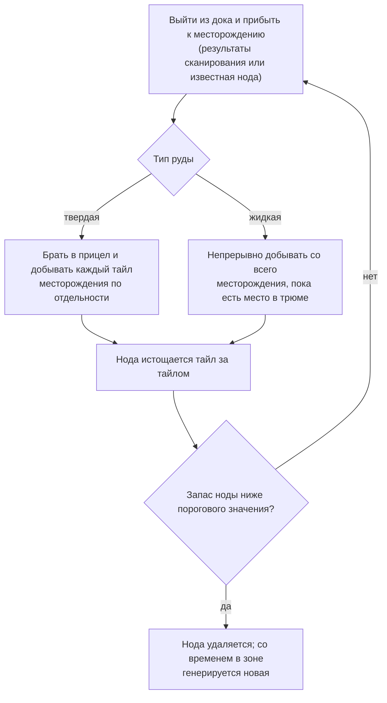
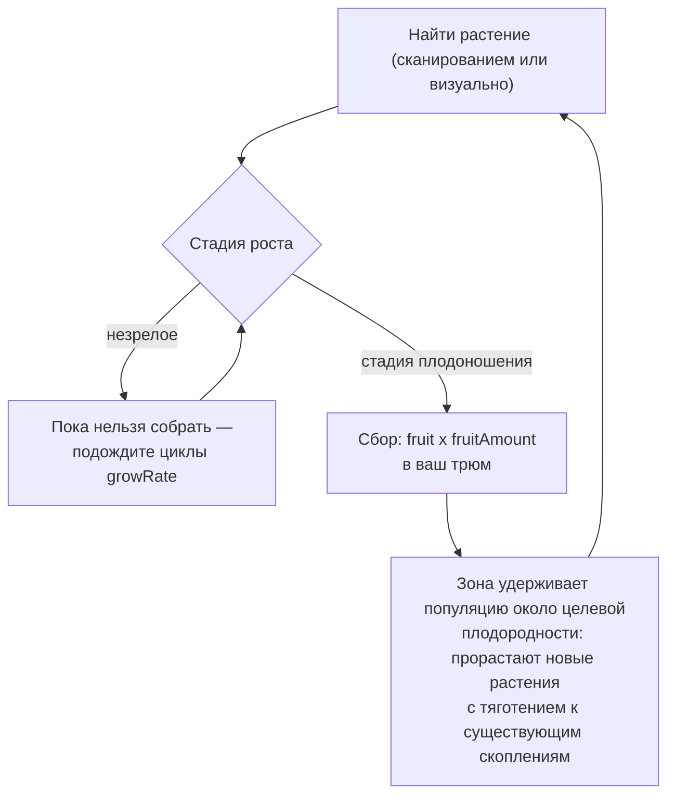
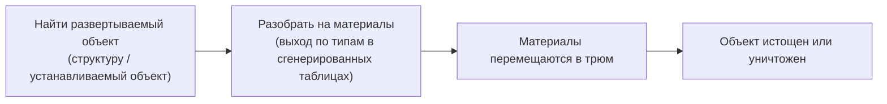

# Сбор ресурсов и сканирование

Ресурсы в игре добываются из трех источников в зоне: **месторождения руды**, **растения**
и **развертываемые объекты (deployables)**. На этой странице объясняется, как устроен каждый источник и как выглядит цикл сбора.

> Расположение элементов интерфейса описано в [обзоре UI клиента](/ru/features/ui/): действия сканирования и сбора находятся в
> списке **действий вне дока (undocked actions)** (в правом верхнем углу при нахождении в зоне). Значения выхода на каждый тип ресурса
> приведены в сгенерированных таблицах: [Контент → Руды](/content/ores/) и
> [Контент → Растения](/content/plants/). Описанные ниже механики сверены с серверной
> реализацией.

## Базовый цикл

1. **Выйдите из дока (Undock)** и переместитесь в зону (см. [перемещение](/ru/features/movement/)).
2. **Просканируйте** местность с помощью модуля сканера вашего робота.
3. **Соберите ресурсы** — добывайте руду, собирайте плоды растений или разбирайте развертываемые объекты.
4. **Зайдите в док (Dock)** и переместите груз в контейнер базы.

## Месторождения руды

- Руда находится под землей в виде **месторождений (нод)**, разбросанных по всей зоне.
- Чтобы обнаружить и зафиксировать их, вам понадобится **модуль геосканера (geo-scanner module)**, установленный на вашем активном роботе.
  Сканирование создает **результат сканирования**; затем вы **загружаете (upload)** его, сохраняя в свой
  персональный список минеральных сканов.
- Сохраненные результаты сканирования можно **просматривать, перемещать, удалять или конвертировать в предметы**
  (предметы «mineral scan», используемые для переработки/производства).

- Месторождения **конечны**: каждая нода содержит ограниченный суммарный объем. Когда нода
  вырабатывается ниже порогового значения, она удаляется, и зона со временем **генерирует новые ноды**
  вплоть до заданного максимума. Подробнее о том, как размещаются ноды и как поддерживаются популяции растений
  (с примерами реальных зон), описано в
  разделе [Зоны → Генерация](/zones/generation/).
- **Твердые и жидкие руды.** Твердые руды истощаются потайлово — вы берете в цель и вырабатываете
  каждый тайл месторождения, пока он не опустеет. Жидкие руды выкачиваются со всего поля целиком, поэтому
  ваш бур может работать непрерывно, пока хватает места в трюме. Именно из-за этой простоты
  жидкие руды обычно стоят дешевле: их добыча требует меньше навыков и внимания.

### Характеристики растений и руд вкратце

Поведение руд и растений определяется данными правил для каждого типа. Поля, имеющие значение для
игрока:

| Поле | Значение в игре |
|---|---|
| `fertility` | Насколько распространен тип — чем выше значение, тем большее его количество зона стремится поддерживать |
| `growRate` | Сколько циклов роста растение должно провести на каждой стадии перед переходом на следующую (выше = медленнее) |
| `spreading` | Растет ли данный тип скоплениями (группами) или рассеянно |
| `killDistance` | Минимальное расстояние между двумя растениями одного типа |
| `slope` / `minSlope` | Крутизна склона, на котором может расти растение |
| `allowedAltitudeLow/High` | Диапазон высот, на которых может расти растение |
| `allowedWaterLevelLow/High` | Диапазон расстояния от береговой линии (формирует прибрежную растительность) |
| `fruitingState` | Стадия роста, которой должно достичь растение, прежде чем оно начнет давать урожай (станет доступным для сбора) |
| `fruitDefinition` / `fruitAmount` | Что дает растение и базовое количество плодов |
| `maxAmount` | Лимит количества объектов этого типа в области обработки |
| `health` | Очки прочности на каждой стадии роста (более поздние стадии могут быть прочнее) |
| `damageScale` | Сопротивление растения урону |
| `playerSeeded` | Растение появляется только там, где его посадил игрок |
| `onlyOnUnprotectedZone` | Растет только в незащищенных зонах (бета-/гамма-класса) |

Полный справочник по полям (типы, значения по умолчанию, хранение и использование в тике зоны)
приведен в разделе [Форматы → Поля растений](/ru/formats/plant-fields/).

## Растения

- Растения **растут со временем**, проходя последовательность стадий. Каждая стадия занимает определенное количество
  циклов роста (`growRate`), после чего растение случайным образом переходит на следующую.
- Растение **дает плоды только по достижении стадии плодоношения** — незрелые растения
  собрать нельзя.
- Зона поддерживает популяции растений в соответствии с **целевым показателем плодородности (fertility target)**: если участок
  земли недостаточно засажен для своего уровня плодородности, прорастают новые растения; при выборе типа
  учитывается `fertility` каждого вида, а параметр `spreading` смещает новый рост в сторону существующих
  скоплений.

- Некоторые растения **высаживаются игроками** (они встречаются только на фермах игроков), а некоторые
  **растут исключительно в незащищенных зонах**.
- Растения могут быть **повреждены и уничтожены**; их параметры `health` и `damageScale` определяют,
  насколько тяжело это сделать.

## Развертываемые объекты (Deployables)

Развертываемые объекты — это размещенные в зоне структуры (см. [Базовые энергостанции](/ru/features/pbs/) касательно
конструкций). Некоторые из них можно **разобрать (strip)** на материалы. Правила разбора и показатели выхода
по каждому типу приведены в сгенерированных таблицах: [Контент → Руды](/content/ores/) и [Контент → Растения](/content/plants/).

## Киоски

**Киоск** — это структура, связанная с миссиями: вы **сдаете в него предметы** (находясь в радиусе действия) в рамках
выполнения миссии. Сам по себе он не является источником добычи ресурсов — см. [миссии](/ru/features/missions/).

## Практические заметки

- **Для сканирования требуется модуль** — без установленного геосканера получить результаты сканирования невозможно.
- **Результаты сканирования принадлежат вам** — они сохраняются индивидуально для каждого персонажа и не передаются другим.
- **Ноды руды возрождаются, но медленно** — если область пуста, месторождение выработано, а не
  спрятано. Регенерация восстанавливает количество нод не мгновенно.
- **Собирайте созревшее** — растения на стадии плодоношения дают полный урожай; более ранние стадии
  не дают ничего.

<!-- TODO: only the client UI flow remains (scan screen, harvest interaction, cargo UI) —
     needs a running client. Per-type ore yields are at /content/ores/ and plant fruit
     definitions at /content/plants/ (generated from the live DB).
     Developer notes: Zone/ZoneUploadScanResult.cs (GeoScannerModule required);
     MineralScanResult*.cs (per-character repository);
     Zones/Terrains/Materials/Plants/PlantRule.cs (all plant rule fields);
     Zones/Terrains/NatureCube.cs (GrowPlants, fertility/spreading/killDistance logic);
     Zones/Terrains/Materials/Minerals/MineralLayer.cs (ore node lifecycle);
     Zone/UseItem.cs + UseItemVisitor.cs (IUsableItem harvest path);
     Zone/KioskSubmitItem.cs (mission item submission, range-limited). -->