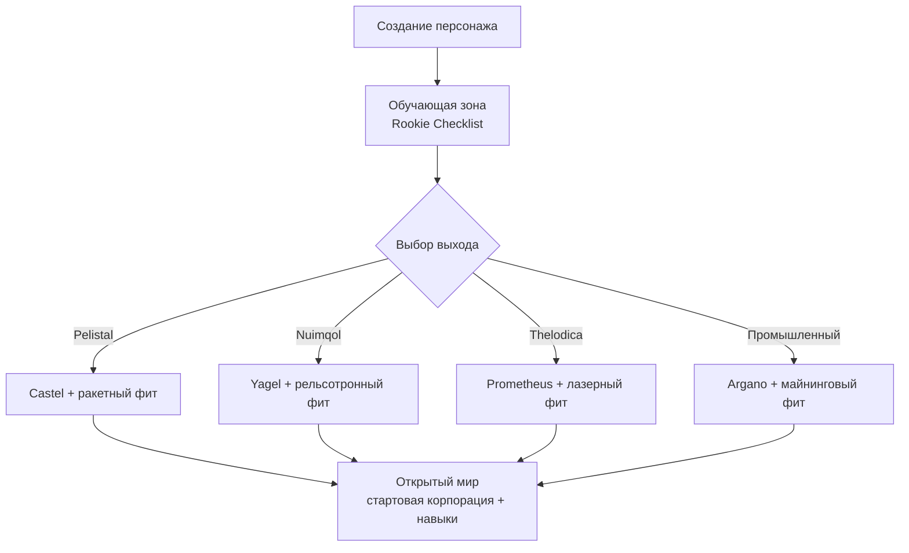

# Начало игры

На этой странице описаны первые шаги: создание персонажа, получение первого робота
и настройки персонажа, с которыми вы столкнетесь в самом начале.

> Расположение элементов интерфейса описано в [обзоре интерфейса клиента](/ru/features/ui/). Приведенные ниже механики
> подтверждены реализацией серверной части.

## Получение игры

Perpetuum доступна бесплатно в [Steam](https://store.steampowered.com/app/223410/Perpetuum/).

  <a class="steam-card-link" href="https://store.steampowered.com/app/223410/Perpetuum/" target="_blank" rel="noopener">
    
    Perpetuum в Steam — бесплатная игра
  </a>

## Рекомендуется посмотреть

Гайды от Open Perpetuum Project. Нажмите на карточку, чтобы воспроизвести видео здесь.

  

    
    &#9654;
    
Perpetuum Online Tutorial Walkthrough. + Extension Advice and lots more.

  

  

    
    &#9654;
    
Syndicate Careers Help — Artifacting

  

  

    
    &#9654;
    
Open Perpetuum Tutorial — How to run multiple clients

  

## Создание персонажа

- Вы можете **проверить, свободно ли имя**, перед созданием (`characterCheckNick`).
- **Создайте персонажа** — он привязывается к вашему аккаунту. Аккаунт может содержать
  нескольких персонажей; играть можно только одним за раз.
- **Выберите персонажа**, чтобы войти в игру. Смена персонажа отменяет выбор текущего.
- Позже персонажа можно **переименовать** (новое имя должно быть свободно).
- Вы можете **удалить** персонажа, которым больше не пользуетесь.

## Ваш первый робот

- Находясь **в доке базы**, вы можете **запросить стартового робота** (службы базы —
  см. [обзор интерфейса клиента](/ru/features/ui/), чтобы узнать, где находятся действия базы).
  - На базе должны оставаться стартовые роботы в наличии — на популярных базах они могут
    заканчиваться, и в этом случае запрос завершится ошибкой.
  - Между запросами стартового робота действует **5-минутный кулдаун** на персонажа.
  - Новый робот доставляется в публичный контейнер базы.

- Находясь в доке, вы также можете **запросить «бесконечный контейнер» (infinite box)**: специальный контейнер,
  добавляемый в ваш инвентарь за **плату в 5 000 кредитов**. Это удобный контейнер для хранения,
  а не источник бесплатных ресурсов.

## Настройки персонажа

- **Аватар** — внешний вид вашего персонажа.
- **Сообщение о настроении (Mood message)** — короткая строчка, видимая другим игрокам.
- **Личная заметка (Private note)** — заметка к персонажу, которую видите только вы.
- **Домашняя база (Home base)** — установка или сброс домашней базы; это ваш базовый док по умолчанию,
  когда игре требуется переместить вас в безопасное место.
- **Настройки (Settings)** — параметры конкретного персонажа (получение/установка).
- **Блокировка торговли (Block trades)** — включение или отключение возможности торговли для персонажа.
- **Кредиты (Credits)** — перевод кредитов между своими персонажами; просмотр истории транзакций.
- **Уровень аккаунта (Account level)** — изменение сессионного e-mail/пароля, просмотр истории
  транзакций аккаунта и истории начисления EP за активность.

## Выход и повторный вход

- **Выход из системы (Sign out)** завершает сессию; **выбор персонажа (select character)** запускает её снова.
- Если сервер принудительно отключит вас (например, принудительный возврат на базу), вы снова появитесь в доке — см. [перемещение](/ru/features/movement/).

## Обучение (Tutorial)

Новые персонажи начинают в тренировочной зоне со списком заданий **Rookie Checklist** — обязательно пройдите его:
он охватывает базовые механики и вознаграждает несколькими роботами с модулями и боеприпасами. Обучение можно
пропустить (выйти из дока и направиться к выходу любой фракции), но тогда вы потеряете награды и
не сможете вернуться в тренировочную зону позже. Подробнее о том, что дает каждый из четырех фракционных выходов,
описано в [FAQ](/ru/features/faq/#chto-daet-kazhdyi-vykhod).

## Выживание

Perpetuum — это песочница с механикой риска и награды: когда ваш робот уничтожен, вы теряете его
(в доке или вне его, убит игроком или NPC) и снова появляетесь на своей [домашней базе](#nastroiki-personazha)
(если вы остались с пустыми руками, там можно запросить бесплатного стартового робота). Несколько
правил, позволяющих пережить потери:

- **Рискуйте только тем, что можете возместить.** Выход из дока — это ставка: если робот
  будет уничтожен, он и установленные на нем модули пропадут (или станут добычей). Прежде чем
  покинуть док, убедитесь, что вы готовы перенести эту потерю.
- **Изучайте зоны.** Защищенные (PvE) острова безопасны от нападений игроков; острова
  с открытым PvP представляют собой свободную зону боевых действий без системы преступлений и наказаний.
  Карту можно найти в разделе [зоны](/ru/zones/).
- **Изучайте NPC.** Оранжевые маркеры атакуют только при провокации; красные маркеры
  атакуют при приближении. Убегайте и разрывайте прямую видимость, чтобы сбросить агрессию. См.
  [NPC и PvE-охота](/ru/features/npcs/).
- **Снижайте риски, а не просто миритесь с ними.** Отправляться на открытый PvP-остров на лучшем
  мехе в T4-обвесе — верный способ его потерять. Более дешевая, легко заменяемая экипировка,
  окупающаяся за пару вылетов, гораздо эффективнее дорогого бота, требующего двадцати рейдов.
- **Создайте устойчивый цикл дохода.** Чем бы вы ни занимались — миссиями, сбором ресурсов, охотой,
  производством или перевозками — кто-то платит за это NIC. Сохраняйте резервные активы, чтобы один
  неудачный день не обнулил ваш доход.

## Что делать дальше

1. Выберите своего стартового робота и изучите экран [ангара и фитинга](/ru/features/robots/).
2. Выйдите из дока и направляйтесь в зону — см. [перемещение](/ru/features/movement/).
3. Сканируйте местность и начните сбор ресурсов — см. [сбор ресурсов](/ru/features/gathering/).
4. Изучите первые расширения (extensions) — см. [исследования](/ru/features/research/).
5. Выберите карьеру — варианты представлены в [FAQ](/ru/features/faq/#chto-delat-posle-vykhoda-v-mir).

<!-- TODO(Phase 1): verify client UI flow (account creation screen, character wizard).
     UI model: see features/ui.md (EVE-style, project-provided).
     Developer notes: Perpetuum.RequestHandlers.Characters/* (CharacterCreate,
     CharacterSelect, CharacterRename, CharacterSetHomeBase, ...);
     RequestStarterRobot (5-minute cooldown, base stock), RequestInfiniteBox
     (5000 credits, docked-only). -->