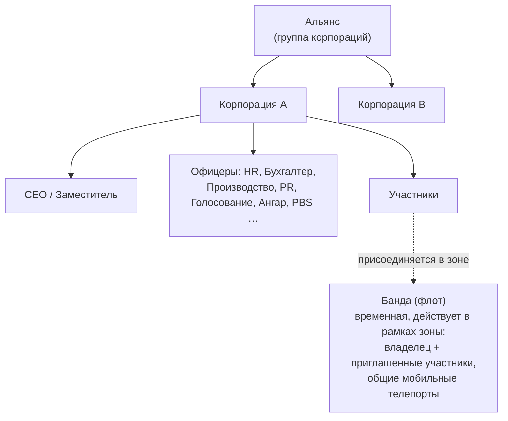

# Группы

Существует три типа объединений: **корпорации** (ваша основная организация), **альянсы** (объединения
корпораций) и **банды** (временные флоты для совместных действий в зоне).

> Расположение элементов интерфейса приведено согласно [обзору интерфейса клиента](/ru/features/ui/) (кнопка **Корпорация** в верхнем левом углу;
> категория **Хранилище корп.**; для банд предусмотрено отдельное окно). Описанные ниже механики
> подтверждены на стороне сервера.

## Корпорации

### Вступление и выход
- **Создание** корпорации — требует базового расширения управления корпорацией
  (уровень 1) и регистрационного взноса в размере **250 000 NIC**. Вы выбираете официальное название,
  **короткий ID** (максимум 6 символов, отображается на местности для идентификации участников),
  а также **налоговую ставку** — долю доходов участников (в частности, выплат за миссии), которая
  автоматически перечисляется на счет корпорации.
- **Подача заявки** на вступление или **приглашение** персонажа.
- **Принятие заявки** / **просмотр списка заявок** (для офицеров).
- **Ответ** на полученное приглашение.
- **Выход** из корпорации или **отмена** запроса на выход.
- **Исключение участника**, **назначение роли участнику**, **снятие с себя ролей** или перевод участников
  в нейтральный статус.

### Роли
В корпорациях действует иерархия ролей. Роли определяют доступные возможности — например, разблокировку
узлов древа технологий корпорации, управление ангаром или редактирование PBS (см.
[pbs](/ru/features/pbs/)). Роли, определенные сервером (`CorporationRole`):

- **CEO** — полный контроль.
- **Заместитель CEO (Deputy CEO)** — второй человек в руководстве.
- **HR-менеджер (HR Manager)** — управление членством (заявки/приглашения/исключение).
- **Делегат корпорации (Corporation Delegate)** / **Делегат альянса (Alliance Delegate)** — представление интересов организации.
- **Бухгалтер (Accountant)** — финансы корпорации.
- **Менеджер производства (Production Manager)** — корпоративное производство.
- **Администратор голосований (Vote Admin)** — организация голосований.
- **PR-менеджер (PR Manager)** — связи с общественностью / доска объявлений.
- **Доступ к ангару (низкий / средний / высокий / защищенный)** — уровни прав доступа к ангару с
  соответствующими уровнями на **изъятие предметов** и ролью **оператора ангара**.
- **Просмотр PBS / редактирование PBS** — просмотр или изменение PBS-структур корпорации.
- **Просмотр древа технологий / разблокировка** — просмотр или исследование древа технологий корпорации.

Некоторые типичные ограничения прав: действия по управлению членством (заявки/приглашения/исключение, назначение ролей) требуют
прав **CEO / заместителя / HR-менеджера**; доска объявлений и PR требуют прав **CEO / заместителя / PR-менеджера**;
финансы корпорации и улучшение сооружений требуют прав **CEO / заместителя / бухгалтера** (для производства дополнительно требуется
**менеджер производства**); для развертывания PBS требуются права **CEO / заместителя / редактирования PBS**.

Вы можете просматривать **историю изменений ролей** для себя и других участников. Место в ангаре сдается в аренду (настройки
сервера по умолчанию: 50 000 кредитов за 7-дневный период).

### Информация и поиск
- **Информация о корпорации / моя информация** — подробные сведения и статус вашего членства.
- **Поиск** корпораций.
- **Отношения / репутация** — статус отношений и репутация вашей корпорации.
- **Делегаты** — персонажи, действующие от имени корпорации.

### Финансы
- **Пожертвования** на кошелек корпорации.
- **Выплаты** со счета.
- **Переводы** между кошельками.

### Внешний вид и профиль
- **Смена названия**, **выбор цвета**, **настройка информации** (публичный профиль).
- **Логотип** — до 5 символов из фиксированного набора, каждый из которых настраивается (размер, прозрачность,
  порядок слоев); создавать или изменять его могут только уполномоченные участники.
- **История названий** — предыдущие названия.

### CEO
- **Выдвижение на пост CEO** или проверка **статуса перехвата управления (CEO takeover)**.
- **Перехват управления на практике**: если CEO находится офлайн более **30 дней**, заместитель
  может инициировать перехват — запускается **48-часовой обратный отсчет**, объявление о котором появляется
  в окне корпорации. CEO или любой другой заместитель может мгновенно наложить **вето** (вето не
  препятствует следующей попытке, если CEO так и не войдет в игру). Если обратный отсчет доходит до
  нуля, заместитель становится CEO со всеми правами.

### Голосования
Корпорации могут проводить **голосования**:
- **Запуск** голосования, **выбор темы**, **просмотр списка** голосований, **отдача голоса**, **удаление** голосования.

## Доска объявлений
Информационная доска под управлением корпорации:
- **Активация**, **просмотр списка** записей, просмотр **новых записей**, **публикация** записи, **модерация**
  (редактирование/удаление чужих записей) и просмотр **подробностей**.

## Корпоративный ангар (хранилище)
Общая зона хранения корпорации на базах:
- **Аренда** секции ангара, **оплата аренды**, просмотр **стоимости аренды**, **закрытие** секции.
- **Список** содержимого (всего или на конкретной базе).
- **Папки** — создание и удаление подпапок.
- **Настройка доступа** (кто может использовать) и **указание названия**.
- **Журналы событий** — просмотр, настройка и очистка журнала доступа к ангару.

Примечание: вы **не можете выбрать робота из корпоративного ангара** в качестве активного
(см. [роботы](/ru/features/robots/)).

## Документы корпорации
Общая система текстовых документов корпорации с поддержкой версионирования. Существует два типа
документов:

- **План PBS** — план/чертеж сети структур PBS корпорации.
- **Проект терраформирования** — запись проекта по изменению ландшафта.

Доступные операции: **создание**, **просмотр списка**, **открытие**, **обновление содержимого** (с версионированием), **удаление**,
**передача** права владения, **аренда** (продление срока действия), **отслеживание** / **отмена отслеживания**
(получение уведомлений об изменениях), а также **список регистрации** (до 25 участников), определяющий, кто
может работать с документом.

## Альянсы

Альянс объединяет несколько корпораций:
- **Информация о моем альянсе**, **альянсы по умолчанию** и **история ролей в альянсе**.
- Отношения могут устанавливаться на уровне альянсов (см. [социальные механики](/ru/features/social/)).

## Банды (флоты)

**Банда** — это временная группа для совместной игры в пределах зоны (например, для использования общего мобильного телепорта или совместного
ведения боя):
- **Создание**, **удаление**, **информация**.
- **Приглашение**, **ответ** на приглашение, **исключение**, **выход**.
- **Назначение лидера**, **назначение роли**.

Членство в банде имеет ключевое значение для **мобильных телепортов** — использовать их могут только владелец или члены банды
(см. [перемещение](/ru/features/movement/)).

## Практические заметки

- **Роли определяют возможности** — большинство действий офицеров (заявки, ангар, PBS, голосования) требуют
  наличия соответствующей роли.
- **Технологии корпорации являются общими** — для исследований корпорации используются общие очки и
  множитель (см. [исследования](/ru/features/research/)).
- **Ангар предназначен для хранения, а не для запуска** — вы не можете вылететь на роботе напрямую из корпоративного ангара.
- **Банды временны** — используйте их для сессий в рамках зоны, а не как постоянную организацию.
- **Отношения привязаны к корпорации** — репутация и отношения вашей корпорации напрямую влияют на то, как к вам относится
  окружающий мир (см. [социальные механики](/ru/features/social/)).

<!-- TODO: only the corp UI remains (window layout, role picker).
     Confirmed: CorporationRole enum (21 roles incl. hangar access/remove tiers
     low/medium/high/secure, viewPBS/editPBS, TechTreeList/TechTreeUnlock, delegates);
     permission gates sampled from handlers (membership CEO/Deputy/HRManager;
     bulletin CEO/Deputy/PRManager; money+facility upgrades CEO/Deputy/Accountant;
     production +ProductionManager; PBS CEO/Deputy/editPBS); documents = pbsPlan(1) +
     terraformProject(2) (CorporationDocumentType.cs), versioned, rent extends validity,
     monitor for change notifications, register list max 25 (MAX_REGISTERED_MEMBERS).
     Developer notes: Corporations/* (apply/invite/accept, roles, leave, info, money,
     votes, bulletin, hangar, documents, histories, CEO); AllianceGetMyInfo.cs /
     AllianceGetDefaults.cs / AllianceRoleHistory.cs; Gangs/* (create/invite/kick/leave,
     leader/role). SelectActiveRobot.cs forbids corp-hangar robots. -->