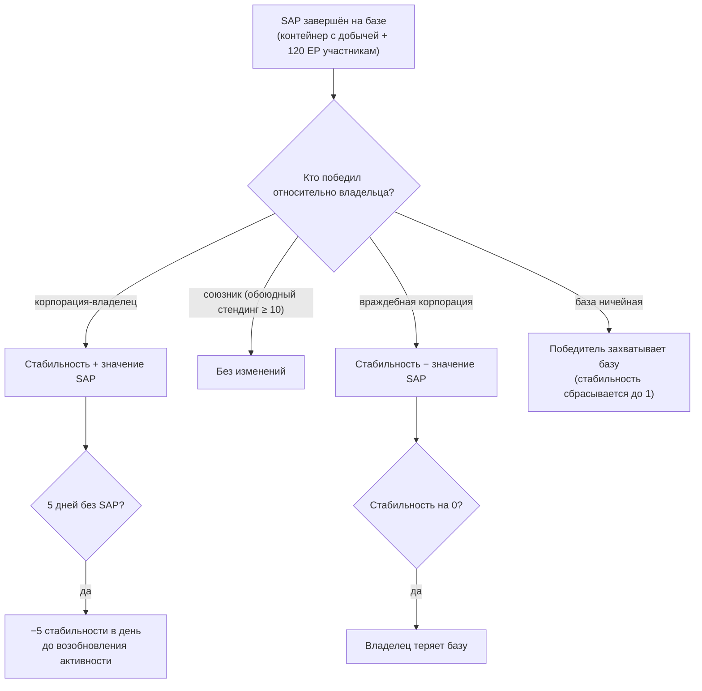

# Вторжение

**Вторжение** (Intrusion) — это игровой режим, построенный вокруг **баз NPC** — управляемых игроками или оспариваемых объектов со своими показателями **стабильности**, **обороны** и **сооружений**. Вы вкладываете предметы, усиливаете защиту и улучшаете сооружения, чтобы контролировать базу и извлекать из неё выгоду.

> Внутриигровое название термина «intrusion» требует подтверждения. Расположение элементов интерфейса приведено согласно [обзору интерфейса клиента](/ru/features/ui/). Описанные ниже механики сверены с сервером.

## Базы и стабильность

- **Информация о базе** (Site info) — подробные сведения о базе вторжения.
- **Стабильность** (Stability) — ключевой параметр базы со значением от **0 до 150**. Новый владелец начинает с **1**. Стабильность определяет всё:
  - **Пороги бонусов** (контент, `intrusionsitestabilitythreshold`): бонусы сооружений открываются при стабильности **20 / 60 / 80**; набор эффектов ауры (ядро вторжения, обнаружение, геосканирование, сборщик урожая, производство, маскировка, добыча, ремонт, сигналы — каждый 1–3 уровней, плюс комбинированные эффекты 4 уровня) открывается поэтапно на уровнях **10, 20, 40, 50, 70, 80 и 100**; **права на стыковку** открываются на **50**; лимит узлов обороны увеличивается на **40**.
  - **Очки производства** = `стабильность / 10` (макс. 15) — валюта для улучшения сооружений (одно очко за уровень).
  - **Упадок**: если успешных SAP не происходит в течение **5 дней**, база начинает терять **5 стабильности в день**, пока активность не возобновится.
  - **Потеря**: падение стабильности до **0** приводит к потере базы владельцем (она становится ничейной).
- **Журнал стабильности** (Stability log) — просмотр изменений стабильности базы.

### Что влияет на стабильность

Изменения стабильности происходят в результате завершения **SAP** (см. ниже) и системного упадка. Эффект зависит от того, *кто* побеждает на SAP относительно текущего владельца:

- **Побеждает владелец** → стабильность **увеличивается** на значение SAP.
- **Побеждает союзник** (обоюдный стендинг ≥ 10) → **без изменений**.
- **Побеждает враждебная корпорация** → стабильность **уменьшается** на значение SAP.
- **Ничейная база** → первая победившая корпорация игроков **захватывает контроль** (стабильность сбрасывается до 1).

## SAP (точки атаки базы)

**SAP** (site attack point) — это временная задача, появляющаяся на базе. При её завершении на месте SAP появляется **контейнер с добычей**, изменяется стабильность базы, а каждый участвовавший персонаж получает **120 EP**. **NPC-культисты также борются за SAP** — если они наберут очки первыми, SAP будет засчитан против вашей стороны. Существует четыре типа SAP:

| SAP | Способ выполнения | Значение стабильности |
|---|---|---|
| **Активный взлом** | использовать модуль взлома на SAP (до 120 применений модуля) | +15 |
| **Пассивный взлом** | находиться в радиусе 5 от SAP в течение **8 минут** | +10 |
| **Уничтожение** | уничтожить SAP уроном (урон от NPC также учитывается) | +15 |
| **Обработка образцов** | сдать **5–6 образцов SAP** (партиями по 2–3, перезарядка 1.5 мин, радиус 7) | +15 |

- **Сдать предмет SAP** — сдать образец в SAP обработки образцов, находясь в зоне.
- **Информация о предмете SAP** — просмотр данных о предметах SAP (ваших и общих).

Образцы SAP являются расходными материалами этого режима; они также обладают высоким запасом энергии ядра, поэтому могут использоваться и как [топливо для реакторов PBS](/ru/features/pbs/).

## Оборона и эффекты

- **Установить порог обороны** (Set defense threshold) — настроить порог обороны базы (условие активации автоматической защиты базы).
- **Установить бонус эффекта** (Set effect bonus) — настроить конфигурацию бонусов аур/эффектов на базе (из набора аур, открытых по уровню стабильности).
- **Улучшить сооружение** (Upgrade a facility) — улучшить сооружение базы: стоит **1 очко производства** (т. е. 10 стабильности), доступно только CEO, заместителю (deputy) и бухгалтеру (accountant), ограничено максимальным уровнем.
- **Установить сообщение базы** (Set a site message) — задать публичное сообщение для базы.

## Журналы

- **Журнал моих вторжений** (My intrusion log) — история вашей активности во вторжениях.
- **Публичный журнал** (Public log) — общая лента событий вторжений.
- **Журнал моих баз** (My sites log) — активность на подконтрольных вам базах.
- **Журнал стабильности** (Stability log) — изменения стабильности (см. выше).

## Практические советы

- **Стабильность — ключевой показатель**: она открывает уровни бонусов, генерирует очки для улучшений и именно её отнимают вражеские SAP.
- **За SAP идёт борьба**: NPC-культисты соревнуются с вами; проигранный SAP стоит вам стабильности.
- **Не оставляйте базу без присмотра**: 5 дней без успешно завершённых SAP запускают ежедневный упадок.
- **Следите за журналами**: используйте личные, публичные журналы и журнал стабильности, чтобы отслеживать всё происходящее на ваших базах.

<!-- TODO: only the in-client name for "intrusion" and the UI remain.
     Confirmed: stability 0-150, start 1 (Outpost.cs constants); bonus thresholds from
     intrusionsitestabilitythreshold (facility 20/60/80; aura effects 50-74 at tiers
     10/20/40/50/70/80/100; docking rights 50; defense nodes 40); production points =
     stability/10, facility upgrade costs 1 point, CEO/Deputy/Accountant; decay -5/day
     after 5 days idle (OutpostDecay.cs); owner-win +, ally (standing>=10) 0,
     hostile -; unowned -> winner takes it; stability 0 -> ownership lost; 120 EP per
     SAP participant (EP_WINNER, EpForActivityType.Intrusion); 4 SAP types: active
     hacking (120 module uses, +15), passive (8 min in range 5, +10), destruction
     (kill it, +15), specimen processing (5-6 specimens in 2-3 batches, 1.5 min cd,
     range 7, +15; siegeitems table: def_specimen_sap_item 2-3); SAP increase values
     from entitydefaults #increase option; NPC sap guard/invade units contest SAPs.
     Developer notes: Intrusion/IntrusionSAPSubmitItem.cs (SpecimenProcessingSAP,
     zone submit), IntrusionSAPGetItemInfo.cs / IntrusionSapItemInfo.cs,
     IntrusionSetDefenseThreshold.cs, IntrusionSiteSetEffectBonus.cs,
     IntrusionUpgradeFacility.cs, SetIntrusionSiteMessage.cs; GetIntrusionSiteInfo.cs,
     GetIntrusionLog.cs / GetIntrusionPublicLog.cs / GetIntrusionMySitesLog.cs /
     GetIntrusionStabilityLog.cs, GetStabilityBonusThresholds.cs;
     EventProcessors/AffectOutpostStability.cs; Zones/Intrusion/Outpost.cs,
     OutpostDecay.cs, SAP.cs + *SAP.cs subclasses. -->