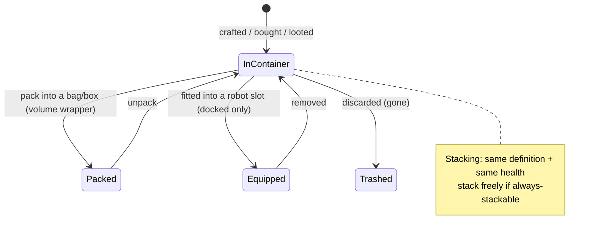

# Предметы и инвентарь

Ваш **инвентарь** представляет собой набор **контейнеров** (общий контейнер базы,
контейнер вашего робота, сумки/ящики и т. д.). На этой странице описаны действия с предметами внутри них.

> Расположение элементов интерфейса соответствует [обзору интерфейса клиента](/ru/features/ui/). Механики ниже подтверждены на основе работы сервера.

## Контейнеры

- **Просмотр контейнера (List a container)** — просмотр его содержимого.
- **Перемещение предметов (Relocate items)** — перенос предметов между контейнерами, к которым у вас есть доступ.

Действуют правила доступа: некоторые контейнеры (ангар корпорации, инвентарь робота, системные контейнеры) имеют ограничения — см. [роботы](/ru/features/robots/) и [группы](/ru/features/groups/).

## Упаковка и распаковка

- **Упаковать предметы (Pack items)** — поместить предметы в сумку/ящик (контейнер-«оболочку объёма»), чтобы компактно их переносить.
- **Распаковать предметы (Unpack items)** — извлечь предметы обратно из сумки/ящика.

Упаковка также используется для компактного хранения и транспортировки **роботов**: сервер сбрасывает динамическое состояние робота и установленные компоненты и помечает его как *переупакованный (repacked)*. Робота можно упаковать только в том случае, если он **не повреждён**, **не выбран в данный момент**, **не застрахован** и имеет **пустой инвентарь**. Распаковка восстанавливает робота и ремонтирует его. Упаковать можно только предметы с флагом контента *repackable*; переупакованного робота нельзя выбрать или оснастить модулями до тех пор, пока он не будет распакован (см. [роботы](/ru/features/robots/)).

## Объединение и разделение стопок (Stacking)

Многие предметы объединяются в стопки. Доступные операции:

- **Объединить предметы (Stack items)** / **положить в стопку (stack to)** / **объединить выбранное (stack selection)** — объединить предметы одного типа в одну стопку (или переместить стопку на другую).
- **Отделить количество (Unstack an amount)** — отделить указанное количество предметов от стопки.

Сервер объединяет только те предметы, которые имеют **одинаковый идентификатор (definition) и одинаковый уровень прочности (health)**. Предметы с флагом *always stackable* (руда, боеприпасы, большинство сырья) складываются в стопки свободно; предметы с флагом *non-stackable* никогда не объединяются; все остальные предметы могут объединяться в стопки **только в переупакованном виде** (packed) — поэтому распакованное, повреждённое снаряжение остаётся по отдельности.

## Переименование и использование

- **Переименовать предмет (Rename an item)** — задать предмету собственное имя.
- **Использовать предмет (Use an item)** — активировать используемый предмет (зависит от контекста; в зоне это также может активировать взаимодействие с объектами зоны — см. [сбор ресурсов](/ru/features/gathering/)).
- **Использовать лотерейный предмет (Use a lottery item)** — открыть или активировать предмет лотерейного типа.

## Уничтожение и компенсация

- **Выбросить предметы (Trash items)** — избавиться от предметов (безвозвратно удаляет их).
- **Компенсировать предмет (Reimburse an item)** — процедура возврата предметов администрацией/персоналом: создаёт предмет и передаёт его персонажу с записью в журнал транзакций. Игроки не могут вызывать это действие напрямую.

## Особые предметы

- **Активируемые награды (Redeemables)** — просмотр списка, **получение (redeem)** или **активация** предметов по кодам/наградам.
- **Наборы подарков (Goodie packs)** — просмотр списка и **получение (redeem)** наборов предметов.
- **Открыть подарок (Open a gift)** — подарок содержит один **случайный** предмет из общесерверного пула добычи (боеприпасы, сырая руда, плазма, исследовательские наборы, модули, капсулы, покраски, бустеры — 221 возможный предмет, каждый со своим диапазоном количества).

## Практические советы

- **Доступ определяется для каждого контейнера отдельно** — вы можете взаимодействовать только с теми контейнерами, которыми владеете или к которым вам выдан доступ.
- **Упаковывайте, чтобы переносить больше** — сумки и ящики позволяют компактно перевозить большие объёмы груза.
- **Стопки экономят место** — объединяйте одинаковые предметы; разделяйте стопки, чтобы взять ровно столько, сколько нужно.
- **Удаление необратимо** — выброшенные предметы удаляются навсегда.
- **Награды и наборы подарков одноразовые** — при получении код или предмет расходуется.
- **Упакованные роботы неактивны** — распакуйте робота перед тем, как выбрать его или оснастить модулями.
- **В стопки объединяются только упакованные предметы** — если одинаковые предметы не объединяются, сначала упакуйте (или отремонтируйте) их.

<!-- TODO: only the inventory UI remains.
     Confirmed: stacking rules (Item.cs CanStackTo: same ED + same health; AttributeFlags
     alwaysStackable/nonStackable; others must be repackaged); pack rules (ItemPacker.cs:
     robot must be undamaged, not selected, not insured, empty inventory; repackable
     flag); unpack rebuilds + repairs (ItemUnpacker.cs); gifts = random draw from
     giftloots (221 defs: ammo x1500-2000, epriton/fluxore x600-1000, reactor plasma
     x10-20k, research kits, paints, capsules, named3 modules, boosters, respec tokens);
     goodie packs are campaign-based (GoodiePackRedeem: campaignID + indy selection);
     ReimburseItem = admin tool (opp_reimburselog). AttributeFlags bit positions:
     nonStackable=10, alwaysStackable=11, repackable, consumable=24, deployable=23.
     Developer notes: ListContainer.cs; RelocateItems.cs; PackItems.cs / UnpackItems.cs;
     StackTo.cs / StackSelection.cs / UnstackAmount.cs; SetItemName.cs; UseItem.cs /
     UseLotteryItem.cs; TrashItems.cs; ReimburseItem.cs (PbsReimburseRequestHander.cs);
     RedeemableItemList.cs / RedeemableItemRedeem.cs / RedeemableItemActivate.cs;
     GoodiePackList.cs / GoodiePackRedeem.cs; GiftOpen.cs. Container access:
     ContainerAccess / ContainerAccessChecker.cs. -->