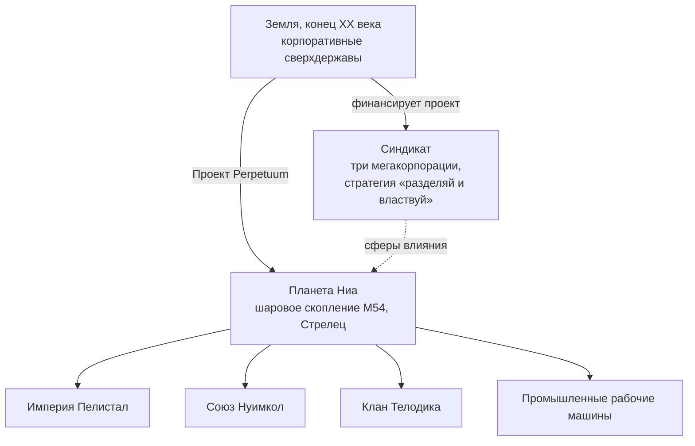

# Лор

## Открытие Ниа

Технологический бум конца XX века на Земле — интернет, слияние медицины с информационными технологиями, космические исследования — разрушил старые физические и ментальные границы. Связь и торговля стали быстрее и дешевле, а крупнейшие корпорации превратились в фактические правительства своих регионов.

В этот мир пришло открытие **планеты Ниа** в шаровом звездном скоплении M54 созвездия Стрельца (откуда взят логотип проекта). Ниа обращается вокруг одной из пары звезд — будучи четвертой планетой этой системы — и поразительно похожа на Землю: средняя температура поверхности около 19 °C, а плотность атмосферы близка к земной. Две особенности отличают её: океаны планеты непреодолимы для любых электрических аппаратов из-за плотного ядра и быстрого вращения, поддерживающего их заряд, и лишь около 17% поверхности составляет суша, которую активная тектоника плит непрерывно дробит на острова. На этой суше процветает жизнь.

## Нианцы

Обитатели Ниа не вписываются в привычное понятие «форма жизни»: это синтетический вид, по строению напоминающий наших роботов, но организованный в самостоятельные высокоразвитые **сообщества** — каждое со своей промышленностью, армией и культурой. Наиболее ценным достижением для истощенной Земли стала их **технология производства энергии**.

Три инопланетные расы ведут борьбу за окончательную победу на островных цепочках своих территорий — **Империя Пелистал** (Pelistal Empire), **Союз Нуимкол** (Nuimqol Union) и **Клан Телодика** (Thelodica Clan), а между ними рассеяна популяция **промышленных** (Industrial) рабочих машин (это те же четыре группы, с которыми вы сталкиваетесь в виде [NPC](/ru/features/npcs/)).

## Синдикат

Главным инвестором проекта Perpetuum выступает **Синдикат** — альянс трех могущественнейших земных мегакорпораций, каждая из которых контролирует свою сферу операций на поверхности:

| Корпорация | Сфера влияния |
|---|---|
| **Truhold-Markson** | Североамериканский гигант потребительской промышленности; продвигается на угасающие территории **Пелистал**. |
| **ICS — Institute of Corporate Security** | Европейско-российское объединение; действует в мятежном секторе **Нуимкол**. |
| **Asintec** | Азиатский промышленный гегемон с высокотехнологичными партнерами; ведет полномасштабное наступление на **Клан Телодика**. |

Их стратегия — старый принцип *«разделяй и властвуй»*: поддержание баланса между тремя сферами заставляет инопланетные силы воевать друг с другом, вместо того чтобы объединиться. Человеческие «Агенты» работают на поверхности — добывают энергетические ресурсы нианцев, исследуют их технологии и поддерживают выгодный Синдикату порядок.

Здесь и начинается ваша роль.
