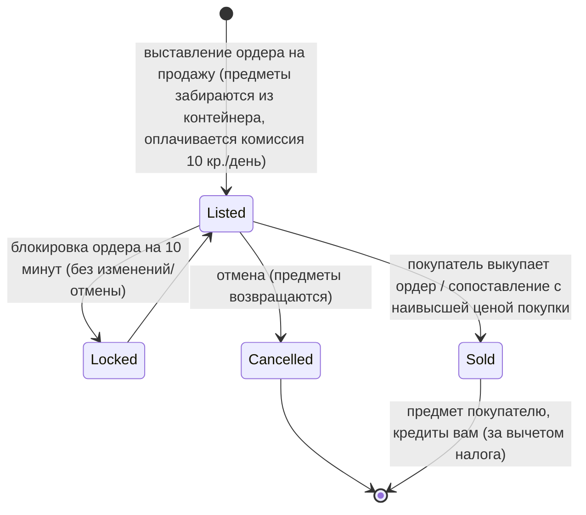

# Рынок и торговля

**Рынок** — это место, где вы покупаете и продаете предметы на базе. Все действия на рынке
**доступны только при стыковке с базой (docked-only)** (торговля ведется на той базе, где вы находитесь).

> Расположение элементов интерфейса описано в [обзоре интерфейса клиента](/ru/features/ui/) (категория **Market** на верхней
> панели). Приведенные ниже механики подтверждены на стороне сервера.

## Рыночные ордера

На рынке вашей текущей базы можно размещать ордера двух типов:

### Ордера на продажу (Sell orders)
Выставление предметов на продажу.
- Выберите **предмет**, **количество**, **цену за штуку** и **срок действия** в днях
  (минимум 1).
- Предмет забирается из вашего контейнера (если продается часть стопки, стопка разделяется).
- **Комиссия за размещение** — вы платите `10 кредитов × срок действия` авансом (может быть снижена расширением
  *market transaction fee*); комиссия поступает в центральный банк базы (пул прибыли зоны).
- **Защита цены (Price guard)** — при включении ваша цена должна находиться в пределах **±30%** от
  **14-дневной средней цены** предмета; цены вне этого диапазона отклоняются. *(В настоящее время эта защита
  **отключена** на данном сервере).*
- **Блокировка ордера** — ордер нельзя изменить или отменить в течение **10 минут** после
  его размещения.
- **Количество ордеров** — вы можете иметь 1 + (бонус расширения *market sellorder expert*) активных ордеров на
  продажу (ордера на покупку имеют свой собственный счетчик).
- **Для моей корпорации** — вы можете ограничить ордер на продажу только членами своей корпорации
  (доступно только для нестандартных корпораций).
- Оплата списывается с **личного** или **корпоративного** кошелька по вашему выбору.

### Ордера на покупку (Buy orders)
Размещение бессрочного ордера на покупку предмета по указанной цене.
- Рынок исполняет его, когда появляется подходящий ордер на продажу.

### Управление ордерами
- **Изменить ордер** — изменить цену/количество/срок действия.
- **Отменить предмет / ордер** — снять его с продажи (предмет вернется в ваш контейнер).
- **Мои предметы** — просмотреть ваши активные ордера.
- **Сопоставление с наивысшей ценой покупки (Highest-buy matching)** — продажа может быть направлена в существующий ордер на покупку.

## Прямая покупка

- **Купить предмет** — мгновенно купить предмет, выставленный на рынке (без размещения ордера на покупку).

## Просмотр рынка

- **Список предметов / доступные предметы / предметы в радиусе** — просмотр того, что выставлено на продажу.
- **Информация о рынке** — подробные сведения о рынке базы.
- **Средние цены** — средняя цена на рынке базы, средняя по типу предмета и **глобальная** средняя цена.
  На их основе работает защита цен.

## Рыночный налог

- **Изменить рыночный налог** — установить ставку налога на рынке. Только **рынки на базах PBS**
  управляются игроками; во всех остальных местах действует фиксированное значение по умолчанию.
- **Журнал налогов** — просмотр истории изменений налога.

Налог вычитается из суммы, которую получает **продавец** при продаже на рынке. Ставка по умолчанию составляет
**12%** (продавец получает 88% от цены продажи); ставка может быть снижена расширением *market
transaction tax*, а на рынках, контролируемых игроками, владелец PBS может установить
собственную ставку.

## Прямой обмен между игроками

**Обмен (Trade)** — это прямая сделка между двумя персонажами, состыкованными с одной базой:

- **Начать обмен** — открыть сессию обмена с другим игроком.
- **Установить / отозвать предложение** — выставить предметы/кредиты со своей стороны.
- **Принять** — обе стороны подтверждают обмен для атомарного совершения сделки.
- **Отмена** — прервать обмен.
- **Обмен завершен / состояние** — статус завершения и текущее состояние.

Персонаж может **заблокировать входящие предложения обмена** (см. раздел [начало работы](/ru/features/getting-started/)).

## Магазин предметов (Item shop)

**Магазин предметов** — это NPC-торговец с фиксированными ценами на базе (не контролируется игроками). Полный
каталог (каждый предмет, количество, цена в валюте, требования к репутации) сгенерирован в разделе
[Магазин предметов](/content/shop/).

- **Список** — посмотреть ассортимент магазина.
- **Купить** — приобрести предмет за кредиты.

## Перевод кредитов

- **Перевод кредитов** между своими персонажами (см. раздел [начало работы](/ru/features/getting-started/)).

## Практические заметки

- **Все операции требуют стыковки** — торговать в открытой зоне нельзя.
- **Учитывайте налог 12% при ценообразовании** — по умолчанию продавцы получают 88% от указанной цены
  (на рынках PBS с высоким налогом — меньше).
- **Комиссия за размещение оплачивается авансом** — длительное размещение стоит дороже, даже если предмет продастся
  в первый же день.
- **Ордера только для корпорации** — удобный способ передавать товары внутри корпорации без риска публичного выкупа.
- **Сделки атомарны** — обе стороны должны подтвердить обмен, иначе передача не состоится.
- **Налог меняет эффективную стоимость** — закладывайте рыночный налог в свою цену.

<!-- TODO: only the client UI remains (market and trade screen flows).
     Confirmed: MarketInfoService(0.3, 10, false) registered in
     PerpetuumBootstrapper.cs -> margin +-30% vs 14-day average (MARKET_AVERAGE_DAYSBACK
     14), fee 10 credits/day (Market.MARKET_FEE), CheckAveragePrice=false on this
     server; DEFAULT_MARKET_TAX = 0.12 (seller gets 88%), player-controlled tax only on
     PBSDockingBase markets (MarketTaxHelper); order modify/cancel locked 10 min after
     submit (MARKET_CANCEL_TIME); order count = 1 + expert extension bonus;
     fee paid up front to the base's central bank. -->
     Developer notes: Markets/MarketCreateSellOrder.cs (docked, price guard vs average
     price, corp-only, unstack, corp wallet), MarketCreateBuyOrder.cs,
     MarketModifyOrder.cs, MarketCancelItem.cs, MarketBuyItem.cs, MarketItemList.cs,
     MarketAvailableItems.cs, MarketItemsInRange.cs, MarketGetMyItems.cs,
     MarketGetAveragePrices.cs / MarketGetDefinitionAveragePrice.cs /
     MarketGlobalAveragePrices.cs, MarketTaxChange.cs / MarketTaxLogList.cs;
     Trade*.cs (begin/offer/accept/cancel, atomic); ItemShopList.cs / ItemShopBuy.cs;
     CharacterTransferCredit.cs. -->