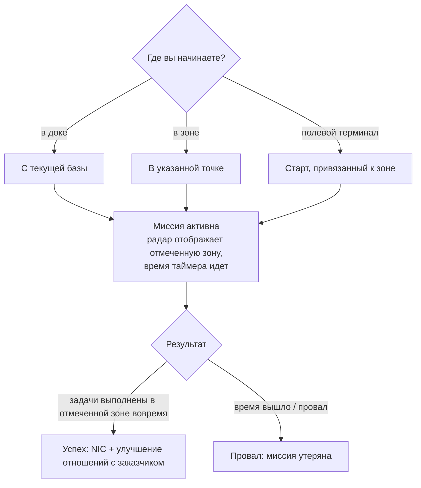

# Миссии

**Миссии** — это структурированные задачи, которые вы берете на себя в зоне: доставка предметов,
уничтожение целей, использование структур. С их помощью вы развиваетесь, получаете награды
и взаимодействуете со множеством элементов контента зоны (тревоги, киоски и некоторые механизмы
PBS/транспортировки напрямую связаны с миссиями).

> Расположение элементов интерфейса описано в [обзоре интерфейса клиента](/ru/features/ui/). Приведенные ниже
> механики подтверждены на стороне сервера.

## Взятие миссии

Вы берете миссию, выбирая **категорию** и **уровень** (уровни ограничиваются допустимым диапазоном),
в определенной **локации**:

- Если вы находитесь **в доке**, миссия начинается из местоположения вашей текущей базы.
- Если вы находитесь **в зоне**, вы указываете локацию явно.
- Миссии также могут начинаться напрямую **из зоны** (старт, привязанный к зоне) или **с полевого терминала**.

Не каждая категория или уровень доступны повсеместно — доступность зависит от контента. Полный
список миссий (тип, категория, уровень, длительность, денежная награда и награды в виде предметов)
сформирован в разделе [Миссии](/content/missions/).

## Для чего нужны миссии

Миссии преследуют две цели одновременно: приносят NIC и развивают ваши **отношения**
с выдавшей задание корпорацией (заказчиком). Хорошие отношения — ключевой фактор для
получения **более высокого коэффициента мощностей (facility ratio)** на терминалах этой корпорации:
производство и использование других сервисов обходятся вам дешевле и происходят быстрее.
Отношения могут и *ухудшаться*: некоторые миссии противоречат интересам других корпораций,
и в описании задания указано, когда выполнение повлечет за собой потерю репутации.

- **Обучающие миссии** — простые, выделенные специально для новичков; обязательно пройдите их все,
  награды послужат отличным начальным капиталом.
- **Обычные миссии** делятся на три категории:
  - *Боевые* — разведка (сканирование вражеских роботов), охота за головами (уничтожение целей в
    отмеченном круге), уничтожение и эвакуация (убийство + подбор + доставка), разведка и эвакуация,
    особые контракты на устранение (труднодоступные цели).
  - *Промышленные* — геология (поиск минералов с подходящим зарядом), сбор ресурсов, добыча
    полезных ископаемых, квалифицированная добыча (охраняемые участки раскопок — берите с собой
    вооруженное прикрытие).
  - *Логистические* — транспортировка (доставка груза между терминалами) и эвакуация груза
    (крупный груз через опасные территории — требуется сопровождение).
- Понятия **безопасная миссия** не существует: если вы заметили врагов на маршруте и у вас
  нет снаряжения для самообороны, зовите на помощь, пока не потеряли все по пути.
- **Задачи засчитываются только в отмеченной области** — на карте миссии и радаре она
  обозначена красным кругом; убийства и сканирования вне этой области не принесут результата.
  Если истечет время — миссия будет мгновенно провалена.
- **Частные транспортные контракты** — система Синдиката (вторая вкладка окна миссий),
  где игроки выставляют контейнеры для перевозки другими игроками между терминалами с фиксированной
  наградой и **залогом**, вносимым перевозчиком (возвращается при успехе, теряется при уничтожении
  контейнера; при досрочной отмене возвращается только половина). Ограничивайте размер контейнеров так,
  чтобы их действительно можно было увезти.

## Данные и параметры миссий

- **Данные миссии (Mission data)** — подробные сведения о задании.
- **Параметры миссии (Mission options)** — доступные варианты и условия миссии.
- **Снабжение миссии (Mission supply)** — ресурсы и припасы, задействованные в миссии.
- **Стартовые предметы (Start items)** — предметы, которые выдаются на старте задания.

## Выполнение миссии

- **Список текущих миссий (List running missions)** — задачи, выполняемые вами в данный момент.
- **Прервать (Abort)** — отменить текущую выполняемую миссию.
- **Добавить участника (Add a participant)** — привлечь другого персонажа к выполнению (кооперативные миссии).
- **Журнал миссии (Mission log)** — журнал событий выполнения миссии.

## Доставка

- **Сдать груз (Deliver)** — выполнить задачу по доставке. Это можно сделать **в доке** (на базе)
  или **в зоне** (в определенной точке/eid), в зависимости от условий миссии.

## Агенты

- **Список агентов (List agents)** — доступные агенты миссий (NPC/фракции, выдающие задания).

## Полевые терминалы

- **Информация о полевом терминале (Field terminal info)** — осмотреть полевой терминал в зоне
  (структуру, которая может выдавать или обслуживать миссии).

## Практические заметки

- **Миссии выступают связующим звеном** — тревоги, киоски и некоторые структуры являются объектами
  миссий (см. [сбор ресурсов](/ru/features/gathering/) и [бой](/ru/features/combat/)).
- **Кооператив** — вы можете добавлять участников для совместного выполнения миссии.
- **Контекст сдачи имеет значение** — для одних доставок нужно находиться в доке, для других —
  в конкретной точке зоны.
- **Уровень корректируется** — запрос уровня вне допустимого диапазона нормализуется, а не вызывает ошибку.
- **Отмена — ваш запасной выход** — если выполнение пошло не по плану, прервите миссию.

## Структуры миссий

Миссии привязаны к зонам с помощью **структур**. Сервер поддерживает следующие их типы:

| Структура | Что делает |
|---|---|
| **Simple switch** | мгновенное взаимодействие — приблизьтесь, и цель миссии будет выполнена |
| **Alarm switch** | задача на время — удерживайте позицию в радиусе действия в течение заданного периода (из настроек миссии), проверка каждые 2 с |
| **Item supply** | задача на время (аналогично Alarm switch), по завершении которой **предметы помещаются в контейнер вашего робота** |
| **Kiosk** | пункт **приема предметов** — передайте необходимые по миссии предметы |

<!-- TODO: the full mission list, categories, level ranges and rewards are generated at
     /content/missions/. Verified: mission structure types
     (MissionEngine/MissionStructures: SimpleSwitch, AlarmSwitch, ItemSupply, Kiosk);
     verify the mission UI.
     Developer notes: Missions/MissionStart.cs (category, level clamp, docked vs zone
     location), Missions/MissionDeliver.cs (docked vs zone delivery), MissionAbort.cs,
     MissionData.cs / MissionGetOptions.cs / MissionGetSupply.cs / MissionStartItems.cs,
     MissionListRunning.cs / MissionListAgents.cs / MissionLogList.cs,
     MissionPlayerAddsParticipant.cs, FieldTerminalInfo.cs, MissionStartFromZone.cs;
     Services/MissionEngine/* (MissionProcessor, mission structures incl. AlarmSwitch,
     Kiosk). -->