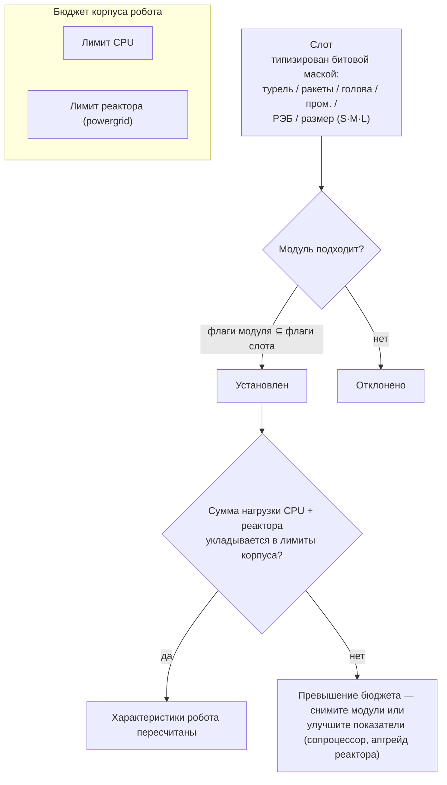

# Модули и фиттинг

«Покупка робота даёт вам только шасси». Оснащение модулями превращает робота в инструмент под ваши задачи. Термин *фиттинг* (fitting) означает как саму конфигурацию модулей («скинь свой фит»), так и бюджет процессора/реактора, который она потребляет.

## Слоты и ресурсы

Корпус робота обладает фиксированным набором **слотов**, определяемым его шасси. Каждый слот типизирован битовой маской — турельный, ракетная установка, головной, промышленный, РЭБ/инженерный, а также размер (малый / средний / большой). Модуль подходит для слота только в том случае, если маска его типа является подмножеством маски слота. Например, турельный слот кастера принимает малые, средние *или* большие турельные модули, но ракетную установку в него установить нельзя. Головные модули (сопроцессоры, модули тюнинга) и модули корпуса/шасси (пластины, рамы) занимают свои выделенные слоты.

Каждый модуль потребляет ресурсы корпуса — **CPU** и **реактор** (powergrid). Суммарное потребление всех установленных модулей должно укладываться в оба лимита. Кроме того, некоторые модули расходуют энергию **аккумулятора** (core) за цикл работы. Оставшийся запас ресурсов отображается в окне фиттинга как *доступная мощность*. Примерные масштабы шасси (образцы T1/T2/T3):

| Класс корпуса | CPU | Реактор | Пример |
|---|---:|---:|---|
| Малый краулер (small crawler) | ~250 | ~140 | Castel |
| Лёгкий мех (light mech) | ~480 | ~300 | Waspish |
| Тяжёлый мех (heavy mech) | ~1 100 | ~1 000 | Tyrannos |
| Шагоход (walker) | ~3 200+ | ~1 100+ | Gropho |

Если не хватает ресурсов: для **CPU** используются модули сопроцессоров (например, сопроцессор T3 даёт +20% CPU) или T2-версии модулей (меньшее потребление). Для **реактора** — апгрейды реактора (например, T3 даёт +20% к мощности реактора) или герметизация реактора (снижает радиацию, что также защищает от EnWar — см. ниже).

## Семейства модулей

Конкретные числовые параметры моделей приведены в [каталоге предметов](/content/) и [справочнике форматов](/ru/formats/); ниже представлена общая структура семейств.

### Оружие и боеприпасы

Четыре оружейные технологии, каждая со своими боеприпасами и дистанционным профилем:

| Оружие | Боеприпасы | Дистанционный профиль | Примечания |
|---|---|---|---|
| **Огнестрельное (firearms)** | Патроны | Короткий оптимал, огромный спад (falloff) | Снаряды, которые *никогда не промахиваются*, но их «точность» действует как радиус области поражения, поэтому небольшие цели всё равно получают сниженный урон из-за широкого разброса. |
| **Магнитное (рельсотроны)** | Болванки (slugs) | Средняя дистанция, резкий спад | Высокая начальная скорость попадания; значительное потребление энергии. |
| **Лазеры** | Энергоячейки | Большая дистанция | Наиболее энергозатратные; концентрированные лучи. |
| **Ракеты** | Ракеты | Большая дистанция | Попадание или промах определяется параметром шанса попадания *самого робота*, а не расстоянием. Урон масштабируется относительно соотношения размера цели и радиуса взрыва: крупные ракеты наносят гораздо меньше урона малым целям. |

Урон плавно снижается с дистанцией по косинусной кривой: полный урон на оптимальной дистанции, нулевой — на отметке «оптимал + спад» (см. [спад урона](/ru/features/combat/#tipy-urona)).

Боеприпасы позволяют настраивать наносимый урон: комбинация первичного и вторичного типов урона даёт возможность адаптироваться под конкретную цель (см. [типы урона](/ru/features/combat/#tipy-urona)) ценой некоторой потери общего урона по сравнению с монотипными боеприпасами.

Турели делятся на малые, средние и большие; **подбирайте размер под габариты робота** (малые боты используют малые модули, мехи и тяжелые корпуса — средние и большие).

### Защита

- **Бронепластины** — основной запас очков прочности (HP); когда броня падает до нуля, робот взрывается. Пластины **LWF** (облегчённый каркас) жертвуют прочностью ради скорости: пластина LWF T2 снижает броню с коэффициентом ~0.73, но даёт +19% к скорости, −0.2 к сигнатуре и −0.2 к массе.
- **Генератор щита** — барьер с питанием от аккумулятора, поглощающий урон до того, как он дойдёт до брони. Щит расходует *ваш собственный накопитель* для поглощения: удар, наносящий 100 урона при щите 2×, заберёт 50 единиц энергии накопителя вместо 100 очков брони. Пока щит активен, собственное оружие стрелять не может. Эффективность поглощения масштабируется соотношением радиуса щита и вашей сигнатуры: крупные щиты лучше всего показывают себя на малых корпусах.
- **Ремонт брони** — активные ремонтные модули (малые/средние/большие); **дистанционный ремонт брони** работает по заблокированной цели (союзники или структуры PBS), но имеет малую дальность и увеличенное время цикла.
- **Укрепители брони (hardener)** — пассивные резисты по типам урона (химический / кинетический / термический / взрывной).
- **Адаптивный сплав** — пассивный модуль, который *подстраивается* под входящий спектр урона и перераспределяет фиксированный пул очков сопротивления в пользу того типа урона, который наносит больше всего попаданий.
- **Маневрирование / уклонение** — модули снижения сигнатуры и NEXUS (см. ниже) уменьшают видимый размер цели: это снижает урон от площадных эффектов и усложняет захват в прицел.

### Энергетика

- **Реактор** — предел постоянной выходной мощности; апгрейды реактора увеличивают его отдачу, а герметизация реактора снижает излучение (уменьшая входящий урон от EnWar за счёт небольшой потери мощности реактора).
- **Аккумулятор (core)** — резерв пиковой энергии, питающий циклы работы модулей. Восстанавливается со временем (параметр шасси `core_recharge_time`, ~120 мс у краулера T1); **перезарядчики аккумулятора** ускоряют этот процесс.
- **Инжекторы энергии (core boosters)** — расходуют заряд для мгновенного пополнения аккумулятора.
- **Передатчики энергии** — передают энергию ядра с вашего робота на залоченного союзника (игроки не могут передавать энергию NPC).

### Электроника

- **Сенсорный бустер (sensor booster)** — пассивный, действует на себя: ускоряет захват цели и увеличивает дальность захвата.
- **Дистанционный сенсорный бустер** — активный, целевой: даёт аналогичный бонус заблокированному союзнику на ~10.5 с.
- **Сопроцессоры** — увеличивают лимит CPU корпуса (от T1 +10% … до T3 +20%).
- **Стабилизаторы оружия** — улучшают точность стрельбы (уменьшают эффективный радиус разброса) и немного снижают массу.
- **Модули тюнинга** (головные слоты) — фиксированные бонусы к конкретным направлениям: модификаторы урона (+25% к урону профильной оружейной ветки на T3), улучшения добычи (+10% к добыче и сбору на T3), апгрейды ремонта брони (+16% к объёму ремонта, −8% к длительности цикла на T3).

### Радиоэлектронная борьба (РЭБ / EWar)

Ослепляет и дезориентирует противника:

- **Глушитель сенсоров (sensor dampener)** — дистанционный дебафф: увеличивает время захвата цели и урезает дальность её прицела на ~5.5 с. Срабатывает только в том случае, если мощность вашего ECM превышает (случайную) силу сенсоров цели.
- **Постановщик помех (sensor jammer)** — мгновенный эффект: сбрасывает *все* захваченные цели противника при успешной проверке ECM.
- **ECCM (защита от помех)** — селф-бафф на 20 с: повышает силу сенсоров и сопротивляемость захвату, а также *снимает* дебаффы, уязвимые к ECM (глушители, сетки).
- **Нейрализатор (neuralyzer)** — сбрасывает прицел у **каждого** игрока в радиусе ~1.65 км. Кнопка экстренного спасения.

Контрмеры: базовая сила сенсоров шасси, модули ECCM и сохранение дистанции.

### Маскировка и обнаружение

- **Модуль невидимости (stealth)** — ~10.5 с маскировки; расход энергии масштабируется от радиуса сигнатуры (чем больше корпус, тем быстрее выгорает накопитель).
- **Подсветка целей (target painter)** — дебафф на ~10.5 с, снижающий силу маскировки цели.
- **Модуль обнаружения** — пассивное повышение силы вашего обнаружения.

Соотношение силы обнаружения и силы маскировки определяет, сможете ли вы вообще увидеть (и взять в прицел) замаскированную цель — см. [обнаружение и маскировка](/ru/features/combat/#obnaruzhenie-maskirovka-i-skorost).

### Энергетическая война (EnWar)

Истощение или блокировка энергетических ресурсов врага:

- **Поглотители энергии (energy vampires)** — выкачивают заряд аккумулятора из захваченной цели и перенаправляют в ваш накопитель.
- **Нейтрализаторы** — действуют аналогично, но высосанная энергия просто уничтожается.
- Эффективность обоих типов снижается **радиацией реактора** цели — герметизация служит прямой контрмерой.
- **Демобилизаторы (сетки / webs)** — замедление цели на ~5.5 с; эффект зависит от массы цели (тяжёлые корпуса замедляются слабее) и не действует на противников за пределами оптимальной дальности модуля.
- **Скорчер (scorcher)** — электрическое оружие, поражающее цепью до 5 целей и наносящее проникающий урон по щитам и броне.

### Промышленность

- **Буры** (малые / большие) и **харвестеры** (малые / большие) — модули добычи; ключевые характеристики — производительность, длительность цикла и расход аккумулятора. Добыча приносит EP (с учётом дневного лимита и штрафа за переработку).
- **Геосканер** — сканирует залежи минералов вокруг вас с точностью зонда; результатом становится карта подземных ресурсов (см. [сбор ресурсов](/ru/features/gathering/)).
- **Экскаватор** — модуль ауры: увеличивает объём добычи/сбора окружающих союзников (T3: +50%) ценой демаскировки.
- **Терраформирование** (гамма-зоны) — модули привязки к местности, которые поднимают, опускают или выравнивают грунт (макс. радиус 5 м) и выращивают защитные растения; подробности см. в [разделе зон](/zones/zone-gamma-z106/).
- **Контроллеры удалённого управления** — турели и дроны на привязи: каждый модуль управления обладает параметрами пропускной способности (максимальное количество), дальности действия и времени жизни дронов (5–10 мин в зависимости от тира). Варианты: тактические (урон/цикл), штурмовые (урон), поддержки (дистанционный ремонт), промышленные (дроны для бурения/сбора), охотники. Модуль **транслятора удалённых команд** усиливает урон дронов, броню, объём добычи и ремонт (T3: +7.5% к каждому параметру) и способен расширять пропускную способность контроллера.

### NEXUS

Системы сетевого применения расширений (NEXUS): **групповые баффы**. Модуль NEXUS излучает вокруг своего робота ауру, дающую бонусы **членам отряда** (gang) и их турелям/дронам в пределах радиуса действия (по умолчанию 10 м, обновляется каждые 10 с). Правила:

- робот может нести максимум **3 ауры NEXUS** и не более **одной ауры каждого типа**;
- аура распространяется только на членов вашего **отряда**, но не на случайных союзников.

Список типов T3 (13): скорость (velocity), броня, щит, дальний захват (farlock), ускоритель захвата (lock booster), критический удар, штурм (цикл орудий), РЭБ (дальность EWar), уклонение (сигнатура), ремонт, промышленность (расход накопителя при сборе), быстрый экстрактор (цикл сбора), перезарядка (восстановление накопителя). Каждый модуль T3 даёт порядка +7.5% к своему показателю; к примеру, модуль NEXUS на скорость умножает максимальную скорость на 1.075 для каждого участника отряда в радиусе 10 м.

### NOX

Инструменты противодействия культистского уровня: модули-**нейтрализаторы** (negator), которые *отключают* вражеские системы в своём радиусе — **нейтрализатор щита** (снижает поглощение щита примерно на 90%), **нейтрализатор ремонта** (урезает объём ремонта) и **нейтрализатор телепортации** (блокирует телепортацию). Каждая активация **расходует плазму** из грузового отсека, а запуск в открытой (не тренировочной) зоне **переводит персонажа в режим PvP**.

### Специальное назначение

- **Модуль осады (siege hack)** — инструмент для воздействия на активные SAP: цикл 5 с, дальность 3 м (см. [аванпосты](/ru/features/outposts/)).
- **Самоуничтожение** — запускает 8-секундный таймер; луч виден на расстоянии 600 м. Крайняя мера зачистки.
- **Миноискатель** — увеличивает радиус обнаружения мин для корпуса.
- **Излучатели блобов (blob emitters)** — развёртывают эмиттер, создающий замедляющее блоб-поле; модуль модулятора эмиссии настраивает параметры поля (см. [бой](/ru/features/combat/)).
- **Строительство PBS** — модуль, применяемый для возведения структур PBS в гамма-зонах.

## Практические правила

1. **Не смешивайте разные оружейные системы.** Магнитное + лазерное + ракетное вооружение на одном боте обычно уступает связке из орудий одного типа; гибриды ближнего и дальнего боя редко показывают себя успешно.
2. **Следите за массой.** Каждая бронепластина и модуль щита добавляют массу и сигнатуру — в некоторых ситуациях скорость важнее чистой защиты.
3. **Не пытайтесь делать всё сразу.** Робот, который одновременно копает, сканирует и стреляет, ни в одной из задач не покажет результатов, сравнимых со специализированным фитом.
4. **Подбирайте размеры модулей** в соответствии с шасси робота и оставляйте небольшой запас CPU/реактора под модули тюнинга, которые делают сборку по-настоящему эффективной.
5. …и да, некоторые нишевые фиты нарушают все эти правила и при этом отлично работают. Главное — подходить к сборке осознанно.

<!--
Developer notes: rewritten 2026 from backend sources; no community-wiki text reused.
Verified against:
- src/Perpetuum/Robots/RobotComponent.cs (slot bitmask fitting: moduleFlagMask & slotFlagMask)
- src/Perpetuum/Modules/SlotFlags.cs (12 slot flag bits)
- src/Perpetuum/Modules/Weapons/WeaponModule.cs + FirearmWeaponModule.cs +
  MissileWeaponModule.cs (accuracy: firearms never miss, explosion radius from
  Accuracy; missiles use ParentRobot.MissileHitChance)
- src/Perpetuum/Modules/Weapons/Damage.cs (cosine falloff, critical 1.75x +/-10%,
  explosion scaling signature/explosionRadius clamped [0,1])
- src/Perpetuum/Units/Unit.cs GetResistByDamageType (resist/(resist+100))
- src/Perpetuum/Zones/DamageProcessors/DamageProcessor.cs (shield draws core,
  electric = penetrating)
- src/Perpetuum/Modules/EffectModules/ShieldGeneratorModule.cs (absorption
  modifier = shieldRadius ratio / shieldAbsorbtion; WeaponModule.cs:112 blocks
  firing while HasShieldEffect)
- src/Perpetuum/Modules/EffectModules/{Webber,SensorDampener,SensorBooster,
  Stealth,TargetPainter,Eccm,Detection,AdaptiveAlloy}.cs (durations from
  effects table: dampener/web 5.5s, stealth/paint/remote-boost 10.5s, ECCM 20s)
- src/Perpetuum/Modules/SensorJammerModule.cs + Neuralyzer.cs (lock reset,
  NEURALYZER_RANGE=1650)
- src/Perpetuum/Modules/{EnergyVampire,EnergyNeutralizer,Scorcher,
  CoreBooster,EnergyTransferer}.cs (EnWar, reactor radiation modifier, chain)
- src/Perpetuum/Modules/GangModule.cs + Zones/Effects/GangEffect.cs +
  EntitiesModule.cs:532-544 (13 aura types, gang-members-only, effects table
  auraradius=10)
- src/Perpetuum/Modules/NoxModule.cs (plasma consumption, PvP flag)
- src/Perpetuum/Modules/RemoteControl/* (bandwidth/range/lifetime, translator
  amplification)
- entitydefaults rows: named1-3 armor plates/hardeners, shield generators
  (absorbtion 2.0-2.3, radius 5-33), LWF (mass_reductor), cpu/powergrid
  upgrades, damage/mining/repairer tuning, NEXUS named3 values, NOX cultist
  values, siege hack (5s/3m), chassis core_max/powergrid_max.
Corrections vs ingested page: NEXUS auras reach gang members only (not "all
friendly units"); no "co-reactor" module exists (reactor upgrades/sealing do
that); demobilizer effect scales with target mass, no "resistance stat";
sensor suppressor = sensor dampener (5.5s debuff).
-->