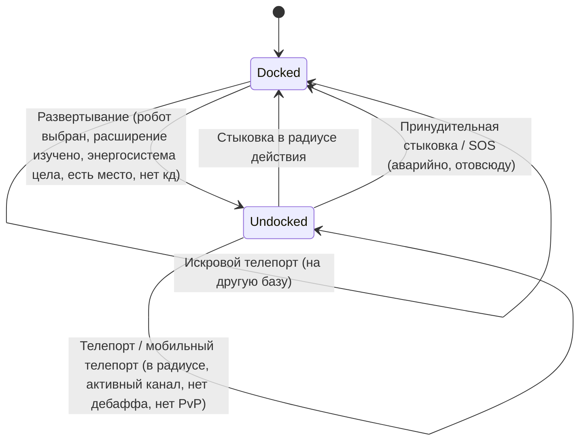

# Перемещение и зоны

Вы всегда находитесь в одном из двух состояний: **состыкованы** (docked) на базе или **отстыкованы** (undocked) в зоне,
где дистанционно управляете своим активным роботом. Всё на этой странице посвящено переходу между этими состояниями
и перемещению между зонами.

> Расположение элементов интерфейса описано в [обзоре интерфейса клиента](/ru/features/ui/): кнопка **Развернуть/Стыковаться (Deploy/Dock)** находится
> в центре верхней панели. Описанные ниже механики сверены с логикой сервера.

## В доке и вне дока

- **В доке (Docked)** — вы находитесь на базе. Ваши роботы и предметы находятся в контейнерах. Вы не можете
  пилотировать робота, использовать телепорты или сканировать, но можете заниматься производством, торговлей, исследованиями и пользоваться
  службами базы.
- **Вне дока (Undocked)** — вы находитесь в зоне, пилотируя своего активного робота. Вы можете перемещаться, сканировать,
  сражаться и
  взаимодействовать с объектами зоны, но большинство действий, доступных только на базе, заблокированы.

## Отстыковка (Undocking)

Нажмите **Развернуть (Deploy)** (по центру верхней панели). После этого сервер проверяет все следующие условия:

1. У вас **выбран активный робот**.
2. Для класса этого робота у вашего персонажа изучено необходимое **разрешающее расширение** (enabler extension)
   (см. [исследования](/ru/features/research/)).
3. **Энергосистема** робота исправна.
4. В **контейнере робота есть свободное место**.
5. У вас нет **таймера задержки на отстыковку** (undock cooldown — короткий таймер после определенных событий).

Если хотя бы одна проверка не пройдена, в отстыковке будет отказано.

## Возвращение на базу (Стыковка)

- **Стыковка (Dock)** на базе возможна, когда вы находитесь в радиусе её действия.
- **Принудительная стыковка (Force dock)** — экстренное действие: оно мгновенно извлекает вас из зоны и стыкует на
  главной базе (TMA), даже во время боя. Используйте её, когда проигрываете сражение.
- **SOS** — запрос помощи в зоне, который стыкует вас на текущей базе и фиксирует инцидент.

## Очередь на вход в зону

Некоторые зоны сильно загружены и используют **очередь на вход** при выходе из дока или переходе:

- Проверка состояния очереди (`zoneGetQueueInfo`).
- Установка предпочтительной длины очереди (`zoneSetQueueLength`).
- Отмена ожидания, если вы передумали (`zoneCancelEnterQueue`).

## Телепорты

**Телепорты** — это сооружения внутри зоны. Чтобы воспользоваться телепортом:

- Вы должны находиться **в радиусе его действия**.
- **Канал** (точка назначения) должен быть **активен** и доступен.
- У вас **не** должно быть *болезни перемещения (teleport sickness)* — короткого кулдауна после любого телепорта,
  во время которого нельзя телепортироваться снова.
- Определенные эффекты (например, нейтрализация *Nox*) или нахождение **в PvP-бою** могут блокировать использование телепортов.

Каналы телепорта бывают трех типов:

| Тип | Эффект |
|---|---|
| **В пределах зоны** | Перемещает вас в случайную точку той же зоны |
| **Другая зона** | Перемещает вас в случайную точку другой зоны |
| **Выход из обучения** | Выход из тренировочной зоны (с возможностью выбора уровня награды) |

**Мобильные телепорты** — это *принадлежащие игрокам* предметы телепортации (например, мобильные телепорты аванпоста/мира).
К ним применяются дополнительные правила:

- Использовать их может только **владелец или член банды владельца**.
- Их **нельзя использовать во время PvP**.
- Каждое использование запускает **кулдаун** для этого телепорта.

Вы можете просматривать список телепортов и их каналов, а также запрашивать глобальные каналы.

## Искровые телепорты (Spark teleports)

**Искровые телепорты** — это система быстрого перемещения между базами:

- Вы **настраиваете** точку назначения искры на одной базе, а затем **используете** её (находясь в доке), чтобы мгновенно
  переместиться на другую базу.
- Вы можете **просматривать, настраивать, использовать и удалять** свои искровые телепорты.
- Целевая база должна **разрешать стыковку** для вас.
- По прибытии сервер выбирает для вас подходящего робота (для которого у вас изучены соответствующие расширения).
- **Количество доступных искровых телепортов** ограничено расширением
  (см. [исследования](/ru/features/research/)); при превышении лимита в операции будет отказано.

## Врата (Gates)

**Врата** — это зональные сооружения, которые можно использовать из любой точки (без ограничения по дальности,
в отличие от телепортов). Владелец базы может **переименовывать** её врата.

## Информация о базе

Вы можете просмотреть сведения о любой базе:

- **Информация** — что это за база и где она находится.
- **Владелец** — кому она принадлежит.
- **Службы** — доступные возможности (производство, рынок, магазин и т. д.).
- **Мои предметы** — ваши предметы, хранящиеся на этой базе.
- **Права стыковки** — владелец базы может настраивать, кому разрешено стыковаться.

## Возможные неполадки

| Признак | Вероятная причина |
|---|---|
| Отказ в отстыковке | Не выбран активный робот, не изучено разрешающее расширение, повреждена энергосистема, переполнен контейнер робота или действует кулдаун отстыковки |
| Отказ в телепортации | Вне радиуса действия, канал неактивен, болезнь перемещения, эффект Nox или нахождение в PvP |
| Отказ в мобильном телепорте | Вы не являетесь владельцем/членом банды или находитесь в PvP |
| Отказ в искровом телепорте | На целевой базе запрещена стыковка, нет подходящего робота для выбора или исчерпан лимит искровых телепортов |
| Застревание при входе в зону | Очередь зоны — проверьте статус очереди или отмените ожидание |

<!-- TODO(Phase 1): verify client UI flow (dock/undock buttons, teleport screen).
     Developer notes: Dock.cs / Undock.cs / ForceDock.cs (TMA = baseEid 561) /
     ZoneSOS.cs; Zone/TeleportUse.cs (TeleportPlayerValidator, three
     TeleportDescriptionType strategies, mobile-teleport gang/PVP rules);
     Sparks/SparkTeleportUse.cs (docked-only, extension-count limit);
     Zone/ZoneCancelEnterQueue.cs + ZoneEnterQueueService; GateSetName.cs. -->