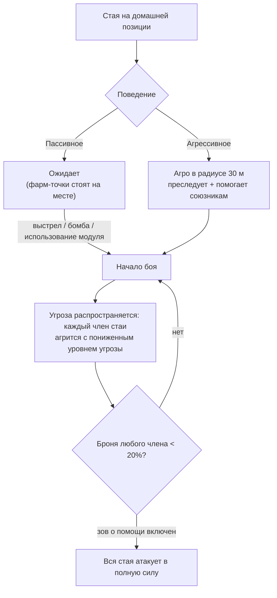

# NPC и PVE-охота

NPC являются основным источником [реакторной плазмы](/content/ores/),
[кернелов](/ru/features/research/) и модулей в игре, а также надежным способом заработка очков
расширения (EP) на любом уровне развития. Они существуют в виде **стай (flocks)** —
групп, имеющих общую домашнюю позицию, радиус обитания, время возрождения и тип поведения.

## Кто встречается в мире

NPC принадлежат к четырем фракциям — **Nuimqol, Pelistal, Thelodica и Industrial** —
каждая из которых представлена несколькими классами роботов (раннеры, краулеры, мехи, тяжелые мехи)
и рангами с 1 по 5, определяющими характеристики и ценность добычи. Помимо стандартных рангов, встречаются:

- **Гоблины (Goblins)** — охранники с модулями радиоэлектронной борьбы (EWar) на защищенных островах. Они хрупкие,
  но обладают экстремальными модификаторами захвата цели (захватывают вас примерно в 5 раз быстрее обычного
  и с дистанции примерно в 2 раза дальше): лагерь гоблинов делает бой или добычу ресурсов поблизости крайне сложными.
- **Элиты (Elites)** — редкие вариации ранговых NPC с приблизительно удвоенными
  базовыми характеристиками и улучшенной добычей.
- **Наблюдатели (Observers)** — блуждающие агрессивные NPC (Arbalest, Baphomet, Waspish,
  Tyrannos, Artemis, Kain, Gropho, Sequer, Seth, Mesmer…). Они патрулируют обширные
  участки острова и значительно сильнее обычных ранговых NPC того же класса.
  *Великие (grand)* наблюдатели на защищенных островах и их аналоги на открытых
  островах — сильнейшие рядовые охотники в игре.
- **Боссы (Bosses)** — редкие, индивидуально настроенные NPC. Они никогда не убегают, могут
  оповещать о своем появлении на весь сервер, а некоторые из них привязаны к аванпостам (их убийство
  влияет на [стабильность аванпоста](/ru/features/outposts/)) или создают реликтовые разломы после
  смерти. Более слабых боссов на защищенных островах можно одолеть в одиночку; для сильнейших
  потребуется слаженная группа.
- **Спавны Синдиката (Syndicate spawns)** — особая фракция (Синдикат со своими
  именными NPC), которая держит собственные статичные точки фарма, обычно расположенные на защищенных
  и мелководных открытых островах.

## Пассивные и агрессивные

- **Пассивные стаи** никогда не атакуют первыми — по ним необходимо выстрелить, сбросить бомбу
  или применить активный модуль. Большинство классических статичных точек фарма являются пассивными.
- **Агрессивные стаи** нападают сами, как только вы приближаетесь на расстояние **30 м**,
  преследуют вас и приходят на помощь сражающимся союзникам. Все Наблюдатели, большинство блуждающих
  спавнов, а также защитники и захватчики аванпостов агрессивны.

Когда начинается бой, **уровень угрозы распространяется по всей стае**: каждый ее участник берет
вас на прицел с пониженным приоритетом угрозы, а если броня любого члена группы падает ниже **20%**,
вся группа переключается на вас в полную силу (для стай с включенным зовом о помощи). Исходите из того,
что вы вступаете в бой со всей группой в тот самый момент, когда стреляет первый бот.

## Спавны и возрождение

- **Статичные спавны** привязаны к фиксированной домашней точке с определенным радиусом действия; участники
  возрождаются **индивидуально** по собственному таймеру. Стая, которую активно и часто зачищают,
  возрождается быстрее; нетронутая группа появляется медленнее.
- **Блуждающие спавны** перемещаются по острову — к ним относятся Наблюдатели и
  группы конвойного типа, и обычно они агрессивны.
- **Подкрепления на местах добычи** — промышленные NPC, разрабатывающие ресурсные узлы,
  имеют заранее настроенные волны подкреплений: по мере затягивания боя на точку прибывают новые
  волны. Боссы также вызывают подкрепления при получении урона.
  Таким образом, бой с «одним роботом» может превратиться в групповое сражение; обязательно оценивайте обстановку,
  прежде чем вступать в бой.

## Выпадающая добыча

Добыча настроена отдельно для каждого типа NPC: **реакторная плазма фракции острова**,
**кернелы** (обычные, высокотехнологичные, промышленные и фракционные), компоненты модулей
и, реже, упакованные модули. С более высоких рангов и особых типов противников выпадает больше добычи.

Каждое убийство также приносит **очки расширения (EP)**, количество которых зависит от типа NPC
и удваивается на открытых (бета-тир) островах.

## Особенности уровней зон

Острова делятся на три уровня: защищенные (альфа), открытые PvE (бета) и открытые
PvP (гамма). По мере продвижения вглубь охота становится опаснее, но и награда возрастает:

- **Посмертные взрывы** — на защищенных островах роботы при уничтожении *не*
  взрываются. На открытых островах (бета и гамма) каждый уничтоженный робот — будь то игрок
  или NPC — детонирует, нанося урон по площади. Цепные взрывы ускоряют зачистку
  фарм-зон, но делают места засад значительно опаснее.
- **Удвоенный EP** — базовая награда EP за любую активность удваивается на островах
  бета-уровня.
- **Улучшенные миссии** — миссии более высоких уровней доступны на открытых островах,
  и награда EP за них также удваивается.
- **Фракционные монеты миссий** — за выполнение заданий на открытых островах выдаются монеты миссий соответствующей фракции
  (Nuimqol / Pelistal / Thelodica coin) вместо универсальных монет. Фракционные монеты также продаются
  напрямую в терминалах открытых островов, а универсальную монету можно приобрести там, где фракционные недоступны.

## Практические советы

- **Оценивайте стаю перед атакой** — пересчитайте цели, обратите внимание на их ранги
  и уровень агрессии; пассивная группа, к которой вы подошли, все равно может состоять
  из пяти крепких ботов.
- **Используйте преимущество в дальности** — статичные спавны не выходят за пределы своего домашнего радиуса;
  ведение огня с максимальной дистанции обычно является наименее затратным способом победы.
- **Ресурсные точки могут быть ловушкой** — из-за прибывающих подкреплений на промышленных узлах
  чем дольше длится бой, тем больше врагов появляется.
- **Остерегайтесь патрулирующих Наблюдателей** — если вы занимаетесь исследованием, поиском артефактов
  или дальней перевозкой грузов, агрессивный Наблюдатель на пути вынудит вас принять бой или искать обходной маршрут.

<!--
Written from scratch against the server backend, 2026-09-27:
Zones/NpcSystem/Flocks/ (Flock.cs, NormalFlock.cs — group respawns, adaptive
respawn multiplier), AI/Behaviors/ (Passive vs Aggressive; threat spread at
50%, call-for-help at 20% armor in SmartCreature.cs), AI/BodyPullThreatHelper.cs
(30 m aggro range, aggressive-only body-pull), Reinforcements/ + npcreinforcements
(mining-site and boss waves at HP thresholds), NpcSpecialType + npcbossinfo
(boss respawn noise, outpost stability links, server-wide announce),
entitydefaults (rank1-5 + dps/interceptor/scout/miniboss/elite variants, 30
elite definitions with ~2x modifiers; 13 def_npc_roaming_* observers; goblin
lancer/shark with 5x lock-time / 2x lock-range modifiers),
npcloot (26k rows: race plasma, common/hitech/industrial/race kernels,
modules), NpcEp.cs + GetNpcKillEp (EP per NPC, x2 on beta),
Unit.DoExplosion (death AoE suppressed on protected zones, active on
beta/gamma; radius from signature, damage from remaining core),
MissionLocation.cs (race-specific mission coins; universal coin on protected
zones), ZoneConfiguration (IsAlpha/IsBeta/IsGamma).
An earlier version of this page was adapted from the Open Perpetuum
community wiki (perpetuum.miraheze.org) and has been fully rewritten from
backend sources; no text was reused.
The ingested "TAP" section was dropped: no teleport-attractor concept exists
in this backend (no definition, code or table).
-->