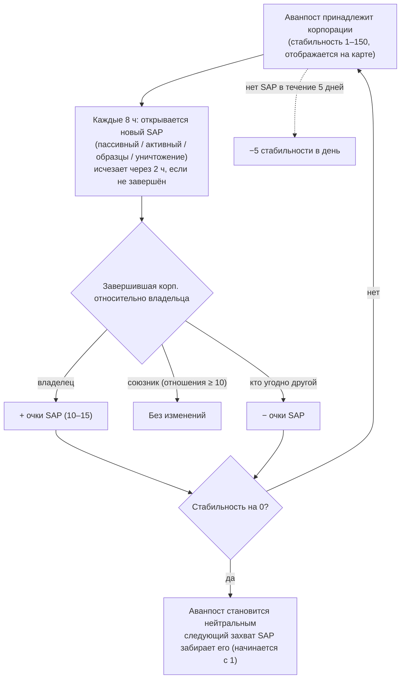

# Аванпосты и SAP

На островах с открытым PvP **аванпосты могут принадлежать корпорациям игроков**.
Контроль измеряется шкалой **стабильности** (0–150), отображаемой над аванпостом
в режиме карты. Система **SAP** (Service Access Point / Точка доступа к службам) — это механизм,
с помощью которого изменяется эта шкала, и способ перехода аванпостов из рук в руки.

## Правила

- Когда корпорация-**владелец** завершает SAP, стабильность **увеличивается** на
  количество очков данного SAP.
- Когда завершает **корпорация-союзник владельца** (взаимные отношения +10 или выше),
  стабильность **не меняется**.
- Когда завершает **кто-либо другой**, стабильность **снижается** на
  то же самое значение.
- При достижении **нуля** аванпост теряет владельца и становится нейтральным. Завершение
  любого SAP на нейтральном аванпосте **захватывает** его (завершившая корпорация
  становится владельцем, начиная со стабильности 1).
- **Угасание (Decay)**: если ни один SAP не завершается в течение **5 дней**, аванпост начинает терять
  по **5 единиц стабильности в день**, пока активность не будет выполнена (или пока он не будет потерян).

## Четыре типа SAP

Каждые 8 часов на аванпосте появляется новый SAP — один из четырёх типов. Каждый тип имеет
собственную ценность в очках и свой способ завершения:

| Тип | Как выполняется | Очки | Особенности наград |
|---|---|---|---|
| **Пассивный (Passive)** | Находитесь внутри луча SAP в течение **8 минут**. Прогресс индивидуальный (собственное непрерывное время каждого игрока в луче); перехватывает игрок с наибольшим личным прогрессом. | +10 | Фракционная плазма (масштабируется от стабильности), исследовательские наборы, бустеры EP. |
| **Активный (Active)** | Возьмите SAP в цель и держите включённым **модуль взлома SAP (SAP hacking module)** — около 120 циклов модуля (по 5 секунд каждый), т.е. ~10 минут. Прогресс сохраняется, если вы прервётесь или улетите; индивидуальный. | +15 | Плазма, ядра (kernels), исследовательские наборы и **реакторные ядра (reactor cores)** (производство роботов). |
| **Образцы (Specimen)** | Доставьте **предметы-образцы (specimens)** к SAP (в радиус 7 м) и сдайте требуемые 5–6 штук. Каждая сдача имеет кулдаун 90 секунд; прогресс индивидуальный. | +15 | Плазма, ядра (kernels), исследовательские наборы. |
| **Уничтожение (Destruction)** | Расстреляйте его: **30 000 брони** и **150 сопротивления ко всем четырём типам урона** (снижение на 60%), **сигнатура 6 м** — оружие малого калибра попадает лучше всего. Прогресс урона является **корпоративным, а не индивидуальным**, поэтому целые флоты могут атаковать одновременно; результат засчитывается корпорации, нанёсшей больше всего урона на момент его уничтожения. | ±15 | Фракционные **PvP-боеприпасы**, плазма, ядра (kernels). |

Все четыре типа SAP **транслируют текущих лидеров** (топ-10) всем игрокам
поблизости, и они **исчезают через 2 часа**, если не были завершены.

### Тактика сдерживания противника

Поскольку прогресс в SAP на уничтожение является корпоративным, а знак изменения стабильности
зависит от победителя, распространённой тактикой является **нанесение достаточного урона, чтобы возглавить
таблицу лидеров, но не добивать SAP**: если команда владельца сама завершит его, *ваша* корпорация всё равно останется победителем, и стабильность
изменится против владельца.

## Наблюдение и прогнозирование

- **Заряд сканера вторжений (intrusion scanner charge)** в геосканере, активированный рядом с
  аванпостом, показывает **время до следующего SAP** для аванпостов в радиусе действия
  (на островах с открытым PvP тот же заряд вместо этого сообщает о статусе подкреплений NPC).
- SAP оповещают ближайших игроков о своём появлении незадолго до открытия.
- Трансляция лидеров SAP позволяет **наблюдать за оспариваемым SAP в
  реальном времени** и принимать решение о вступлении в бой.

## Другие способы изменения стабильности

- **Реликвии SAP (SAP relics)** — объекты-реликвии, появляющиеся на расстоянии 90–350 м от аванпоста (респаун 4 часа,
  время жизни до 12 часов). Уничтожение реликвии даёт **±1 к стабильности мгновенно**
  (в пользу вашей корпорации), вешает на вас PvP-флаг и награждает EP вместе с контейнером плазмы.
- **Стражи и захватчики (Guardians and invaders)** — NPC-боссы аванпоста:
  - NPC-**охранники (Guard)** держатся близко к аванпосту (~35 м). Убийство охранника **всегда
    снижает** стабильность на 3, независимо от того, кто его убил; они возрождаются через ~6 часов.
  - NPC-**захватчики (Invader)** патрулируют территорию в радиусе до ~300 м. Убийство захватчика **повышает**
    стабильность на 2 в пользу корпорации совершившего убийство; время возрождения ~6 часов.

## Почему аванпосты важны

Владение аванпостом даёт корпорации свои бонусы (производство, оборонительные
сооружения, эффекты) и составляет основу территориального геймплея в открытом PvP — см.
раздел [PBS](/ru/features/pbs/) о структурах, которые превращают аванпост в полноценную базу
для операций.

<!--
Written from scratch against the server backend, 2026-09-27:
Zones/Intrusion/Outpost.cs (stability 0-150, capture at 1, ally threshold
+10, EP to participants), OutpostDecay.cs (5-day grace, -5/day), SAP.cs +
PassiveHackingSAP.cs / ActiveHackingSAP.cs / SpecimenProcessingSAP.cs /
DestructionSAP.cs (8-min passive, 120x5s active, 5-6 specimen items with 90s
cooldown, corporate destruction score, 2h expiry, top-10 broadcast),
entitydefaults options (#increase=n10/n15), siegeitems (def_specimen_sap_item
2-3 x 5-6), def_sap_destruction stats (30k armor, 150 res all types, 6m
signature), def_siege_hack_module (5s cycle), intrusionsitestabilitythreshold
+ intrusionsaps, intrusionloot (plasma/kernels/research kits/cores/PvP ammo
by stability tier), npcbossinfo + npcflock (guard -3 @ ~35m, invader +2 @
~300m, 6h respawn), OutpostRelicManager.cs + SAPRelic.cs (90-350m spawn,
4h respawn, 12h lifespan, +1 stability, PvP flag), Scanner.Intrusion.cs
(next-SAP-time scan), EntitiesModule.cs (8h SAP interval).
An earlier version of this page was adapted from the Open Perpetuum
community wiki (perpetuum.miraheze.org) and has been fully rewritten from
backend sources; no text was reused.
Note: the ingested text had several numbers this server contradicts (3-day
decay vs 5-day, 10-min passive vs 8-min, "no resistances" vs 150 all types,
3 km invader range vs 300 m).
-->