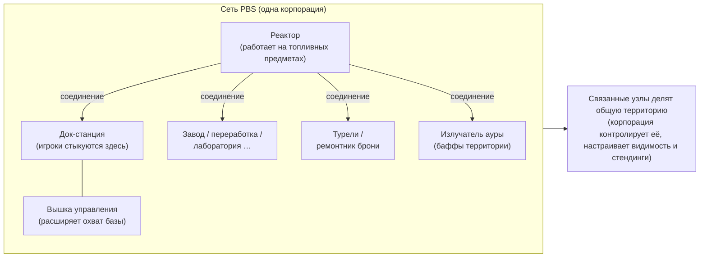
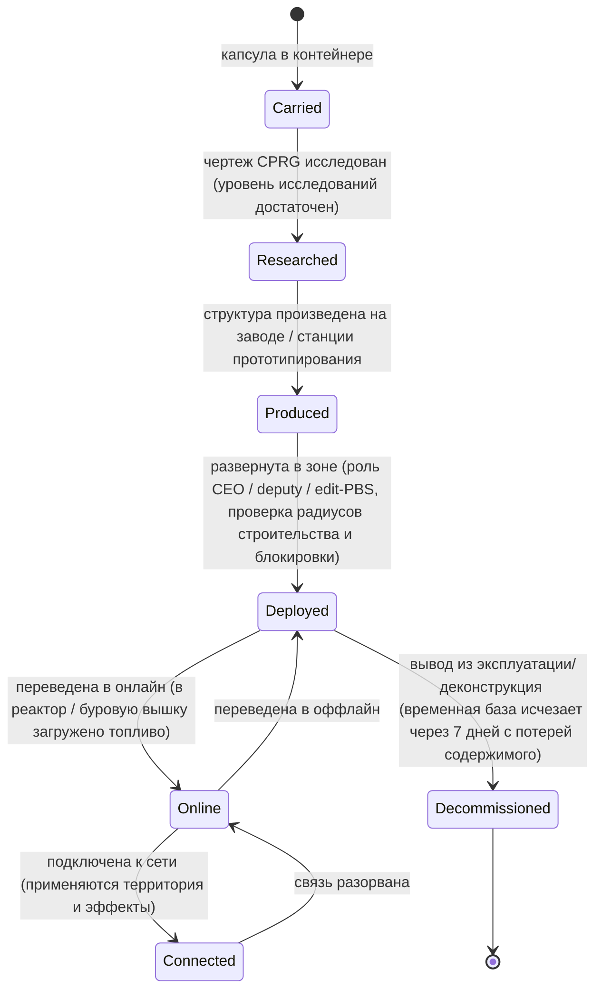

# Опорные энергетические станции (PBS)

**PBS** (Power Base Station — опорная энергетическая станция) — это размещаемая в зоне структура. Объекты PBS
можно **объединять** в **сеть**, которая задает границы **территории** и активирует **эффекты**.
Это активность уровня корпорации/структур: для большинства действий требуется соответствующая корпоративная
роль.

> Расположение элементов интерфейса соответствует [обзору UI клиента](/ru/features/ui/). Точное внутриигровое
> название «PBS» в клиенте требует уточнения. Описанные ниже механики проверены по коду сервера.

## Что делает PBS

- Является **узлом** в **сети** PBS.
- Связанные узлы образуют общую **территорию**, подконтрольную корпорации-владельцу.
- Сеть может распространять **эффекты** (баффы/контроль) на всю свою территорию.
- Некоторые структуры PBS требуют **снабжения** ресурсами (топливом) для работы.

## Семейства структур

Каждая структура PBS представлена в трех размерных классах: **small / medium / large** (малый / средний / большой). Вы перевозите
**капсулу**, исследуете чертеж (CPRG) и **развертываете** объект — возможность развертывания
ограничена правами доступа (см. ниже). Семейства структур:

| Семейство | Структуры | Роль |
|---|---|---|
| Энергетика | реактор, энергетическая скважина, батарея ядра, передатчик ядра | генерация, хранение и распределение **энергии ядра**, на которой работает вся сеть |
| Докование | док-станция, временная док-станция, вышка управления | места стыковки игроков; вышка управления расширяет радиус действия базы |
| Производство | завод, перерабатывающий завод, репроцессор, ремонтный цех, прототипирование, исследовательская лаборатория, станция калибровки (CPRG), станция исследовательских наборов, модуль модернизации производства | [производственные](/ru/features/production/) мощности, развернутые прямо в зоне вместо домашней базы |
| Оборона | турели (лазерные / рельсовые / ракетные / РЭБ), ремонтник брони | автоматизированная защита территории |
| Эффекты | излучатель ауры, поставщик эффектов, маскировочная вышка, буровая вышка | проецирование бонусных эффектов территории; буровая вышка добывает руду автоматически |
| Транспорт | узел магистрали | подключение к **магистрали** зоны (линии быстрого перемещения) |
| Строительство | строительный модуль | строитель, размещающий остальные структуры |

### Эффекты излучателя ауры

Излучатель ауры — основной источник баффов на территории. Каждый размерный класс излучателя дает один из трех
**базовых бонусов, масштабируемых по уровням**:

- **small** — сенсоры ур. 1 / инженерия ур. 1 / индустрия ур. 1
- **medium** — те же три бонуса ур. 2
- **large** — те же три бонуса ур. 3

Сенсоры увеличивают радиус сканирования/разведки, инженерия ускоряет строительство, индустрия ускоряет
производство.

### Временная док-станция

Особая база PBS с фиксированным **сроком жизни в 7 дней** (168 часов в конфигурации). Ее **нельзя
разобрать** — она либо **исчезает по истечении срока, либо уничтожается**. Оставшееся время работы
транслируется внутриигровым оповещением (тема канала базы, почта и MOTD); когда время истекает,
база уничтожается, а ее содержимое теряется. Это модель «аренды» для док-станций PBS: вы не платите аренду,
а получаете фиксированное временное окно.

## Развертывание

- **Проверка развертывания (Check deployment)** — перед установкой проверяет, может ли структура PBS быть развернута в данной точке
  (проверка наклона рельефа, блокировки другими объектами и прав доступа). Требуется корпоративная роль
  (**CEO / deputy / edit-PBS**).
- При развертывании учитываются **радиус строительства** и **радиус блокировки** структуры.

## Сеть и соединения

- **Просмотр сети (Get network)** — отображение сети PBS, к которой вы принадлежите.
- **Информация об узле (Node info)** — подробные данные об узле PBS.
- **Переименование узла (Rename node)**.
- **Создание соединения (Make connection)** — связывание двух узлов PBS. (Подключение к сети, в которой уже есть
  док-станция, запускает особый сценарий передачи прав владения.)
- **Разрыв соединения (Break connection)** — разъединение двух узлов.
- **Настройка веса соединения (Set connection weight)** — изменение мощности/приоритета линии связи.

## Управление и состояние

- **Перевод в онлайн/оффлайн (Set online)** — включение или отключение узла.
- **Настройка эффекта (Set effect)** — выбор эффекта, транслируемого узлом.
- **Демонтаж базы (Set base deconstruction)** — установка метки на разбор базы.

## Территория

- **Список территорий (Get territories)** — перечень территорий под контролем вашей сети.
- **Настройка видимости территории (Set territory visibility)** — управление видимостью территории для сторонних игроков.
- **Ограничение по стендингу (Set standing limit)** — ограничение доступа на основе отношений (стендинга).
- **Настройка времени укрепления (Set reinforce offset)** — регулировка параметров режима укрепления (reinforcement).

## Снабжение топливом

- **Информация о снабжении (Feedable info)** — необходимые ресурсы и текущий статус заполнения PBS.
- **Загрузка ресурсов (Feed items)** — передача предметов для питания/работы PBS.

Снабжаемыми структурами являются **реактор** и **буровая вышка**. Загрузка преобразует
предметы с определенной энергоемкостью (значение `corecalories` за единицу) в буфер энергии ядра узла
вплоть до максимального значения — загрузить топливо в узел может любой игрок в радиусе действия. Доступное топливо:

| Топливо | Энергия ядра за единицу |
|---|---|
| Ускоритель реактора класс C (Reactor booster class C) | 8,000,000 |
| Ускоритель реактора класс B (Reactor booster class B) | 4,000,000 |
| Ускоритель реактора класс A (Reactor booster class A) | 2,000,000 |
| Образец SAP (вторжение) / SAP specimen (intrusion) | 600,000 (вариант flux: 28,000) |
| Гамма-энергоблок (Gamma energy block) | 2,000 |
| Заряд ускорителя ядра (Core booster ammo) | 1,000 |
| Неочищенная руда (espitium) | 400 |
| Неочищенная руда (vitricyl / prilumium / chollonin) | 300 |
| Неочищенная руда (axicol) | 40 |

Ускорители — наиболее эффективное топливо; необработанная руда — дешевый резервный вариант.

## Компенсации

- **Информация о компенсациях (Get / set reimburse info)** — настройка компенсации расходов, связанных с PBS.

## Журналы

- **Журналы PBS (PBS logs)** — просмотр истории активности PBS (соединения, развертывания и т. д.).

## Практические советы

- **Это задача для офицеров** — развертывание и большинство функций управления требуют определенных ролей в корпорации.
- **Соединения определяют территорию** — вы контролируете именно то пространство, которое охватывает построенная вами сеть.
- **Всегда делайте предварительную проверку** — функция проверки развертывания заранее покажет причину невозможности установки
  (наклон склона, помехи от других объектов, нехватка прав) до того, как вы начнете процесс.
- **Снабжение поддерживает жизнь сети** — реакторы и буровые вышки сжигают топливо (ускорители
  или сырую руду) для поддержания энергетического буфера ядра.
- **Временная база имеет жесткие сроки** — 7 дней без возможности разбора; планируйте операции с учетом ее неминуемого уничтожения.
- **Параметры видимости и стендингов** позволяют гибко открывать или закрывать вашу зону для других игроков.

## Оборонительные турели

Не управляются игроками напрямую — развертываются как оборонительные структуры PBS. Турели собираются из
компонентов точно так же, как и любые роботы, но жестко закреплены на платформе PBS и не могут пилотироваться.

| Турель | Роль |
|---|---|
| PBS Turret | Базовая оборона PBS |
| PBS EW Turret | Радиоэлектронная борьба (нарушение работы щитов/брони) |
| PBS Laser Turret | Лучевая (лазерная) оборона |
| PBS Missile Turret | Ракетная оборона |
| PBS Rail Turret | Оборона кинетическим/электромагнитным оружием |
| Police guard tower | Охрана зоны полицейскими силами NPC |

Подробную информацию о деталях и сборках см. в [справочнике роботов](/content/robots/).

<!-- TODO: only the in-client name for PBS and the UI remain (structure list, network
     editor, feeding screen).
     Confirmed: 416 def_pbs_* definitions, S/M/L tiers with capsule/cprg/pr/object
     variants; aura emitter #effect=N93..101 = pbs sensors/engineering/industry lvl1-3
     (EffectType enum); feedable = reactor + mining tower (IPBSFeedable), fuel =
     definitionconfig.corecalories (boosters A/B/C 2/4/8M, SAP 600k/28k, gamma block
     2k, ore espitium 400 / vitricyl+prilumium+chollonin 300 / axicol 40);
     ExpiringPBSDockingBase: lifetime 168 h from definitionconfig.lifetime, no
     deconstruction, announcer channel topic + mail, kill on expiry. -->
     Developer notes: Zone/PBS/PBSCheckDeployment.cs (construction/blocking radius,
     CEO/deputy/editPBS role), PBSMakeConnection.cs / PBSBreakConnection.cs,
     PBSSetConnectionWeight.cs, PBSSetOnline.cs, PBSSetEffect.cs, PBSSetBaseDeconstruct.cs,
     PBSGetNetwork.cs, PBSNodeInfo.cs, PBSRenameNode.cs, PBSGetTerritories.cs,
     PBSSetTerritoryVisibility.cs, PBSSetStandingLimit.cs, PBSSetReinforceOffset.cs,
     PBSFeedableInfo.cs / PBSFeedItemsHander.cs, PBSGetReimburseInfo.cs /
     PBSSetReimburseInfo.cs, PbsGetLog.cs; Zones/PBS/* (IPBSObject, ConnectionHandler). -->