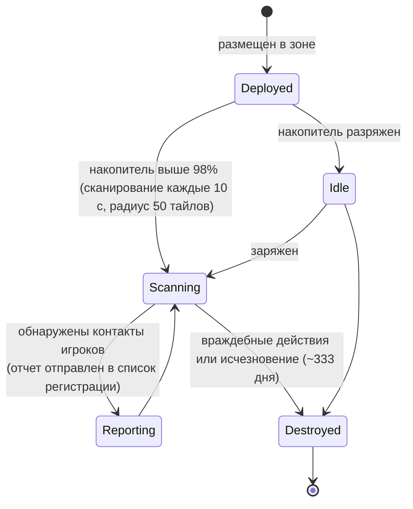

# Датчики присутствия

Зонды делятся на два семейства:

- **Датчики видимости (присутствия)** — небольшие устройства, которые вы развертываете в зоне для **наблюдения за областью**. Находясь под напряжением, они сканируют окружающее пространство на наличие юнитов игроков и отправляют отчеты зарегистрированным персонажам. Это инструмент разведки и наблюдения.
- **Геологические зонды** — **модуль**, устанавливаемый на вашего робота (тиры от *noob* до *standard*, *industrial*, *named*, *elite* и *artifact*), плюс **боеприпасы под конкретную руду** (варианты: тайловые / направленные / площадные для каждого типа руды). Запуск такого зонда выдает результат сканирования данной руды в области, который сохраняется для персонажа (см. раздел [добыча → сканирование](/ru/features/gathering/)).

> Расположение элементов интерфейса описано в [обзоре интерфейса клиента](/ru/features/ui/). Приведенные ниже механики подтверждены на стороне сервера.

## Управление зондами

- **Список** зондов — просмотр имеющихся у вас зондов.
- **Информация о регистрации** — состояние и данные о регистрации зонда.
- **Настройка регистрации** — привязка персонажей к списку получателей отчетов зонда.
- **Назначение имени** — присвоение зонду метки.
- **Удаление** регистрации зонда (в зоне) — прекращение наблюдения / очистка зонда.

### Как работает датчик видимости

- Он **питается от накопителя (core)**: сканирование происходит только тогда, когда его накопитель практически полон (более 98% от `core_max`); разряженный зонд бездействует.
- В активном состоянии он сканирует пространство **каждые 10 секунд** на наличие роботов игроков в пределах своего **радиуса обнаружения (50 тайлов)** и отправляет отчет (ID персонажа и координаты каждого контакта) всем, кто находится в списке регистрации.
- **Регистрация** — это корпоративная функция: вы можете регистрировать только **членов собственной корпорации**, а **генеральный директор (CEO) и его заместитель всегда вносятся в список** автоматически. Список имеет максимальный размер.
- **Срок службы**: развернутый зонд исчезает по истечении заданного в контенте времени `despawn_time` (для датчика видимости установлено значение ~333 дня) либо уничтожается.

## События жизненного цикла

Сервер сообщает о событиях жизненного цикла зондов по мере их возникновения:
- **created**, **updated**, **dead** — зонд развернут, отправляет отчет или уничтожен.

Они приходят в виде push-уведомлений; вы не отправляете их, а реагируете на них.

## Практические советы

- **Сначала зарегистрируйте, потом читайте** — зонд отправляет отчеты только зарегистрированным персонажам.
- **Зонды могут погибать** — зонд может выйти из строя из-за враждебных действий или истечения срока службы; следите за событиями жизненного цикла.
- **Давайте им имена** — когда в поле находится несколько зондов, метки помогают не запутаться.
- **Разведка, а не бой** — зонды собирают информацию; они не предназначены для сражений.

<!-- TODO: only the UI remains (probe list, registration picker).
     Confirmed: visibility probe (def_visibility_probe): core_max 50, active only at
     core>98%, 10 s scan interval (ProximityDevice.cs _probingInterval), detection via
     blob_emission 10 / blob_emission_radius 50, report = characterID + x/y per contact
     pushed to registered characters (ProximityProbe.OnUnitsFound); registration =
     own-corp members only, CEO+Deputy always included, max count
     (ProximityProbeRegisterSet.cs); despawn_time 28,800,000 s (~333 d) on the capsule;
     stealth_strength 275 / detection_strength 45. Mining probes: tiered modules
     (noob/standard/industrial1-2/named1-3/elite t2-t4/artifact) + per-ore tile/
     direction/area ammo (79 def_*probe* definitions).
     Developer notes: ProximityProbeList.cs / ProximityProbeGetRegistrationInfo.cs /
     ProximityProbeRegisterSet.cs / ProximityProbeSetName.cs; Zone/ProximityProbeRemove.cs;
     Zones/ProximityProbes/ProximityProbe.cs + ProximityProbeDeployer.cs +
     ProximityDevice.cs; Zones/Blobs/* (blob emission/stealth); lifecycle events via
     ProximityProbeCreated/Update/Dead/Info commands. -->
     Developer notes: ProximityProbeList.cs / ProximityProbeGetRegistrationInfo.cs /
     ProximityProbeRegisterSet.cs / ProximityProbeSetName.cs; Zone/ProximityProbeRemove.cs;
     Zones/ProximityProbes/ProximityProbe.cs + ProximityProbeDeployer.cs; lifecycle
     events via ProximityProbeCreated/Update/Dead/Info commands. -->