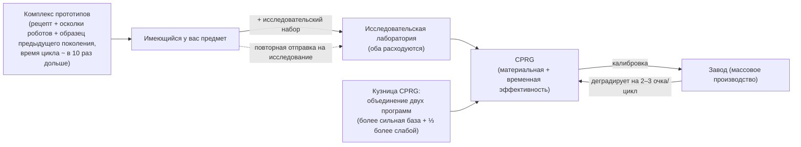

# Производство

Производство — это процесс превращения необработанных ресурсов и компонентов в готовые к использованию предметы. Оно осуществляется на **производственном комплексе** («заводе» / mill) на базе, где вы пристыкованы. Все операции здесь доступны **только при стыковке**.

> Расположение элементов интерфейса описано в [обзоре интерфейса клиента](/ru/features/ui/) (категории **Refinery / Recycling / Repair / Insurance** на верхней панели). Приведенные ниже механики подтверждены на стороне сервера.

## Производственные линии

**Производственная линия** — это сохраненный рецепт: она определяет, что именно вы производите и из чего. Полный список компонентов для каждого создаваемого предмета (с требуемыми уровнями исследований) сформирован в разделе [Рецепты](/content/recipes/). Линия запускается на определенное количество **циклов** (rounds).

- **Список линий** — просмотр доступных вам линий.
- **Запуск линии** — запуск линии на предприятии на выбранное количество циклов (минимум 1).
  - Оплату можно производить из **личного кошелька** или из **кошелька корпорации**.
  - Исходные компоненты могут браться из вашего **инвентаря** или из ваших **роботов**.
- **Калибровка линии** — настройка параметров линии.
- **Установка количества циклов** — выбор числа запускаемых циклов.
- **Запрос следующего цикла** — предварительный просмотр затрат и выхода продукции для следующего цикла.
- **Отмена** — остановка текущего производства.
- **Удаление линии** — удаление сохраненной линии.

Работа линии потребляет компоненты (и кредиты) и производит целевой предмет на протяжении заданных циклов.

## Разовые операции

Это одиночные действия, а не многораундовые линии. Для каждого из них предусмотрен вариант **Query** (запрос), который позволяет оценить стоимость и результат до подтверждения операции.

- **Переработка сырья (Refine)** — сырье → готовые материалы в соответствии с рецептом предмета (см. [Рецепты](/content/recipes/)). Вы сами выбираете, сколько единиц целевого предмета изготовить; номинальный объем входящих материалов масштабируется с помощью материального множителя `1 + 50/(bonus + 100)`, где *bonus* — ваш навык переработки (расширения + бонусы комплекса + очки отношений/стендинга). Без бонусов затрачивается **150%** от номинального рецепта; при максимальном бонусе расход снижается почти до **100%**.
- **Утилизация / повторная переработка (Recycle / reprocess)** — разбирает предмет обратно на компоненты его рецепта (обратный рецепт). Выход рассчитывается по формуле `номинал × (1 − 75/(bonus + 100)) × доля прочности предмета`. Без бонусов от навыков базовый выход составляет **25%**, возрастая с прокачкой до 100%; при этом **поврежденный предмет дает пропорционально меньше материалов** (если предмет ценный, сначала отремонтируйте его). Перерабатываются только полные «партии» (стандартные единичные количества); остаток сохраняется. Миссионные предметы при этом удаляются, а не перерабатываются.
- **Ремонт (Repair)** — восстанавливает прочность поврежденного предмета/робота до максимума. Стоимость составляет `(% недостающей прочности) × материальная стоимость предмета × 75/(bonus + 100)`. «Материальная стоимость» рассчитывается рекурсивно: рецепт предмета раскладывается до базового сырья и оценивается по **среднемировым рыночным ценам**, поэтому стоимость ремонта динамически меняется вместе с рынком. Множитель навыка начинается с **75%** без бонусов и стремится к 0 при максимальной прокачке.
- **Исследовательские компоненты (Research components)** — производство исследовательских компонентов (запрос + запуск).

## Жизненный цикл предмета (замкнутый процесс)

Создание предметов представляет собой замкнутый цикл взаимодействия трех связанных комплексов:

1. **Исследования (обратная разработка)** — поместите единицу предмета, который вы хотите производить, вместе с **исследовательским набором** (research kit), чей уровень соответствует уровню исследования предмета (наборы бывают уровней 0–10), в исследовательскую лабораторию. Оба исходных компонента **расходуются**, а в результате создается одна **CPRG** для этого предмета. Эффективность полученной программы отталкивается от базового значения самого предмета (для большинства предметов это 50, для боеприпасов выше, для турелей — вплоть до 90) и увеличивается на величину *(уровень набора сверх требуемого) × 5* плюс ваш бонус исследовательского навыка (вплоть до дополнительных +50). Таким образом, набор на пару уровней выше предмета — вкупе с хорошими производственными расширениями — превращает стандартную программу 50/50 в высококонкурентную. Именно так новые предметы попадают в ваш производственный арсенал.
2. **Завод (массовое производство)** — массовое производство по программе. Каждый цикл **ухудшает** параметры эффективности линии (на 2–3 очка за цикл в зависимости от категории предмета; см. [CPRG](#cprg-kalibrovochnye-programmy)) — когда уровень потерь становится слишком высоким, линию необходимо откалибровать свежей программой. Для прототипов в качестве компонента также требуется **образец предыдущего поколения** (один стандартный модуль для создания прототипа T2, один T2 для создания T3), который расходуется в процессе.
3. **Комплекс прототипов** — создание **прототипа** предмета напрямую: материалы рецепта плюс осколки роботов (robot shards) *и* образец предыдущего поколения. При этом **время цикла примерно в 10 раз больше, чем на заводе** (плюс стандартный модификатор времени). Создавать прототипы можно только для тех предметов, которые уже разблокированы в вашем дереве технологий. Прототипы обходятся значительно дороже стандартных аналогов; их основная цель — **служить материалом для исследований с целью получения высококачественных программ** (исследование прототипа — это то, что открывает доступ к следующему тиру) — либо использоваться на роботе, если предмет слишком редок в виде лута и слишком дорог на рынке.

## Развитие по тирам (рангам)

Большинство модулей и роботов разделены на **тиры T1 → T4** (обозначение тира в клиенте; линейки определений `standard → named1 → named2 → named3`, а также специальные линейки `elitet4`/`artifact`). Основные правила:

- **Каждый тир — это отдельный предмет со своим узлом в дереве технологий.** Открытие узла требует очков исследований (получаемых из ядер/kernels) и наличия **родительского узла**, поэтому тиры должны открываться строго по порядку. Вы можете создать **прототип** (или запустить массовое производство) только для предмета, чей узел уже разблокирован: получить более высокий тир без предварительного исследования невозможно.
- **Каждый последующий тир требует один экземпляр предыдущего тира** в качестве компонента (плюс материалы и осколки роботов). Соответственно, предмет T1 нельзя сразу «обменять» на T3 — прототипу T3 требуется предмет **T2**, при этом образец **расходуется**, а не улучшается: на выходе вы получаете совершенно новый предмет.
- На странице каждого предмета отображается его **линейка тиров** — вся цепочка `T1 → T2 → T3 → T4` в виде ссылок, а на [страницах узлов дерева технологий](/content/techtree/) указаны родительские/следующие узлы и стоимость в очках.

Пример линейки малых буровых модулей: [standard small miner (T1)](/content/items/standard-small-driller/) →
[Biroter 5050 small miner module (T2)](/content/items/named1-small-driller/) →
[Sublimator Low-D small miner module (T3)](/content/items/named2-small-driller/) →
[Scraper-990 small miner module (T4)](/content/items/named3-small-driller/) —
и точно такая же схема действует для каждого семейства модулей и роботов.

## Прототипы и исследовательские наборы

- **Прототип** — производство прототипа предмета (запуск + запрос). Один прототип на слот; больше параллельных слотов под прототипы открывается через производственные расширения.
- **Объединение исследовательских наборов** — объединение нескольких исследовательских наборов в один более высокого уровня (запуск + запрос). Более высокий уровень набора сокращает время исследования и повышает показатели эффективности получаемой программы.

## CPRG (калибровочные программы)

**CPRG** (calibration program, калибровочная программа) — это основа работы производственной линии; индивидуальная для каждого предмета программа с показателями **материальной эффективности** (material efficiency) и **временной эффективности** (time efficiency) от 0 до 100 очков каждый. Получить ее можно путем **исследования предмета** в исследовательской лаборатории (уровень исследования определяет, какие предметы вы вообще способны производить) или активацией **калибровочной капсулы**.

- Свежеисследованная CPRG имеет базовые показатели **50/50** очков.
- **Кузница CPRG** (calibration-program forge): объединение двух CPRG для одного и того же предмета. Полученный результат берет очки более сильной программы за основу и прибавляет к ним треть от очков более слабой. Процесс ковки требует времени и кредитов (время × стоимость секунды комплекса).
- **Калибровка линии** с помощью CPRG задает показатели ее эффективности. Каждый производственный цикл **ухудшает** эффективность линии (фиксированное для каждого предмета значение декалибровки), поэтому со временем параметры линии снижаются — перед длинными сериями циклов проводите перекалибровку.

Показатели эффективности подставляются в формулы завода (на один производственный цикл):

- **Потребление материалов** = рецепт × `1 + 50/(очки материалов + навык + 100 + бонус_завода)`
  — новая CPRG на 50 очков без навыков и без бонусов дерева технологий на массовое производство расходует ≈ **133%** от номинального рецепта.
- **Время производства** = базовое время комплекса (3 600 с на цикл для завода) ×
  `1 + 100/(очки времени + навык + 100)` × модификатор длительности предмета — для новой CPRG без навыков время составляет ≈ **1 час 40 минут** на предмет.
- **Стоимость** = время производства × стоимость секунды комплекса (7 кредитов/с для завода PBS, 3 для большой/средней исследовательской лаборатории PBS) × модификатор цены предмета (1–10).
- CPRG для миссий бесплатны и имеют фиксированное время 10 секунд.

## Страхование

Страховой комплекс страхует **ваших роботов**, а не произведенную продукцию:

- **Покупка** страховки на робота (робот должен быть целым, распакованным и не являться стартовым ботом), **список** страховок, **запрос информации** о страховке, **удаление** страховки.
- Срок действия полиса составляет **15 дней** (+ бонусные дни от расширений); вы можете одновременно страховать 1 + (бонус от расширений) роботов.
- Для каждого робота установлены фиксированные **взнос** и **выплата** (таблица `insuranceprices`, 67 моделей роботов); взнос уменьшается бонусом профильного расширения и может оплачиваться из кошелька корпорации.
- Если застрахованный робот уничтожен, **выплата производится в кредитах** (сам робот при этом безвозвратно теряется) — см. [бой](/ru/features/combat/).

## Комплекс и статус

- **Информация о комплексе / описание** — возможности производственного комплекса.
- **В процессе (мои / корпорации)** — что производится в данный момент.
- **История производства** — журнал ваших прошлых производств.
- **Список компонентов** — доступные компоненты для производства.
- **Информация о сервере** — статус производственного сервера.

## Практические советы

- **Вы должны быть пристыкованы к базе с производственным комплексом.**
- **Всегда используйте запрос (Query) перед запуском** — варианты с предварительным запросом показывают расходы и результат, предотвращая случайную потерю компонентов из-за ошибки.
- **Кошелек корпорации** — при наличии соответствующих прав вы можете использовать средства корпорации для производства.
- **Компоненты берутся и из роботов** — производственная линия может забирать исходные компоненты из оснащенных роботов, а не только из инвентаря.
- **Утилизируйте только полностью целые предметы** — поврежденный предмет приносит меньше сырья; ремонтируйте ценные предметы перед повторной переработкой.
- **Множители навыков — главный двигатель экономики**: бонусы к переработке сырья, утилизации, ремонту и производству на заводе рассчитываются по схожему принципу; вложения в производственные расширения окупаются экономией материалов на каждом цикле.
- **Страховка — это подушка безопасности для роботов**: оформляйте ее на дорогие сборки перед выходом в PvP в дальнем космосе.
- **Исследовательские наборы — ключ к производству**: уровень исследования предмета (1–9) определяет, какие наборы могут его расшифровать, а применение набора на несколько уровней выше самого предмета — наиболее экономный способ поднять показатели эффективности итоговой программы.

<!--
Developer notes: rewritten 2026 from backend sources; no community-wiki text reused.
Verified against:
- refine = 1 output per unit, input = nominal x (1+50/(bonus+100)) (Refinery.cs);
- recycle = reverse recipe x (1-75/(bonus+100)) x healthRatio, whole batches only,
  mission items deleted (ReprocessSessionMember.cs);
- repair price = (1-healthRatio) x PriceCalculator world-market value x
  75/(bonus+100) (Repair.cs + PriceCalculator.cs);
- ResearchLab.cs (StartResearch/EndResearch: source item + research kit both
  consumed; kit level must be >= itemresearchlevels.researchlevel (1-9);
  efficiency = per-item base + levelDifference*5 + (1-100/(100+skill))*50);
- itemresearchlevels (1101 rows, levels 1-9), research kits def_research_kit_0..10
  (#level option), RandomResearchKit (mission kits, fake 100/100);
- calibrationdefaults (per-CPRG base efficiencies 50-90; default fallback 50/50;
  CalibrationProgram.OnInsertToDb sets 50/50);
- PBSFacilities.cs CalculateResultingPoints (forge = better base + weak/3 +
  (1-100/(100+skill))*25);
- productiondecalibration (2-3 points decrease per round per category,
  distorsion 0.5-1%);
- Prototyper.cs (StartPrototype: components include previous-gen specimen via the
  components table — e.g. T2 NEXUS consumes 1x standard module, T3 consumes 1x T2;
  time = 10x cycle x multiplier; tech-tree unlock check in
  ProductionPrototypeStart.cs);
- prototypes table (339 rows, standard->prototype mapping);
- Mill.cs (CalculateFinalMaterialMultiplier 1+50/(pts+skill+100+millBonus) with
  tech-tree mass-production bonus; CalculateFinalTimeMultiplier;
  productionduration table);
- Insurance: InsuraceFacility.cs (15d + time-extension bonus, 1+slot-extension
  policies, noob bot excluded, must be single+unpacked), InsuranceDescription.cs
  (payout in credits via central bank), insuranceprices (67 robot definitions,
  payout = 80x fee except noob/arkhe2 at 4x).
- Facility options (entitydefaults): def_pbs_facility_mill #perSecondPrice=7
  #productionTime=3600; refinery #materialEfficiency=0.95;
  calibration_program_forge #perSecondPrice=7; def_production_public_factory
  #materialEfficiency=0.6 #manufactureTime=3600 #perSecondPrice=3.
Developer files: Production/ProductionLineStart.cs (PrepareProductionForPublicContainer,
LineStartInMill, corp wallet, search-in-robots, rounds); Production/ProductionLine*.cs;
Production/ProductionRefine*.cs, ProductionReprocess*.cs, ProductionRepair*.cs,
ProductionResearch*.cs (query+run pairs); Production/ProductionPrototype*.cs,
ProductionMergeResearchKitsMulti*.cs; Production/ProductionCPRG*.cs,
ProductionGetCPRGFromLine*.cs; Production/ProductionInsurance*.cs;
Production/ProductionFacility*.cs, ProductionInProgress*.cs, ProductionHistory.cs;
Services/ProductionEngine/Facilities/*.cs; Services/ProductionEngine/PBSFacilities.cs;
Services/ProductionEngine/ResearchKits/*.cs; Services/ProductionEngine/CalibrationPrograms/*;
Services/Insurance/InsuranceHelper.cs; Items/PriceCalculator.cs.
Corrections vs ingested page: no "decoder" item exists (research kits are the
level-gated inputs); the "researched to 100%" claim is wrong (tech-tree unlock is
the gate; research levels run 1-9); prototype time is 10x the mill cycle; specimen
consumption verified from the components table; insurance payout is 80x the fee.
-->