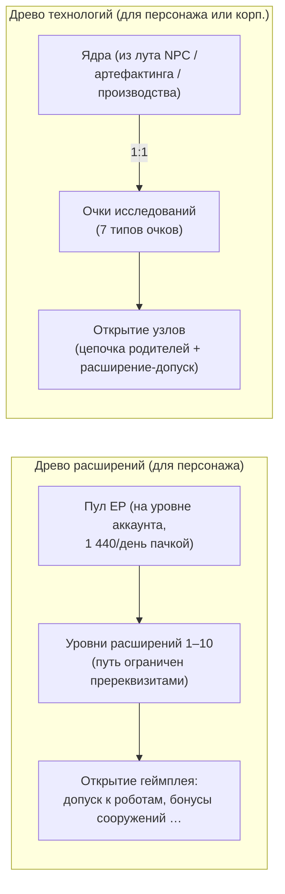

# Исследования

Существуют **две отдельные системы развития**. Обе доступны только при нахождении на станции (в доке).

> Расположение элементов интерфейса описано в [обзоре интерфейса клиента](/ru/features/ui/) (окно персонажа → расширения; для древа технологий предусмотрено отдельное окно). Описанные ниже механики сверены с серверной логикой.

## Древо расширений (навыки персонажа)

Расширения (extensions) — это уровни навыков конкретного персонажа, которые открывают доступ к игровым возможностям. Наиболее важными среди них являются **расширения допуска (enablers)**, позволяющие пилотировать определенный класс роботов (необходимы для выбора робота и вылета из дока, см. [перемещение](/ru/features/movement/) и [роботы](/ru/features/robots/)).

### Как устроено изучение

- Для изучения вы должны находиться **на станции (в доке)**.
- Каждое расширение можно прокачать с **1 по 10 уровень** (10-й уровень — максимальный).
- **1-й уровень стоит кредиты** (параметр расширения `price`), которые списываются из вашего кошелька.
- **Каждый уровень требует очков расширений (EP)** согласно фиксированной таблице «ранг × уровень»:
  для уровней 1–5 стоимость составляет `60 × ранг × уровень`; для уровней 6–10 происходит скачок до
  `ранг × (1440, 2520, 3840, 5400, 12000)`. Десять уровней расширения 1-го ранга суммарно стоят
  от 60 до 6 000 EP (всего 13 500 EP); расширение 10-го ранга на каждом уровне стоит в десять раз дороже.
- Для изучения расширения необходимо предварительно изучить его **пререквизиты** (список «prerequire»).
- EP образуют **общий пул на уровне аккаунта**: они распределяются между вашими персонажами и накапливаются с течением времени (см. раздел «Источники EP» ниже).

### Управление расширениями

- **Список категорий / получить все / список изученных / список пререквизитов (Category list / get all / learned list / prerequire list)** — навигация по древу навыков и просмотр уже изученного.
- **Доступные очки (Available points)** — просмотр текущего пула EP.
- **Снять один уровень (Remove one level)** — сброс одного уровня конкретного расширения.
- **Сбросить расширения персонажа (Reset character extensions)** — полный сброс всего древа навыков для персонажа.
- **Освободить заблокированные EP (Free locked EP)** — возврат EP, которые были заблокированы (например, после снижения уровня).
- **Купить буст EP (Buy an EP boost)** — платный ускоритель, увеличивающий прирост EP.
- **Журнал начисления EP за активность (EP-for-activity daily log)** — просмотр статистики полученных за игру EP.

### Источники EP

EP — это не свободно покупаемая валюта; они начисляются **ежедневной пачкой**:

- Каждый аккаунт получает **1 440 EP в день** (начисляются один раз в сутки в промежутке между 08:00 и 11:00 по серверному времени с помощью процедуры `extensionPointsAdd`). В коде также определена удвоенная пачка в размере **2 880 EP** для аккаунтов с платной подпиской, однако в текущей реализации базовая пачка начисляется всем учетным записям.
- **Платные бусты** (покупка буста EP) суммируются поверх базового начисления.
- Ваши **доступные EP** = все полученные ежедневные пачки − штрафы − потраченные в игре EP. (Журнал начисления EP за активность показывает подробную разбивку ежедневных начислений.)

**Полный каталог** — все расширения (ранг, стоимость 1-го уровня, бонусы, требования) представлены в разделе [Расширения](/content/extensions/), а все узлы древа технологий (открываемый предмет, требуемое расширение допуска, стоимость в очках) — в разделе [Древо технологий](/content/techtree/).

## Древо технологий (разблокировки)

Древо технологий представляет собой граф **узлов (nodes)**, которые разблокируются за **очки исследований**. В отличие от EP (общий пул аккаунта), очки древа технологий **получаются путем поглощения «ядер» (kernels)** — предметов, которые исследуются и сдаются в систему.

### Как это работает

- **Исследование ядер** — сдача предметов-ядер из контейнера. Каждое ядро конвертируется **1:1** в очки исследований соответствующего **типа очков**; при этом сами ядра уничтожаются. Всего существует семь типов ядер (по одному на каждый тип очков): Theodica, Pelistal, Nüimqol, Industrial, Common, HiTech и NewTech.
- **Разблокировка узла** — трата необходимого количества очков исследований. Узел можно разблокировать только в том случае, если:
  - все его **родительские узлы** уже разблокированы, и
  - у вашего персонажа изучено соответствующее **расширение допуска (enabler extension)**.
- **Разблокировка для корпорации** — при наличии подходящей корпоративной роли узел можно разблокировать **для корпорации** (общий доступ). Разблокировка для корпорации стоит дороже (применяется корпоративный множитель цены) и оплачивается из очков корпорации.
- **Пожертвование (Donate)** — передача очков исследований (например, в пользу вашей корпорации).
- **Инфо / логи** — просмотр деталей узлов и истории ваших исследований/разблокировок.

### Почему это важно

Открытые узлы древа технологий открывают доступ к контенту и функционалу более высоких тиров. Перед тем как тратить очки, всегда проверяйте пререквизиты узла (цепочку родителей и расширение допуска).

## Практические заметки

- **Расширения допуска ограничивают использование роботов** — вы не сможете пилотировать класс роботов, который у вас не исследован (это та же самая проверка, которая блокирует выбор робота и вылет из дока).
- **1-й уровень — единственная трата кредитов** в древе расширений; всё остальное требует исключительно EP.
- **Древо технологий необратимо** — очки, потраченные на разблокировку, не возвращаются; заранее планируйте свой путь развития.
- **Корпоративные технологии — командная работа** — для них используются общие очки корпорации и действует повышающий коэффициент стоимости.

<!-- TODO: only the research UI remains (window layout, point display).
     Confirmed: EP earn = 1440/day flat via dbo.extensionPointsAdd (08:00-11:00 window,
     once per day; 2880 bonus constant exists in GiveExtensionPointsService for paid
     subscriptions but the current SP pays base to all); available = batches -
     penalties - spent (extensionPointsAvailable fn); EP cost table in
     Services/ExtensionService/ExtensionPoints.cs (60*rank*level for levels 1-5, then
     rank*(1440,2520,3840,5400,12000)); kernels convert 1:1 (TechTreeResearch.cs), 7
     kernel definitions -> point types n1..n7 (Theodica/Pelistal/Nuimqol/Industrial/
     Common/HiTech/NewTech).
     Developer notes: Extensions/ExtensionBuyForPoints.cs (docked, prereq, level cap 10,
     level-1 credit price, EP by rank/level, account pool, training-char free);
     Extensions/ExtensionGetAvailablePoints.cs; Extensions/ExtensionBuyEpBoost.cs,
     ExtensionFreeLockedEp.cs, ExtensionRemoveLevel.cs, ExtensionResetCharacter.cs;
     EpForActivityDailyLog.cs; TechTree/TechTreeResearch.cs (kernels → points);
     TechTree/TechTreeUnlock.cs (parent chain + enabler extension, corp multiplier);
     TechTree/TechTreeDonate.cs; Services/ExtensionService/GiveExtensionPointsService.cs;
     Services/ExtensionService/ExtensionPoints.cs. -->
     Developer notes: Extensions/ExtensionBuyForPoints.cs (docked, prereq, level cap 10,
     level-1 credit price, EP by rank/level, account pool, training-char free);
     Extensions/ExtensionGetAvailablePoints.cs; Extensions/ExtensionBuyEpBoost.cs,
     ExtensionFreeLockedEp.cs, ExtensionRemoveLevel.cs, ExtensionResetCharacter.cs;
     EpForActivityDailyLog.cs; TechTree/TechTreeResearch.cs (kernels → points);
     TechTree/TechTreeUnlock.cs (parent chain + enabler extension, corp multiplier);
     TechTree/TechTreeDonate.cs. -->