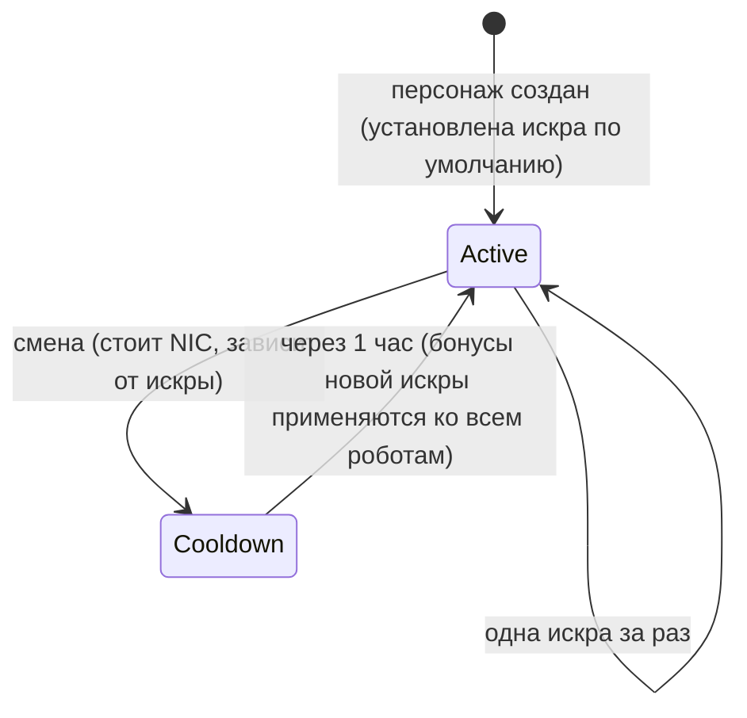

# Искры

**Искра** (spark) — это специализация наноботов, установленная на вашем персонаже.
Пока она активна, её бонусы действуют на каждого пилотируемого вами робота:
например, искра боевой ветки фракции повышает урон оружия и шанс критического
удара с каждым уровнем, тогда как промышленная ветка увеличивает ёмкость
ядра и объём добычи ресурсов.

У каждого персонажа есть **искра по умолчанию**, выдаваемая при создании.
Помимо неё, искры разделены по семействам: базовые начальные ветки, боевые/промышленные/социальные
ветки каждой фракции (по три уровня в каждой), платные ветки Синдиката
и особые лимитированные ветки. Точные бонусы искры представляют собой фиксированный
набор уровней навыков, с которыми можно ознакомиться на [странице расширений](/content/extensions/).
[Обзор семейств ниже](#semeistva-iskr) позволяет сразу перейти к искрам нужной категории.

## Разблокировка (авторизация) искры

Чтобы установить искру, которой у вас ещё нет, её необходимо предварительно
**разблокировать** (только на станции). В зависимости от искры сервер проверяет:

- **стоимость** в NIC (платные ветки — например, вспомогательные искры Синдиката
  и редкие специальные искры),
- **отношения (standing)** с мегакорпорацией разработчиков (фракционные ветки требуют
  минимального уровня отношений с мегакорпорацией соответствующей стороны,
  который прокачивается выполнением [миссий](/ru/features/missions/)),
- или **предмет**, изымаемый из вашего инвентаря (некоторые особые искры
  разблокируются специальным предметом-ключом).

Разблокировка производится один раз: открытая искра навсегда остаётся в вашей коллекции.

## Смена искр

- Одновременно может быть активна только **одна искра**; выбор другой заменяет текущую.
- Каждое переключение **стоит NIC** — сумма зависит от конкретной искры (обычные
  линейки стоят 10k, платные специальные — вплоть до одного миллиона).
- Между сменами действует **кулдаун в один час**: сервер фиксирует время активации
  текущей искры и запрещает переключение до истечения этого интервала.

Поскольку смена искры всегда требует затрат NIC и занимает час времени, выбирайте
ту искру, которая лучше всего подходит для занятия, отнимающего у вас больше
всего времени, и относитесь к переспециализации как к периодическому решению,
а не к действию для каждой отдельной игровой сессии.
<!-- sparkfamilies:generated -->

## Семейства искр

Краткий обзор 47 искр в 6 семействах: по одному блоку на каждое семейство (количество искр, способ разблокировки) в порядке добавления линеек (слева направо, сверху вниз). **Нажмите на блок, чтобы перейти к искрам соответствующего семейства ниже.** **Прокручивайте колесо мыши над схемой для масштабирования**, перетаскивайте для панорамирования и используйте кнопку ⟲ для сброса.

<button type="button" class="zoommap-reset" title="Reset the zoom">⟲</button>
<svg class="zoommap" xmlns="http://www.w3.org/2000/svg" viewBox="0 0 1008 278" width="960" height="264" role="img" aria-label="Spark families: 6 families, 47 sparks; click a family to jump to its sparks below">
  <rect x="0" y="0" width="1008" height="278" fill="#10151f" stroke="#39445a" stroke-width="1"/>
  <g><title>Event &amp; special: 9 sparks, unlocks with free</title><a href="#family-special"><rect x="24" y="40" width="300" height="84" rx="10" fill="#10151f" stroke="#c8d2e0" stroke-width="1.5"/><text x="174" y="68" text-anchor="middle" fill="#e8eefc" font-size="15" font-weight="700">Event &amp; special</text><text x="174" y="92" text-anchor="middle" fill="#c8d2e0" font-size="12">9 sparks · free</text></a></g>
  <g><title>TM (Truhold-Markson): 9 sparks, unlocks with TM standing</title><a href="#family-tm"><rect x="354" y="40" width="300" height="84" rx="10" fill="#10151f" stroke="#41d3ff" stroke-width="1.5"/><text x="504" y="68" text-anchor="middle" fill="#e8eefc" font-size="15" font-weight="700">TM (Truhold-Markson)</text><text x="504" y="92" text-anchor="middle" fill="#41d3ff" font-size="12">9 sparks · TM standing</text></a></g>
  <g><title>ICS: 9 sparks, unlocks with ICS standing</title><a href="#family-ics"><rect x="684" y="40" width="300" height="84" rx="10" fill="#10151f" stroke="#6ee7a0" stroke-width="1.5"/><text x="834" y="68" text-anchor="middle" fill="#e8eefc" font-size="15" font-weight="700">ICS</text><text x="834" y="92" text-anchor="middle" fill="#6ee7a0" font-size="12">9 sparks · ICS standing</text></a></g>
  <g><title>ASI: 9 sparks, unlocks with ASI standing</title><a href="#family-asi"><rect x="24" y="154" width="300" height="84" rx="10" fill="#10151f" stroke="#f5a05a" stroke-width="1.5"/><text x="174" y="182" text-anchor="middle" fill="#e8eefc" font-size="15" font-weight="700">ASI</text><text x="174" y="206" text-anchor="middle" fill="#f5a05a" font-size="12">9 sparks · ASI standing</text></a></g>
  <g><title>Syndicate (NIC): 5 sparks, unlocks with NIC price</title><a href="#family-syndicate"><rect x="354" y="154" width="300" height="84" rx="10" fill="#10151f" stroke="#a78bfa" stroke-width="1.5"/><text x="504" y="182" text-anchor="middle" fill="#e8eefc" font-size="15" font-weight="700">Syndicate (NIC)</text><text x="504" y="206" text-anchor="middle" fill="#a78bfa" font-size="12">5 sparks · NIC price</text></a></g>
  <g><title>Limited: 6 sparks, unlocks with NIC price</title><a href="#family-limited"><rect x="684" y="154" width="300" height="84" rx="10" fill="#10151f" stroke="#f472b6" stroke-width="1.5"/><text x="834" y="182" text-anchor="middle" fill="#e8eefc" font-size="15" font-weight="700">Limited</text><text x="834" y="206" text-anchor="middle" fill="#f472b6" font-size="12">6 sparks · NIC price</text></a></g>
</svg>

### Event &amp; special (9)

Разблокировка: бесплатно — это базовые начальные линейки. Каждое переключение стоит NIC (сумма зависит от искры, см. карточки) и запускает часовой кулдаун — см. раздел [Смена искр](#smena-iskr) выше.

ww

разблокировка бесплатно · смена 10k NIC

Искра по умолчанию — установлена при создании персонажа

wi

разблокировка бесплатно · смена 10k NIC

Искра по умолчанию — установлена при создании персонажа

ws

разблокировка бесплатно · смена 10k NIC

Искра по умолчанию — установлена при создании персонажа

iw

разблокировка бесплатно · смена 10k NIC

Искра по умолчанию — установлена при создании персонажа

ii

разблокировка бесплатно · смена 10k NIC

Искра по умолчанию — установлена при создании персонажа

is

разблокировка бесплатно · смена 10k NIC

Искра по умолчанию — установлена при создании персонажа

sw

разблокировка бесплатно · смена 10k NIC

Искра по умолчанию — установлена при создании персонажа

si

разблокировка бесплатно · смена 10k NIC

Искра по умолчанию — установлена при создании персонажа

ss

разблокировка бесплатно · смена 10k NIC

Искра по умолчанию — установлена при создании персонажа

### TM (Truhold-Markson) (9)

Разблокировка: отношения (standing) с мегакорпорацией TM (2 → 4 → 6 в зависимости от уровня). Каждое переключение стоит NIC (сумма зависит от искры, см. карточки) и запускает часовой кулдаун — см. раздел [Смена искр](#smena-iskr) выше.

Combat Lvl1

разблокировка отношения 2 с TM · смена 10k NIC

Включает 2 уровня расширений

Combat Lvl2

разблокировка отношения 4 с TM · смена 100k NIC

Включает 3 уровня расширений

Combat Lvl3

разблокировка отношения 6 с TM · смена 1M NIC

Включает 3 уровня расширений

Indy Lvl1

разблокировка отношения 2 с TM · смена 10k NIC

Включает 2 уровня расширений

Indy Lvl2

разблокировка отношения 4 с TM · смена 100k NIC

Включает 3 уровня расширений

Indy Lvl3

разблокировка отношения 6 с TM · смена 1M NIC

Включает 3 уровня расширений

Social Lvl1

разблокировка отношения 2 с TM · смена 10k NIC

Включает 2 уровня расширений

Social Lvl2

разблокировка отношения 4 с TM · смена 100k NIC

Включает 3 уровня расширений

Social Lvl3

разблокировка отношения 6 с TM · смена 1M NIC

Включает 3 уровня расширений

### ICS (9)

Разблокировка: отношения (standing) с мегакорпорацией ICS (2 → 4 → 6 в зависимости от уровня). Каждое переключение стоит NIC (сумма зависит от искры, см. карточки) и запускает часовой кулдаун — см. раздел [Смена искр](#smena-iskr) выше.

Combat Lvl1

разблокировка отношения 2 с ICS · смена 10k NIC

Включает 2 уровня расширений

Combat Lvl2

разблокировка отношения 4 с ICS · смена 100k NIC

Включает 3 уровня расширений

Combat Lvl3

разблокировка отношения 6 с ICS · смена 1M NIC

Включает 3 уровня расширений

Indy Lvl1

разблокировка отношения 2 с ICS · смена 10k NIC

Включает 2 уровня расширений

Indy Lvl2

разблокировка отношения 4 с ICS · смена 100k NIC

Включает 3 уровня расширений

Indy Lvl3

разблокировка отношения 6 с ICS · смена 1M NIC

Включает 3 уровня расширений

Social Lvl1

разблокировка отношения 2 с ICS · смена 10k NIC

Включает 2 уровня расширений

Social Lvl2

разблокировка отношения 4 с ICS · смена 100k NIC

Включает 3 уровня расширений

Social Lvl3

разблокировка отношения 6 с ICS · смена 1M NIC

Включает 3 уровня расширений

### ASI (9)

Разблокировка: отношения (standing) с мегакорпорацией ASI (2 → 4 → 6 в зависимости от уровня). Каждое переключение стоит NIC (сумма зависит от искры, см. карточки) и запускает часовой кулдаун — см. раздел [Смена искр](#smena-iskr) выше.

Combat Lvl1

разблокировка отношения 2 с ASI · смена 10k NIC

Включает 2 уровня расширений

Combat Lvl2

разблокировка отношения 4 с ASI · смена 100k NIC

Включает 3 уровня расширений

Combat Lvl3

разблокировка отношения 6 с ASI · смена 1M NIC

Включает 3 уровня расширений

Indy Lvl1

разблокировка отношения 2 с ASI · смена 10k NIC

Включает 2 уровня расширений

Indy Lvl2

разблокировка отношения 4 с ASI · смена 100k NIC

Включает 3 уровня расширений

Indy Lvl3

разблокировка отношения 6 с ASI · смена 1M NIC

Включает 3 уровня расширений

Social Lvl1

разблокировка отношения 2 с ASI · смена 10k NIC

Включает 5 уровней расширений

Social Lvl2

разблокировка отношения 4 с ASI · смена 100k NIC

Включает 6 уровней расширений

Social Lvl3

разблокировка отношения 6 с ASI · смена 1M NIC

Включает 6 уровней расширений

### Syndicate (NIC) (5)

Разблокировка: стоимость в NIC (1M за искру). Каждое переключение стоит NIC (сумма зависит от искры, см. карточки) и запускает часовой кулдаун — см. раздел [Смена искр](#smena-iskr) выше.

Syndicate Nic Combat

разблокировка 1M NIC · смена 100k NIC

Включает 2 уровня расширений

Syndicate Nic Scout

разблокировка 1M NIC · смена 100k NIC

Включает 2 уровня расширений

Syndicate Nic Coreboost

разблокировка 1M NIC · смена 100k NIC

Включает 2 уровня расширений

Syndicate Nic Allresist

разблокировка 1M NIC · смена 100k NIC

Включает 4 уровня расширений

Syndicate Nic Fitboost

разблокировка 1M NIC · смена 100k NIC

Включает 2 уровня расширений

### Limited (6)

Разблокировка: стоимость в NIC (25–50M за искру). Каждое переключение стоит NIC (сумма зависит от искры, см. карточки) и запускает часовой кулдаун — см. раздел [Смена искр](#smena-iskr) выше.

Anniversary Combat

разблокировка 25M NIC · смена 1M NIC

Включает 6 уровней расширений

Anniversary Logistic

разблокировка 25M NIC · смена 1M NIC

Включает 6 уровней расширений

Amazon c1 Combat

разблокировка 25M NIC · смена 1M NIC

Включает 2 уровня расширений

Amazon c1 Indy

разблокировка 25M NIC · смена 1M NIC

Включает 2 уровня расширений

Steam a

разблокировка 50M NIC · смена 1M NIC

Включает 2 уровня расширений

Steam b

разблокировка 50M NIC · смена 1M NIC

Включает 2 уровня расширений

<!--
Written from scratch against the server backend, 2026-09-27:
RequestHandlers/Sparks/SparkUnlock.cs (unlock rules: price, standing, item),
RequestHandlers/Sparks/SparkChange.cs + Services/Sparks/SparkHelper.cs
(60-minute switch cooldown, per-spark change price),
Services/Sparks/Spark.cs, sparks + sparkextensions tables (47 sparks, per-line
bonus bundles).
An earlier version of this page was adapted from the Open Perpetuum
community wiki (perpetuum.miraheze.org) and has been fully rewritten from
backend sources; no text was reused.
-->