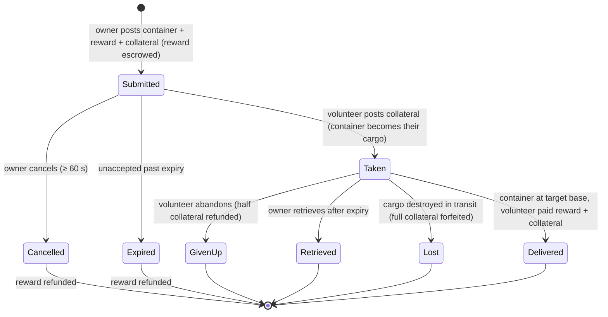

# Транспортировка (перевозка предметов)

**Задание на транспортировку** перемещает контейнер с предметами с одной базы на другую силами **перевозчика-добровольца**, получающего за это оплату. Это двусторонний рынок: **владелец** размещает груз, а **доброволец** берет его и доставляет.

> Расположение элементов интерфейса описано в [обзоре интерфейса клиента](/ru/features/ui/) (категория **Assignments** на верхней панели). Описанные ниже механики сверены с сервером.

## Две стороны

- **Владелец (заказчик)** — размещает груз: контейнер для перевозки с **исходной базы** на **целевую базу** за **награду**, с указанием **залога** и **срока действия**.
- **Доброволец (перевозчик)** — берет задание, перевозит контейнер и доставляет его.

## Размещение транспортировки (владелец)

**Создайте транспортировку**, указав:
- **контейнер** (оболочку с определенным объемом) для отправки,
- **награду**, выплачиваемую при доставке,
- **залог** (гарантийный взнос, вносимый перевозчиком),
- **исходную базу** и **целевую базу**,
- **срок действия** (в днях), в течение которого задание остается открытым.

При создании задания сумма **награды удерживается** с вашего счета (эскроу).

## Принятие транспортировки (доброволец)

- **Принять** задание — вы вносите **залог** в качестве гарантии, и контейнер переходит в ваш грузовой отсек.

## Доставка и возврат

- **Доставить** — привезите контейнер на целевую базу. По прибытии **добровольцу выплачиваются награда и залог**, а владелец получает свои предметы.
- **Отозвать** — владелец (или доброволец, в соответствующих случаях) возвращает контейнер обратно на базу; при отзыве **залог возвращается**, а **награда выплачивается обратно** владельцу.

## Отмена / отказ

- **Отменить** — отмена задания владельцем.
- **Отказаться** — доброволец отказывается от выполнения. При отказе применяется **штраф к залогу**: возвращается только **половина** залога (остальная часть сгорает) — константа штрафа равна 0.5 в `TransportAssignment.cs`.

## Просмотр информации

- **Список** транспортировок, **список содержимого** конкретной транспортировки, **информация о контейнере**, **статус выполнения (выполняется ли?)** и **журнал транспортировок**.

## Движение средств (краткий обзор)

**Награда** — это выплата владельца, которая резервируется (эскроу) при создании и выплачивается только при доставке.
**Залог** — это гарантийный взнос добровольца: выплачивается владельцу при принятии задания, удерживается во время транспортировки груза и возвращается (вместе с наградой) при доставке.

| Событие | Условие | Владелец | Доброволец | Контейнер |
|---|---|---|---|---|
| Размещение | — | награда зарезервирована (эскроу) | — | перемещен в хранилище транспортировки |
| Принятие | не принято | получает залог | выплачивает залог | становится грузом добровольца |
| Доставка | на целевой базе | предметы получены | выплачены **награда + залог** | доставлен |
| Отмена | не принято, прошло ≥ 60 с с момента создания | награда возвращена | — | обратно на исходную базу |
| Отказ | принято | награда возвращена | возвращена **половина** залога (штраф 0.5) | обратно на исходную базу |
| Истечение срока | не принято, срок действия истек | награда возвращена | — | обратно на исходную базу |
| Отзыв | принято **и** срок действия истек | награда возвращена | — | обратно на исходную базу (мгновенно, если перевозчик на станции, иначе при следующем доке добровольца) |
| Груз уничтожен | в пути | возвращена награда **+ полный залог** | полный залог конфискован | утрачен |

## Практические заметки

- **Без комиссий** — перемещаются только награда и залог.
- **Награда резервируется (эскроу)** — владелец не может потратить ее до завершения транспортировки.
- **Залог — это гарантия перевозчика** — его внесение позволяет вам взять груз; потеря груза в пути ведет к потере **всей** суммы залога.
- **Отказ стоит денег** — отказ от транспортировки лишает вас половины залога.
- **Срок действия важен, но только пока груз не взят** — срок, указанный при создании, автоматически закрывает только те задания, за которые никто не взялся (сервер очищает просроченные непринятые задания каждый час). **Принятое** задание само по себе никогда не истекает; запасным выходом для владельца является функция **Отозвать (Retrieve)**, которая становится доступна после истечения срока и возвращает груз (и награду) на исходную базу — мгновенно, если перевозчик находится в доке, или автоматически при следующем доке перевозчика.
- **Проверяйте содержимое перед принятием** — осматривайте, что находится в контейнере, и изучайте маршрут.

<!-- TODO: only the client UI remains (assignments screen layout).
     Money model confirmed: reward escrowed at submit (CashInOnSubmit), collateral paid
     by the volunteer on take (TakeCollateral -> PayCollateralToPrincipal), delivery pays
     volunteer reward+collateral (PayOutReward); cancel needs 60s after creation;
     expiry = submit time + client duration days (<=0 -> 1), cleaned hourly by
     MissionProcessor (_transportAssignmentInterval 1h), taken=0 only; retrieve requires
     expiry passed + taken, auto-completes on next dock; destroyed cargo refunds reward
     and forfeits full collateral to the owner.
     Developer notes: TransportAssignments/TransportAssignmentSubmit.cs;
     Services/MissionEngine/TransportAssignments/TransportAssignment.cs (reward/collateral
     escrow, PayOutReward = reward+collateral, PaybackCollateral, PaybackHalfCollateral
     = COLLATERAL_PENALTY on give-up, RetrieveToBasePublicContainer, expiry);
     TransportAssignmentTake/Deliver/Retrieve/Cancel/GiveUp/List/ListContent/
     ContainerInfo/Running/Log. -->