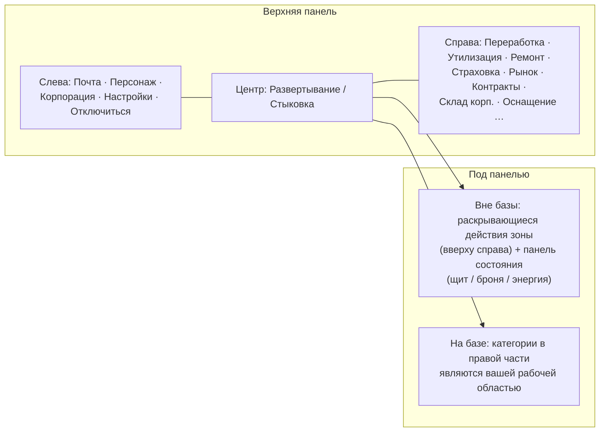

# Обзор интерфейса клиента

Клиент представляет собой интерфейс в **стиле EVE Online**: полноэкранный вид космоса/зоны с
плавающими, **изменяемыми по размеру и перемещаемыми окнами**, которые можно **закрывать и открывать заново** по желанию.
Взаимодействие организовано по подсистемам — см. страницы по ссылкам ниже.

> Этот макет представляет собой рабочую модель, предоставленную проектом, и используется для описания расположения действий.
> Точные названия экранов могут незначительно отличаться; структура служит ориентиром.

## Верхняя панель

Постоянная панель в верхней части экрана.

| Область | Содержимое |
|---|---|
| **Слева** | Основные кнопки: **Почта**, **Персонаж**, **Корпорация**, прочие **Настройки** и **Отключиться** |
| **Центр** | Кнопка **Развертывание / Стыковка** — ваш основной переключатель состояния «на базе ⇄ вне базы» (см. [перемещение](/ru/features/movement/)) |
| **Справа** | Категории действий в виде кнопок: **Переработка**, **Утилизация**, **Ремонт**, **Страховка**, **Рынок**, **Контракты** (перевозки), **Склад корп.**, **Оснащение**, … |

Категории в правой части открывают соответствующие системные окна:

| Кнопка | Открывает / делает | Страница вики |
|---|---|---|
| Переработка | Переработка сырья в компоненты | [производство](/ru/features/production/) |
| Утилизация | Разбор предметов на базовые материалы | [производство](/ru/features/production/) |
| Ремонт | Ремонт поврежденных роботов/модулей | [производство](/ru/features/production/) |
| Страховка | Страховые полисы на производство/роботов | [производство](/ru/features/production/) |
| Рынок | Рыночные ордера и прямые покупки | [рынок](/ru/features/market/) |
| Контракты | Транспортные контракты (перевозки) | [транспорт](/ru/features/transport/) |
| Склад корп. | Ангар / склад корпорации | [группы](/ru/features/groups/) |
| Оснащение | Установка модулей и боеприпасов на активного робота | [роботы](/ru/features/robots/) |

## Состояние на базе (Docked)

Находясь **на базе**, категории действий в правой части служат основным рабочим пространством: вы можете производить,
торговать, оснащать роботов и управлять хранилищем, не покидая базу. Кнопка «Развертывание» выводит вас
в зону (см. условия для вылета в разделе [перемещение](/ru/features/movement/)).

## Состояние вне базы (Undocked)

Находясь **вне базы** (управляя активным роботом в зоне):

- В **правом верхнем** углу появляется **кнопка раскрывающихся действий**: при нажатии на нее вниз разворачивается список
  дополнительных действий в зоне (сканирование, сбор/взаимодействие, инструменты зоны —
  действия, описанные в разделах [добыча](/ru/features/gathering/) и [бой](/ru/features/combat/)).
- **Основная панель состояния** отображает состояние вашего робота: **щит, броня/корпус, энергия**
  и сопутствующий боевой статус — те же данные, на которые ссылается страница [бой](/ru/features/combat/)
  (например, проверка «энергосистема не повреждена» перед вылетом).
- Категории, доступные только на базе (переработка, рынок, …), недоступны до тех пор, пока вы снова не пристыкуетесь.

## Стандартные окна

Большинство систем открываются в стандартном плавающем окне: заголовок, кнопка закрытия, изменяемые по размеру
границы, содержимое в виде вкладок или списков. Системы, поддерживающие множественные экземпляры (инвентарь/контейнеры, рынок, производственные
линии), могут иметь несколько открытых окон одновременно.

- **Инвентарь / контейнеры** — просмотр содержимого контейнера, перемещение/объединение в стопку/упаковка предметов, переименование, удаление —
  см. [предметы](/ru/features/items/).
- **Окно персонажа** (кнопка вверху слева) — профиль, модули расширения (исследования), настройки,
  кредиты — см. [начало работы](/ru/features/getting-started/) и [исследования](/ru/features/research/).
- **Окно корпорации** (кнопка вверху слева) — информация о корпорации, ангар, документы, голосования,
  доска объявлений — см. [группы](/ru/features/groups/).
- **Окно почты** (кнопка вверху слева) — личная и массовая рассылка — см. [социальные функции](/ru/features/social/).

## Соглашения, используемые в этой вики

- **«Верхняя панель → X»** = кнопка с названием X на верхней панели.
- **«Действия вне базы»** = раскрывающийся список в правом верхнем углу при нахождении в зоне.
- **Кнопка «Развертывание / Стыковка»** = центральный переключатель на верхней панели.

<!-- Примечание: эта страница представляет собой согласованную модель интерфейса (предоставленную проектом). Если реальный клиент
     отличается названиями кнопок или их расположением, сначала обновите эту страницу — все остальные
     страницы в features/ ссылаются на определенные здесь соглашения. -->