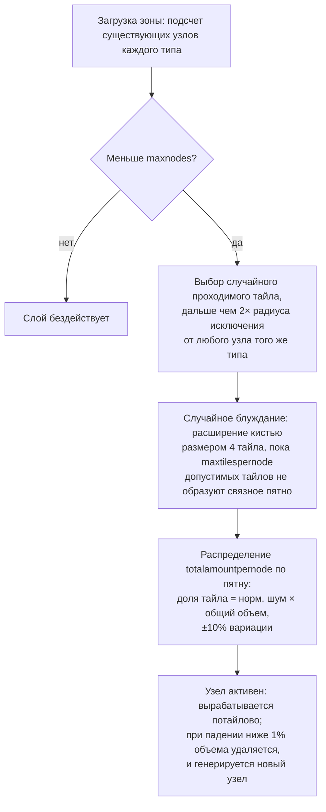

# Генерация ресурсов зоны

На этой странице объясняется, как сервер поддерживает запасы ресурсов в зоне. Обе
системы работают непрерывно в фоновом режиме, пока зона загружена; для их функционирования
не требуется никаких действий со стороны игрока.

## Конфигурация ресурсов зоны

Каждая зона настраивается в базе данных с помощью двух независимых списков:

- **Конфигурация руды** (`mineralconfigs`) — по одной строке для каждого типа руды,
  присутствующего в зоне, с четырьмя параметрами:
  | Колонка | Значение |
  |---|---|
  | `maxnodes` | Сколько узлов данного типа поддерживает зона |
  | `maxtilespernode` | Максимальное количество тайлов, которое может занимать один узел |
  | `totalamountpernode` | Общий объем материала в новом узле, распределенный по его тайлам |
  | `minthreshold` | Минимальный коэффициент заполнения тайла (0–1); тайлы ниже этого порога после выработки удаляются |
- **Конфигурация растений** (`zones.fertility` + набор правил растений) — целевой процент
  покрытия зоны растительностью и список видов растений, которым разрешено там расти
  (поведение каждого вида задается файлом правил, описанным в разделе
  [Растения](/ru/content/plants/)).

Зоны без конфигурации руды (арены, тренировочные зоны, твердыни, некоторые гамма-зоны)
вообще не имеют рудных слоев.

## Рудные узлы

### Как размещается узел

При загрузке зоны слой каждого типа руды подсчитывает свои существующие узлы (сохраненные
в таблице `mineralnodes`) и генерирует новые до достижения `maxnodes`. Новый узел
размещается методом **случайного блуждания** (random walk):

1. Выбирается случайный проходимый тайл.
2. Он должен находиться достаточно далеко от ближайшего существующего узла того же типа —
   радиус исключения рассчитывается из `maxtilespernode` (`√(maxtilespernode/π) × 2`,
   а начальная точка должна быть удалена как минимум на удвоенное расстояние), благодаря чему
   узлы никогда не сливаются в одно гигантское месторождение.
3. От начального тайла блуждание случайным образом распространяется наружу (кистью размером
   в 4 тайла за шаг), собирая до `maxtilespernode` допустимых тайлов в одно связное пятно.
4. Объем материала узла `totalamountpernode` распределяется по пятну: доля каждого тайла
   равна его (нормализованному) значению шума, умноженному на общий объем, со случайной
   вариацией ±10%, поэтому никакие два узла одного типа не выглядят одинаково.

Тайл считается допустимым для узла только в том случае, если он находится внутри зоны,
не является островом, не защищен от терраформирования базой PBS и проходим. Два редких
типа получают **запретные зоны** вокруг док-станций и телепортов: **эпритон** держит
минимальную дистанцию, а **флюкс-руда** (flux ore) — двойную дистанцию, поэтому флюкс-руда
никогда не встречается рядом с базой.

### Как вырабатывается узел

- Добыча извлекает материал тайл за тайлом.
- Узел, запасы которого опускаются ниже **1% от заданного объема**, удаляется, и генерируется
  новый узел (возврат к шагу 1) для поддержания в зоне количества `maxnodes`.
- Узлы флюкс-руды дополнительно вызывают **спавн NPC** — добыча (или удаление) узлов
  генерирует события, которые отслеживает система NPC, из-за чего места залегания
  флюкс-руды привлекают внимание врагов.

## Растения

### Сканирование растительности

Зона разделена на **области 32×32 тайла**. Обработчик растений обходит эти тайлы по порядку,
обрабатывая по одному за такт (tick), в темпе, при котором **полный проход по зоне занимает
около 8 часов** (значение может переопределяться для конкретной зоны). Каждый «куб» (cube)
32×32 обрабатывается фиксированным конвейером:

1. **Валидация** — удаление недопустимых растений (неподходящий грунт, мертвые, неуместные).
2. **Рост** — продвижение каждого растения по стадиям роста (см.
   [Сбор ресурсов](/ru/features/gathering/) касательно `growRate` и плодоношения).
3. **Спавн** — добавление новых растений там, где куб не достиг целевого уровня плодородия.
4. **Разрушение стен** — высота блокирования растений со временем уменьшается.
5. **Удаление по расстоянию** — соблюдение дистанции между растениями одного типа (`killDistance`).
6. **Возобновление материала** — регенерация небольшого количества материала плодов.

### Как выбирается новое растение

Тайл может прорасти только в том случае, если файл зоны дает ему **потенциал спавна**
(байт на тайл, заложенный в слой растений зоны; 0 означает, что тайл никогда не прорастет).
На каждом такте для каждого подходящего тайла:

- **Сначала проверка плодородия зоны**: если блокирующие растения куба уже покрывают
  `fertility%` его наземных тайлов, новые растения там не появляются.
- **Шанс для тайла**: случайный бросок должен превысить потенциал спавна тайла.
- **Выбор вида**:
  - Если у тайла **нет соседних растений**, вид выбирается взвешенным случайным выбором,
    где весом каждого разрешенного вида является его показатель `fertility` (высаживаемые
    игроками виды исключены из естественного спавна).
  - Если соседи **есть**, подбрасывается монетка: 50% шанс на текущий *доминирующий*
    соседний вид (наиболее распространенный поблизости), 50% на выбор по
    **распространению**, взвешенный как `(число соседей × spreading)` для каждого вида —
    именно поэтому скопления разрастаются особями собственного вида.
- **Лимиты и расстояния**: вид с ограничением `maxAmount` пропускается, если в зоне его уже
  достаточно, а тайл в пределах `killDistance` от другого растения того же вида также
  пропускается.

### Что это значит для игроков

- Плотность растений ограничена плодородием зоны — вы никогда не увидите зону со 100%
  покрытием растениями, если ее показатель плодородия равен 20.
- Скопления — это норма: распространение заставляет каждый вид расширять свои заросли,
  поэтому зона тяготеет к разделению на территории видов, а не к равномерному перемешиванию.
- Виды с ограничением `killDistance` (например, некоторые ценные растения) распределены
  равномерно, что делает их расположение предсказуемым после нахождения первого из них.
- Новые узлы появляются там, где завершилось случайное блуждание — в зоне нет фиксированных
  «месторождений»; требуется геосканирование (см.
  [Сбор ресурсов](/ru/features/gathering/)).

<!-- Developer notes: TerrainsModule.cs (per-zone layer construction: OreLayer for
     Solid, LiquidLayer for Liquid, GravelLayer for TrainingZone; LoadMineralNodes
     top-up); MineralLayer.cs (LoadMineralNodes: delete <1% nodes, generate to
     maxnodes; FluxOre -> OreNpcSpawnMessage on decrease/expiry);
     Generators/MineralNodeGeneratorBase.cs (FindStartPosition keep-out + spacing,
     NormalizeNoise, CreateMineralNode jitter); RandomWalkMineralNodeGenerator.cs
     (flood-fill brush 4, 50k step cap); MineralNodeRepository.cs (mineralnodes table,
     compressed per-tile values); PlantHandler.cs (32x32 areas, 8h full pass,
     PlantsGrowthTimerOverrideMin, scanner modes); NatureCube.cs (ProcessAll pipeline,
     SpawnPlants fertility/spawn/killDistance logic, GetNewPlantRule 50/50 ruling vs
     spreading); PlantRuleExtensions.cs (fertility-weighted + spreading-weighted
     draws); PlantInfo.cs (per-tile spawn byte comes from the zone's plant layer
     file, never assigned by server code). -->
