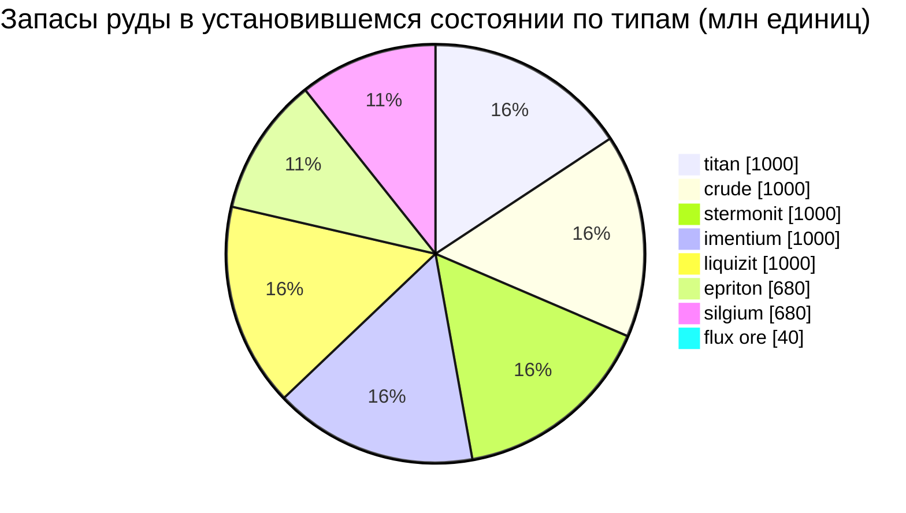

# Daoden (zone_ASI) — практический пример

  <a href="/ru/zones/map/">
    
    <strong>Карта мира</strong> — расположение этой зоны среди остальных вместе со связями телепортов. Открыть полную карту.
  </a>

Где находятся колонны телепортации этой зоны (точки с указанием пункта назначения — затемнены,
если колонна в данный момент отключена), точки прибытия телепортов из других зон
(пунктирные круги) и выходные врата (ромбы), где они существуют. Позиции представляют собой
координаты тайлов, зафиксированные сервером.
Пунктирные линии соединяют пары локальных (внутризонных) колонн телепортации.

Зона **открытого PvP** уровня альфа — богатейшая рудная конфигурация в игре и место,
где залегают редкие типы ресурсов. Здесь есть все, что есть в New Virginia, плюс эпритон,
силгиум и месторождения флюкс-руды, привлекающие атаки NPC.

| Параметр | Значение |
|---|---|
| ID зоны | 2 |
| Тип | PvP (открытая) |
| Защита | [Beta](/ru/zones/protection/) — открытое PvP, стандартный ландшафт |
| Размер | 2048 × 2048 тайлов |
| Плодородие | 20 |
| Набор правил растений | 2 — 19 видов (включая ценные собираемые растения) |
| Виды руд | 8 (titan, crude, stermonit, imentium, liquizit, epriton, silgium, flux ore) |
| Всего рудных узлов | 64 (по 8 каждого типа) |

## Конфигурация руды

| Материал | Узлы | Макс. тайлов/узел | Всего на узел | Мин. порог |
|---|---|---|---|---|
| [titan](/ru/content/ores/titan/) | 8 | 500 | 125,000,000 | 0.5 |
| [crude](/ru/content/ores/crude/) | 8 | 1257 | 125,000,000 | 0.5 |
| [stermonit](/ru/content/ores/stermonit/) | 8 | 500 | 125,000,000 | 0.5 |
| [imentium](/ru/content/ores/imentium/) | 8 | 500 | 125,000,000 | 0.5 |
| [liquizit](/ru/content/ores/liquizit/) | 8 | 500 | 125,000,000 | 0.5 |
| [epriton](/ru/content/ores/epriton/) | 8 | 500 | 85,000,000 | 0.5 |
| [silgium](/ru/content/ores/silgium/) | 8 | 500 | 85,000,000 | 0.5 |
| [fluxore](/ru/content/ores/fluxore/) | 8 | 300 | 5,000,000 | 0.5 |

Примечательные особенности:

- **В 8 раз больше узлов, чем в New Virginia**, но каждый узел меньше (500 тайлов против 1000):
  радиус обхода снижается с 34 до 24 тайлов для стандартных руд. Геосканирование здесь играет
  большую роль — месторождения тоньше и многочисленнее.
- **Эпритон и силгиум** имеют уменьшенные объемы (85 млн против 125 млн) — более высокая
  ценность, более редкие запасы. Эпритон дополнительно выдерживает **минимальную дистанцию
  от баз и телепортов**, поэтому его узлы никогда не располагаются в точке появления игроков.
- **Флюкс-руда — крайний случай**: всего 5 млн на узел на 300 тайлов (~16 600 на тайл —
  тонкая прослойка, а не залежь), 8 узлов и запретная зона, равная **удвоенной** дистанции
  эпритона от баз. Добыча флюкс-узла генерирует события спавна для системы NPC — зоны флюкса
  созданы быть спорными по своей сути (см.
  [Вторжения и системы NPC](/ru/features/intrusion/)).
- Запасы в установившемся состоянии: суммарно ~6,4 млрд единиц материала.

## Состав флоры

Набор правил 2 разрешает 19 видов — полный состав альфа-уровня: базовые растения плюс
**девринол**, **wall**, **titanplant** и **высокоуровневые собираемые растения** (высокие
electroplant, iron tree, rustbush, slimeroot). Плодородие по-прежнему равно 20, поэтому
плотность такая же, как в New Virginia — меняется лишь то, *какие именно* виды могут
выиграть выбор по плодородию. Веса `fertility` самих высокоуровневых растений определяют,
как часто они превосходят обычные травы при отборе.

Правила для каждого вида приведены в разделе [Растения](/ru/content/plants/);
выход продукции по типам руд — в разделе [Руды](/ru/content/ores/).

## Что это значит для игрока

- Доступна полная цепочка руд, включая экономику флюкс-руды — однако это открытое PvP,
  поэтому все добытое вами может быть отобрано (см. раздел о
  [транспортировке](/ru/features/transport/) для безопасной перевозки грузов между базами).
- Ожидайте давления со стороны NPC рядом с узлами флюкс-руды: система спавна реагирует на
  события добычи на этих узлах.
- Сбор растений здесь нацелен на высокоуровневые варианты, плоды которых ценнее, чем у
  низкоуровневых видов в стартовых зонах.

<!-- Developer notes: zones row id 2 (zonetype 2 = PvP, protected 0, fertility 20,
     plantruleset 2); mineralconfigs 8 rows (7 standard + fluxore 8/300/5M);
     MineralNodeGeneratorBase.KeepOutDist: Epriton = MINERAL_DISTANCE_FROM_BASE_MIN,
     FluxOre = 2x; MineralLayer.OnNodeDecrease/OnNodeExpired -> OreNpcSpawnMessage for
     FluxOre; plantrules rulesetid 2 = 19 files (4 harvestable, incl. devrinol and
     wall). -->
