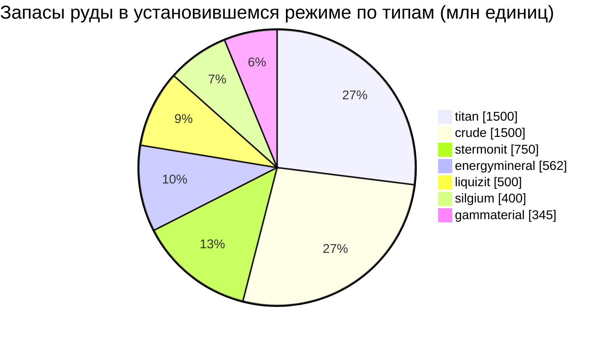

<!-- Generated by tools/generate from the live database (source: zones, mineralconfigs, plantrules, teleportdescriptions, strongholdexitconfig).
     Do not edit by hand; regenerate instead. -->
# Rhaoshan (zone_asi_g_1)

  <a href="/ru/zones/map/">
    
    <strong>Карта мира</strong> — расположение этой зоны среди всех остальных с телепортационными связями. Открыть полную карту.
  </a>

Расположение телепортационных колонн этой зоны (точки с указанием назначения — затемнены, если колонна отключена), точки прибытия телепортов из других зон (пунктирные круги) и выходные врата (ромбы) при их наличии. Координаты соответствуют данным сервера. Пунктирные линии соединяют пары локальных (внутризонных) телепортационных колонн.

Терраформируемый остров с открытым PvP (гамма) региона Daoden (ASI) — игроки могут изменять ландшафт. Здесь поддерживается 7 типов руды.

| Факт | Значение |
|---|---|
| ID зоны | 36 |
| Тип | PvP |
| Защита | [Gamma](/ru/zones/protection/) — открытое PvP, терраформируемая |
| Размер | 2048×2048 клеток |
| Плодородность | 20 |
| Виды растений | 17 (набор правил 4) |
| Типы руды | 7 |
| Всего рудных узлов | 55 |
| Макс. стыковочных баз | 100 |

## Конфигурация руды

Генерация узлов, поддерживаемая этой зоной. Выход ресурсов и формулы генерации описаны в разделе [Руды](/ru/content/ores/) (раздел этой зоны указан ниже).

| Материал | Узлы | Макс. клеток/узел | Всего на узел | Мин. порог |
|---|---|---|---|---|
| [titan](/ru/content/ores/titan/) | 10 | 707 | 150M | 0.5 |
| [crude](/ru/content/ores/crude/) | 6 | 1.257k | 250M | 0.5 |
| [stermonit](/ru/content/ores/stermonit/) | 8 | 314 | 93.75M | 0.5 |
| [liquizit](/ru/content/ores/liquizit/) | 5 | 1.257k | 100M | 0.5 |
| [silgium](/ru/content/ores/silgium/) | 8 | 314 | 50M | 0.5 |
| [gammaterial](/ru/content/ores/gammaterial/) | 3 | 707 | 115M | 0.5 |
| [energymineral](/ru/content/ores/energymineral/) | 15 | 350 | 37.5M | 0.5 |

[Индекс зон](/ru/zones/zone-index/) · [Карта мира](/ru/zones/map/#beta) · [Уровни защиты](/ru/zones/protection/)
