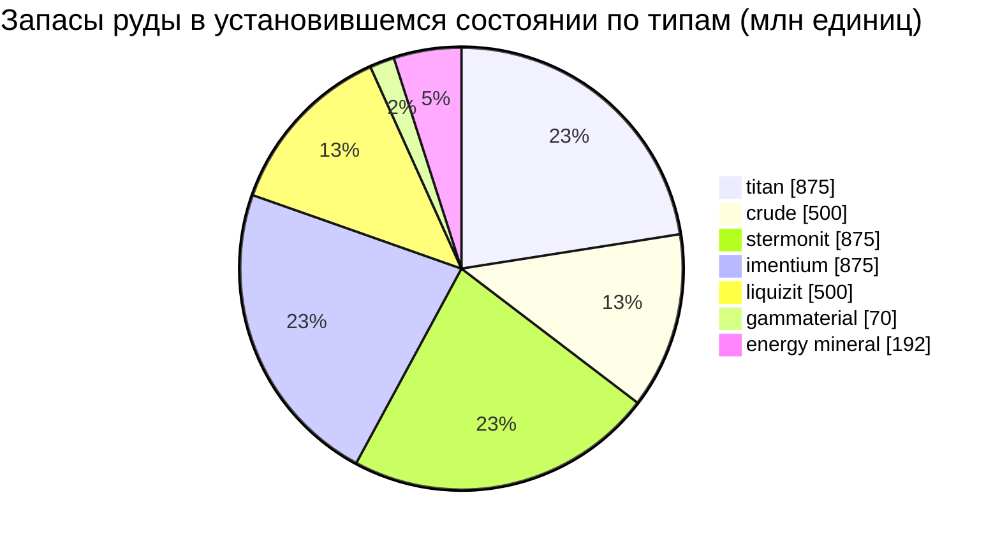

# zone_gamma_z106 — практический пример

  <a href="/ru/zones/map/">
    
    <strong>Карта мира</strong> — расположение этой зоны среди остальных вместе со связями телепортов. Открыть полную карту.
  </a>

Где находятся колонны телепортации этой зоны (точки с указанием пункта назначения — затемнены,
если колонна в данный момент отключена), точки прибытия телепортов из других зон
(пунктирные круги) и выходные врата (ромбы), где они существуют. Позиции представляют собой
координаты тайлов, зафиксированные сервером.

Высокоуровневая зона **открытого PvP**: терраформируемая, с низким плодородием, растениями
2-го ранга и более жесткой экономикой руды. Это формат зоны для финального этапа игры (эндгейма) —
меньше ресурсов и более ожесточенная борьба за них.

| Параметр | Значение |
|---|---|
| ID зоны | 106 |
| Тип | PvP (открытая) |
| Защита | [Gamma](/ru/zones/protection/) — открытое PvP, доступно терраформирование |
| Размер | 2048 × 2048 тайлов |
| Плодородие | 15 |
| Терраформируемая | да (технологический лимит PBS 2) |
| Набор правил растений | 22 — 17 видов («Gamma Plant Rules», смесь 2-го ранга) |
| Виды руд | 7 (titan, crude, stermonit, imentium, liquizit, gammaterial, energy mineral) |
| Всего рудных узлов | 44 |

## Конфигурация руды

| Материал | Узлы | Макс. тайлов/узел | Всего на узел | Мин. порог |
|---|---|---|---|---|
| [titan](/ru/content/ores/titan/) | 7 | 600 | 125,000,000 | 0.5 |
| [crude](/ru/content/ores/crude/) | 4 | 600 | 125,000,000 | 0.5 |
| [stermonit](/ru/content/ores/stermonit/) | 7 | 600 | 125,000,000 | 0.5 |
| [imentium](/ru/content/ores/imentium/) | 7 | 600 | 125,000,000 | 0.5 |
| [liquizit](/ru/content/ores/liquizit/) | 4 | 600 | 125,000,000 | 0.5 |
| [gammaterial](/ru/content/ores/gammaterial/) | 7 | 100 | 10,000,000 | 0.5 |
| [energymineral](/ru/content/ores/energymineral/) | 8 | 300 | 24,000,000 | 0.5 |

Примечательные особенности:

- **Меньше узлов, чем в альфа-зонах** (44 против 64 в Daoden): crude и liquizit сокращены
  до 4 узлов каждый. Объемы на узел такие же, как у стандартных альфа-руд, поэтому запасы
  в установившемся состоянии (~3,9 млрд единиц суммарно) скромнее и восстанавливаются медленнее.
- **Два экзотических типа**: **gammaterial** в крошечных узлах по 100 тайлов (радиус обхода
  10 тайлов — компактные, легко обнаруживаемые, ~1,4 млн на узел) и **energy mineral**
  по 24 млн на узел.
- Нет эпритона и флюкс-руды — редкие/экономические руды остаются прерогативой альфа-уровня.

## Состав флоры

Набор правил 22 разрешает 17 видов: базовые растения плюс **варианты 2-го ранга** — высокие
дикорастущие iron tree t2 и rustbush t2, а также **культивируемые растения 2-го ранга**
(высокие electroplant t2, slimeroot t2). Высаживаемые растения помечены флагом `playerSeeded` —
они **никогда** не появляются естественным путем, а существуют только в огородах игроков
(см. [сбор ресурсов → растения](/ru/features/gathering/)).

Плодородие составляет **15**, а не 20: куб 32×32 может содержать максимум ~15% блокирующих
растений, поэтому растительный покров заметно более разреженный, чем в альфа-зонах, а выбор
по плодородию имеет меньше пространства до того, как куб «насытится».

Правила для каждого вида (включая объемы плодов t2) приведены в разделе
[Растения](/ru/content/plants/); выход продукции по типам руд — в разделе
[Руды](/ru/content/ores/).

## Что это значит для игрока

- Более скупая и медленная экономика: меньшее количество узлов обычных руд означает, что давление
  добычи сказывается быстрее — выработанный узел нефти (crude) дольше возрождается зоной.
- Разреженная растительность: при плодородии 15% открытая местность является нормой, а островки
  растений — исключением.
- Высокодоходный сбор здесь сосредоточен на дикорастущих iron tree / rustbush 2-го ранга, а также
  на ведении огородов с культивируемыми t2 electroplant и slimeroot.
- Терраформирование (технологический лимит PBS 2) означает, что игроки могут изменять сам ландшафт
  (см. [Полевые базы PBS](/ru/features/pbs/)).

<!-- Developer notes: zones row id 106 (zonetype 2 = PvP, protected 0, fertility 15,
     terraformable 1, pbsTechLimit 2, plantruleset 22); mineralconfigs 7 rows (crude
     and liquizit 4 nodes each); plantrules rulesetid 22 = 17 files, note "Gamma
     Plant Rules"; electroplant_seeded_t2.txt / slimeroot_seeded_t2.txt set
     playerSeeded=n1 (inherited via source= from electroplant_hi.txt /
     slimeroot_hi.txt) -> excluded from natural spawns in
     PlantRuleExtensions.GetWinnerPlantTypeBasedOnFertility. -->
