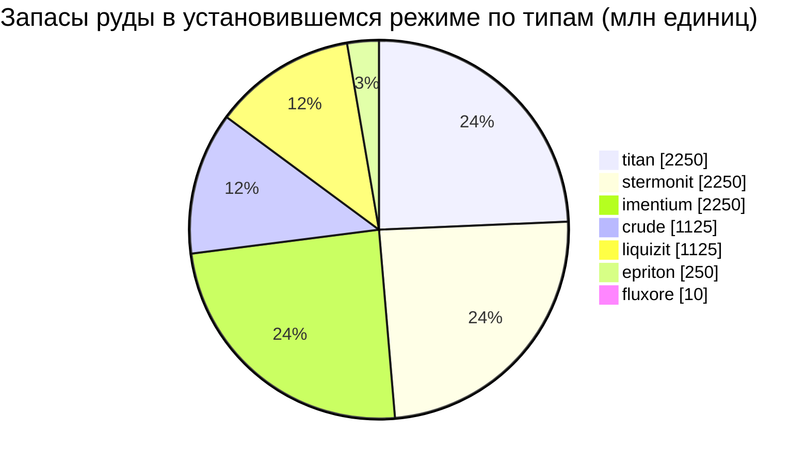

<!-- Generated by tools/generate from the live database (source: zones, mineralconfigs, plantrules, teleportdescriptions, strongholdexitconfig).
     Do not edit by hand; regenerate instead. -->
# zone_gamma_z110

  <a href="/ru/zones/map/">
    
    <strong>Карта мира</strong> — расположение этой зоны среди всех остальных с телепортационными связями. Открыть полную карту.
  </a>

Расположение телепортационных колонн этой зоны (точки с указанием назначения — затемнены, если колонна отключена), точки прибытия телепортов из других зон (пунктирные круги) и выходные врата (ромбы) при их наличии. Координаты соответствуют данным сервера.

Остров с открытым PvP (бета) региона frontier belt — игроки могут свободно атаковать, действуют блобы. Здесь поддерживается 7 типов руды.

| Факт | Значение |
|---|---|
| ID зоны | 110 |
| Тип | PvP |
| Защита | [Beta](/ru/zones/protection/) — открытое PvP, стандартная местность |
| Размер | 2048×2048 клеток |
| Уровень (Tier) | T0 (по данным сервера) |
| Плодородность | 15 |
| Виды растений | 15 (набор правил 20) |
| Типы руды | 7 |
| Всего рудных узлов | 47 |
| Технологический лимит PBS | 0 |
| Макс. стыковочных баз | нет |

## Конфигурация руды

Генерация узлов, поддерживаемая этой зоной. Выход ресурсов и формулы генерации описаны в разделе [Руды](/ru/content/ores/) (раздел этой зоны указан ниже).

| Материал | Узлы | Макс. клеток/узел | Всего на узел | Мин. порог |
|---|---|---|---|---|
| [titan](/ru/content/ores/titan/) | 10 | 600 | 225M | 0.5 |
| [crude](/ru/content/ores/crude/) | 5 | 600 | 225M | 0.5 |
| [stermonit](/ru/content/ores/stermonit/) | 10 | 600 | 225M | 0.5 |
| [imentium](/ru/content/ores/imentium/) | 10 | 600 | 225M | 0.5 |
| [liquizit](/ru/content/ores/liquizit/) | 5 | 600 | 225M | 0.5 |
| [epriton](/ru/content/ores/epriton/) | 5 | 300 | 50M | 0.5 |
| [fluxore](/ru/content/ores/fluxore/) | 2 | 200 | 5M | 0.5 |

[Индекс зон](/ru/zones/zone-index/) · [Карта мира](/ru/zones/map/#t1) · [Уровни защиты](/ru/zones/protection/)
