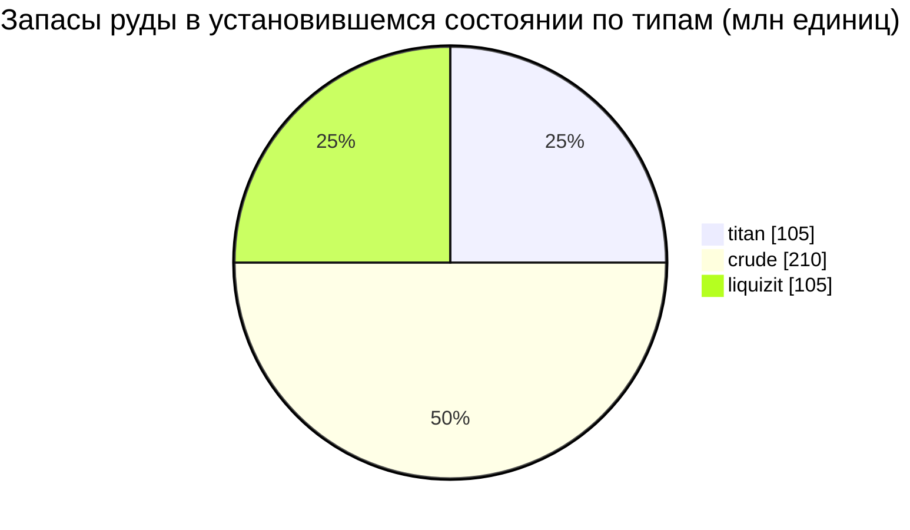

# New Virginia (zone_TM) — практический пример

  <a href="/ru/zones/map/">
    
    <strong>Карта мира</strong> — расположение этой зоны среди остальных вместе со связями телепортов. Открыть полную карту.
  </a>

Где находятся колонны телепортации этой зоны (точки с указанием пункта назначения — затемнены,
если колонна в данный момент отключена), точки прибытия телепортов из других зон
(пунктирные круги) и выходные врата (ромбы), где они существуют. Позиции представляют собой
координаты тайлов, зафиксированные сервером.
Пунктирные линии соединяют пары локальных (внутризонных) колонн телепортации.

Низкоуровневая **защищенная PvE-зона** — безопасное место, где новые персонажи занимаются
сбором ресурсов. Ее конфигурация демонстрирует самый простой край спектра: мало видов руды,
крупные узлы и базовый набор растений.

| Параметр | Значение |
|---|---|
| ID зоны | 0 |
| Тип | PvE (защищенная) |
| Защита | [Alpha](/ru/zones/protection/) — защищенная, PvP отключено |
| Размер | 2048 × 2048 тайлов |
| Плодородие | 20 |
| Набор правил растений | 0 — 15 видов (базовый набор «tm pve») |
| Виды руд | 3 (titan, crude, liquizit) |
| Всего рудных узлов | 21 (по 7 каждого типа) |

## Конфигурация руды

| Материал | Узлы | Макс. тайлов/узел | Всего на узел | Мин. порог |
|---|---|---|---|---|
| [titan](/ru/content/ores/titan/) | 7 | 1000 | 15,000,000 | 0.5 |
| [crude](/ru/content/ores/crude/) | 7 | 1257 | 30,000,000 | 0.5 |
| [liquizit](/ru/content/ores/liquizit/) | 7 | 1000 | 15,000,000 | 0.5 |

Примечательные особенности:

- **Крупные, рассредоточенные узлы** — от 1000 до 1257 тайлов каждый (радиус обхода
  `(int)√(tiles/π)×2` = 34–40 тайлов), поэтому каждый узел представляет собой большое пятно,
  и в зоне поддерживается лишь по 7 узлов каждого типа. Запасы в установившемся состоянии
  составляют суммарно ~420 млн единиц материала (105 млн titan + 210 млн crude + 105 млн liquizit).
- **Отсутствие редких типов** — нет эпритона и флюкс-руды, поэтому вокруг баз нет запретных
  зон и нет месторождений, провоцирующих атаки NPC.
- `minthreshold` 0.5 означает, что тайл пригоден для добычи только в том случае, если заполнение
  шумом в нем составляет не менее половины от максимума — края каждого пятна тонкие.

Выход продукции по типам (во что перерабатывается одна единица каждой руды и формулы генерации
узлов, стоящие за приведенными выше числами) приведен в разделе [Руды](/ru/content/ores/).

## Состав флоры

Набор правил 0 разрешает 15 видов — базовый стартовый набор: трава (a/b), сосна,
кустарники (a/b), ранго, медное дерево, тростник, нанопшеница, низкоуровневые rustbush /
slimeroot / electroplant, бонсай и низкоуровневое железное дерево. Никаких стен, никакого
девринола и никаких ценных высокоуровневых растений.

При плодородии 20 куб 32×32 может содержать максимум ~20% блокирующих растений; по всей карте
2048×2048 это дает верхнюю границу примерно в 838 000 тайлов растений (на практике меньше —
вода и острова не являются сушей). Выбор видов взвешивается по показателю `fertility` каждого
правила, поэтому доминируют базовые травы и кустарники, а низкоуровневые собираемые растения
остаются редкими.

Полные правила для каждого вида (growRate, плоды, запас прочности) приведены в разделе
[Растения](/ru/content/plants/).

## Что это значит для игрока

- Безопасная стартовая экономика: три распространенные руды в крупных, легко сканируемых пятнах.
- Доступные здесь собираемые растения относятся к низкоуровневым вариантам — ценные виды
  (высокоуровневые electroplant / iron tree / rustbush / slimeroot) появляются в более поздних
  зонах.
- Поскольку зона защищена, риск PvP — единственное, что отсутствует в процессе сбора ресурсов
  (см. [перемещение](/ru/features/movement/) касательно входа в зону).

<!-- Developer notes: zones row id 0 (zonetype 1 = PvE, protected 1, fertility 20,
     plantruleset 0); mineralconfigs 3 rows (titan/crude/liquizit, 7 nodes each);
     plantrules rulesetid 0 = 15 files, note "tm pve". Node radius formula and
     threshold semantics: see generation.md. -->
