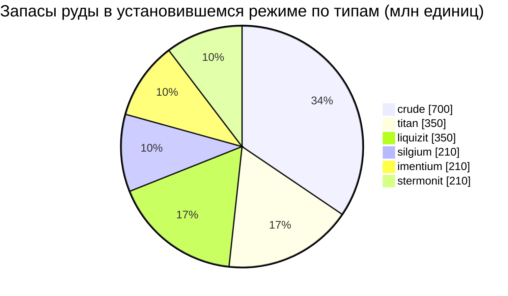

<!-- Generated by tools/generate from the live database (source: zones, mineralconfigs, plantrules, teleportdescriptions, strongholdexitconfig).
     Do not edit by hand; regenerate instead. -->
# Hershfield (zone_TM_pve)

  <a href="/ru/zones/map/">
    
    <strong>Карта мира</strong> — расположение этой зоны среди всех остальных с телепортационными связями. Открыть полную карту.
  </a>

Расположение телепортационных колонн этой зоны (точки с указанием назначения — затемнены, если колонна отключена), точки прибытия телепортов из других зон (пунктирные круги) и выходные врата (ромбы) при их наличии. Координаты соответствуют данным сервера. Пунктирные линии соединяют пары локальных (внутризонных) телепортационных колонн.

Защищенная зона (Alpha) региона New Virginia (TM) — безопасна от атак игроков, стандартная область сбора ресурсов галактики New Virginia (TM). Здесь поддерживается 6 типов руды.

| Факт | Значение |
|---|---|
| ID зоны | 8 |
| Тип | PvE |
| Защита | [Alpha](/ru/zones/protection/) — защищенная, PvP отключено |
| Размер | 2048×2048 клеток |
| Плодородность | 20 |
| Виды растений | 15 (набор правил 0) |
| Типы руды | 6 |
| Всего рудных узлов | 42 |
| Макс. стыковочных баз | нет |

## Конфигурация руды

Генерация узлов, поддерживаемая этой зоной. Выход ресурсов и формулы генерации описаны в разделе [Руды](/ru/content/ores/) (раздел этой зоны указан ниже).

| Материал | Узлы | Макс. клеток/узел | Всего на узел | Мин. порог |
|---|---|---|---|---|
| [titan](/ru/content/ores/titan/) | 7 | 750 | 50M | 0.5 |
| [crude](/ru/content/ores/crude/) | 7 | 750 | 100M | 0.5 |
| [stermonit](/ru/content/ores/stermonit/) | 7 | 750 | 30M | 0.5 |
| [imentium](/ru/content/ores/imentium/) | 7 | 750 | 30M | 0.5 |
| [liquizit](/ru/content/ores/liquizit/) | 7 | 750 | 50M | 0.5 |
| [silgium](/ru/content/ores/silgium/) | 7 | 750 | 30M | 0.5 |

[Индекс зон](/ru/zones/zone-index/) · [Карта мира](/ru/zones/map/#alpha) · [Уровни защиты](/ru/zones/protection/)
