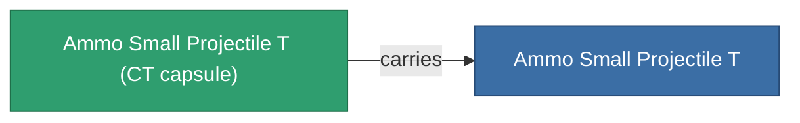

<!-- Generated by tools/generate from the live database (source: entitydefaults definition 5924, aggregatevalues via aggregatefields).
     Do not edit by hand; regenerate instead. -->

# Ammo Small Projectile T

|  |  |
|---|---|
| 定义 | `def_ammo_small_projectile_t` |
| 阶级 | – |
| 耐久 | 100 |
| 容量 | 0.5 |
| 质量 | 0.1 |
| 分类 | Ammo / Projectiles |
| 备注 | toxic ammo small |

## 统计

| 字段 | 值 |
|---|---|
| damage_chemical | 6 |
| damage_explosive | 1 |
| damage_kinetic | 1 |
| damage_thermal | 1 |
| damage_toxic | 20 |

## 运输舱

A transport capsule (CT) exists for this item — it is how the item moves between players and zones.

<!-- production:generated -->
## 生产

**由组件 5个生产** — 组装组件来制造它（完整列表见[配方](/zh-CN/content/recipes/)）:

**蓝图:** [Ammo Small Projectile T Cprg](/zh-CN/content/items/ammo-small-projectile-t-cprg/)

<svg class="prod-card-icon" aria-hidden="true"><use href="#mi-grid"/></svg><a class="prod-card-name" href="/zh-CN/content/items/axicoline/">Axicoline</a>

需要: <b>100</b>

<svg class="prod-card-icon" aria-hidden="true"><use href="#mi-grid"/></svg><a class="prod-card-name" href="/zh-CN/content/items/phlobotil/">Phlobotil</a>

需要: <b>100</b>

<svg class="prod-card-icon" aria-hidden="true"><use href="#mi-grid"/></svg><a class="prod-card-name" href="/zh-CN/content/items/polynitrocol/">Polynitrocol</a>

需要: <b>100</b>

<svg class="prod-card-icon" aria-hidden="true"><use href="#mi-grid"/></svg><a class="prod-card-name" href="/zh-CN/content/items/polynucleit/">Polynucleit</a>

需要: <b>100</b>

<svg class="prod-card-icon" aria-hidden="true"><use href="#mi-grid"/></svg><a class="prod-card-name" href="/zh-CN/content/items/titanium/">Titanium</a>

需要: <b>100</b>

