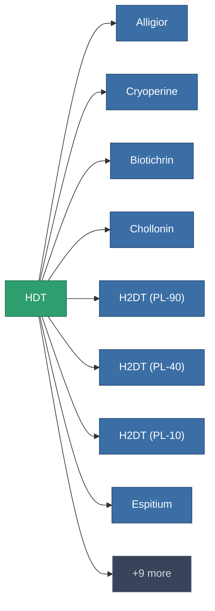

<!-- Generated by tools/generate from the live database (source: entitydefaults definition 170, aggregatevalues via aggregatefields).
     Do not edit by hand; regenerate instead. -->

# HDT

|  |  |
|---|---|
| 定义 | `def_crude` |
| 阶级 | – |
| 耐久 | 100 |
| 容量 | 0 |
| 质量 | 0.02 |
| 分类 | Materials |

_无统计 — 此物品没有聚合值。_

<!-- production:generated -->
## 用于生产

**17个物品的组件** — 使用它可以生产的内容示例（完整列表见[配方](/zh-CN/content/recipes/)）。

