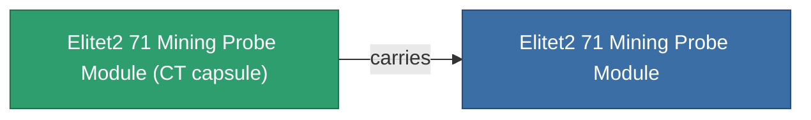

<!-- Generated by tools/generate from the live database (source: entitydefaults definition 6050, aggregatevalues via aggregatefields).
     Do not edit by hand; regenerate instead. -->

# Elitet2 71 Mining Probe Module

|  |  |
|---|---|
| 定义 | `def_elitet2_71_mining_probe_module` |
| 阶级 | T2 (special) |
| 耐久 | 100 |
| 容量 | 0.5 |
| 质量 | 135 |
| 分类 | Modules / Enhancements |
| 备注 | elite module |

## 统计

| 字段 | 值 |
|---|---|
| core_usage | 45 |
| cpu_usage | 38 |
| cycle_time | 15k |
| mining_probe_accuracy | 0.6 |
| powergrid_usage | 43 |
| stealth_strength | 10 |

## 运输舱

A transport capsule (CT) exists for this item — it is how the item moves between players and zones.

## 购买地点

Fixed-price vendors that sell this item (see the [Item shop](/zh-CN/content/shop/) for the full catalog).

| Vendor | Qty | Credits | UniCoin |
|---|---|---|---|
| Daoden outpost | ∞ | 250M | 10k |

<!-- production:generated -->
## 生产

**由组件 2个生产** — 组装组件来制造它（完整列表见[配方](/zh-CN/content/recipes/)）:

**蓝图:** [Elitet2 71 Mining Probe Module Cprg](/content/items/elitet2-71-mining-probe-module-cprg/)

<svg class="prod-card-icon" aria-hidden="true"><use href="#mi-grid"/></svg><a class="prod-card-name" href="/zh-CN/content/items/material-boss-z71/">Material Boss Z71</a>

需要: <b>300</b>

<svg class="prod-card-icon" aria-hidden="true"><use href="#mi-grid"/></svg><a class="prod-card-name" href="/zh-CN/content/items/named1-mining-probe-module/">Ovostec-Chisomel geoscanner</a>

需要: <b>1</b>

