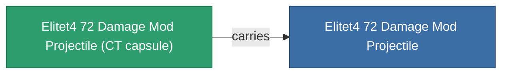

<!-- Generated by tools/generate from the live database (source: entitydefaults definition 6053, aggregatevalues via aggregatefields).
     Do not edit by hand; regenerate instead. -->

# Elitet4 72 Damage Mod Projectile

|  |  |
|---|---|
| 定义 | `def_elitet4_72_damage_mod_projectile` |
| 阶级 | T4 (special) |
| 耐久 | 100 |
| 容量 | 0.5 |
| 质量 | 100 |
| 分类 | Modules / Enhancements |
| 备注 | elite module |

## 统计

| 字段 | 值 |
|---|---|
| cpu_usage | 15 |
| damage_projectile_modifier | 0.25 |
| powergrid_usage | 5 |
| projectile_falloff_modifier | 1.05 |
| projectile_optimal_range_modifier | 1.025 |

## 运输舱

A transport capsule (CT) exists for this item — it is how the item moves between players and zones.

## 购买地点

Fixed-price vendors that sell this item (see the [Item shop](/zh-CN/content/shop/) for the full catalog).

| Vendor | Qty | Credits | UniCoin |
|---|---|---|---|
| Daoden outpost | ∞ | 500M | 25k |

<!-- production:generated -->
## 生产

**由组件 2个生产** — 组装组件来制造它（完整列表见[配方](/zh-CN/content/recipes/)）:

**蓝图:** [Elitet4 72 Damage Mod Projectile Cprg](/zh-CN/content/items/elitet4-72-damage-mod-projectile-cprg/)

<svg class="prod-card-icon" aria-hidden="true"><use href="#mi-grid"/></svg><a class="prod-card-name" href="/zh-CN/content/items/material-boss-z72/">Material Boss Z72</a>

需要: <b>400</b>

<svg class="prod-card-icon" aria-hidden="true"><use href="#mi-panel"/></svg><a class="prod-card-name" href="/zh-CN/content/items/named3-damage-mod-projectile/">DVT-800g firearm tuning</a>

需要: <b>1</b>

