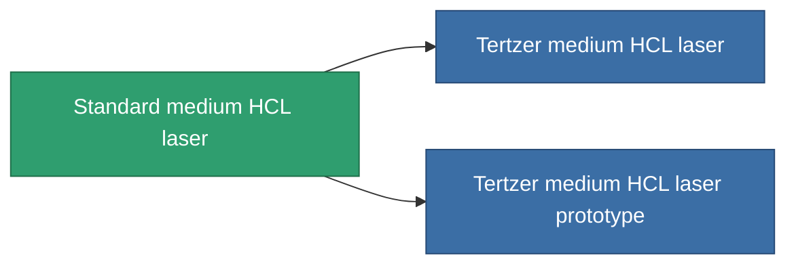

<!-- Generated by tools/generate from the live database (source: entitydefaults definition 1002, aggregatevalues via aggregatefields).
     Do not edit by hand; regenerate instead. -->

# Standard medium HCL laser

|  |  |
|---|---|
| 定义 | `def_longrange_standard_medium_laser` |
| 阶级 | T1 |
| 耐久 | 100 |
| 容量 | 1 |
| 质量 | 650 |
| 分类 | Modules / Weapons |

## 统计

| 字段 | 值 |
|---|---|
| accuracy | 12 |
| core_usage | 20 |
| cpu_usage | 30 |
| cycle_time | 6k |
| damage_modifier | 1 |
| falloff | 10 |
| least_optimal | 11 |
| optimal_range | 35 |
| powergrid_usage | 230 |

<!-- production:generated -->
## 生产

**由组件 5个生产 ，研究等级 4** — 组装组件来制造它（完整列表见[配方](/zh-CN/content/recipes/)）:

**蓝图:** [Standard medium HCL laser CT](/content/items/longrange-standard-medium-laser-cprg/)

<svg class="prod-card-icon" aria-hidden="true"><use href="#mi-grid"/></svg><a class="prod-card-name" href="/zh-CN/content/items/axicol/">Cryoperine</a>

需要: <b>50</b>

<svg class="prod-card-icon" aria-hidden="true"><use href="#mi-grid"/></svg><a class="prod-card-name" href="/zh-CN/content/items/axicoline/">Axicoline</a>

需要: <b>100</b>

<svg class="prod-card-icon" aria-hidden="true"><use href="#mi-grid"/></svg><a class="prod-card-name" href="/zh-CN/content/items/polynucleit/">Polynucleit</a>

需要: <b>100</b>

<svg class="prod-card-icon" aria-hidden="true"><use href="#mi-grid"/></svg><a class="prod-card-name" href="/zh-CN/content/items/prilumium/">Prilumium</a>

需要: <b>50</b>

<svg class="prod-card-icon" aria-hidden="true"><use href="#mi-grid"/></svg><a class="prod-card-name" href="/zh-CN/content/items/titanium/">Titanium</a>

需要: <b>100</b>

## 用于生产

**2个物品的组件** — 所有在制造中使用它的物品:

