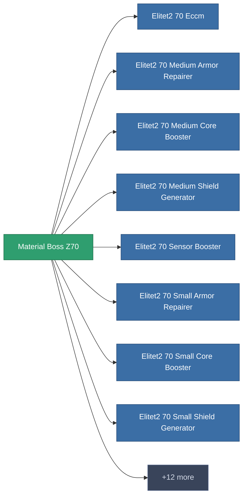

<!-- Generated by tools/generate from the live database (source: entitydefaults definition 5995, aggregatevalues via aggregatefields).
     Do not edit by hand; regenerate instead. -->

# Material Boss Z70

|  |  |
|---|---|
| 定义 | `def_material_boss_z70` |
| 阶级 | – |
| 耐久 | 100 |
| 容量 | 0.01 |
| 质量 | 0.5 |
| 分类 | Materials |
| 备注 | elite module |

_无统计 — 此物品没有聚合值。_

<!-- production:generated -->
## 用于生产

**20个物品的组件** — 使用它可以生产的内容示例（完整列表见[配方](/zh-CN/content/recipes/)）。

