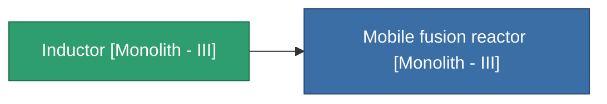

<!-- Generated by tools/generate from the live database (source: entitydefaults definition 5001, aggregatevalues via aggregatefields).
     Do not edit by hand; regenerate instead. -->

# Inductor [Monolith - III]

|  |  |
|---|---|
| 定义 | `def_missionitem_asi_i_level05_exp3_03_t05` |
| 阶级 | – |
| 耐久 | 100 |
| 容量 | 1 |
| 质量 | 50 |
| 分类 | Mission items |

_无统计 — 此物品没有聚合值。_

<!-- production:generated -->
## 用于生产

**1个物品的组件** — 所有在制造中使用它的物品:

