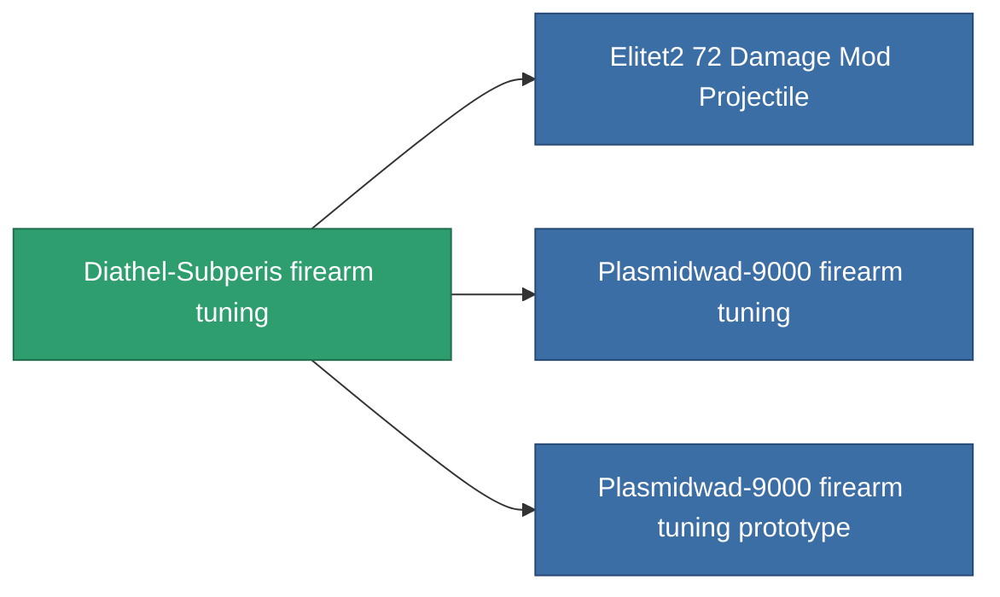

<!-- Generated by tools/generate from the live database (source: entitydefaults definition 933, aggregatevalues via aggregatefields).
     Do not edit by hand; regenerate instead. -->

# Diathel-Subperis firearm tuning

|  |  |
|---|---|
| 定义 | `def_named1_damage_mod_projectile` |
| 阶级 | T2 |
| 耐久 | 100 |
| 容量 | 0.5 |
| 质量 | 90 |
| 分类 | Modules / Enhancements |
| Tier line | [Standard firearm tuning](/zh-CN/content/items/standard-damage-mod-projectile/) (T1) → **Diathel-Subperis firearm tuning** (T2) → [Plasmidwad-9000 firearm tuning](/zh-CN/content/items/named2-damage-mod-projectile/) (T3) → [DVT-800g firearm tuning](/zh-CN/content/items/named3-damage-mod-projectile/) (T4) |

## 统计

| 字段 | 值 |
|---|---|
| cpu_usage | 14 |
| damage_projectile_modifier | 0.15 |
| powergrid_usage | 4 |

<!-- production:generated -->
## 生产

**由组件 5个生产 ，研究等级 4** — 组装组件来制造它（完整列表见[配方](/zh-CN/content/recipes/)）:

**蓝图:** [Diathel-Subperis firearm tuning CT](/zh-CN/content/items/named1-damage-mod-projectile-cprg/)

<svg class="prod-card-icon" aria-hidden="true"><use href="#mi-grid"/></svg><a class="prod-card-name" href="/zh-CN/content/items/axicol/">Cryoperine</a>

需要: <b>200</b>

<svg class="prod-card-icon" aria-hidden="true"><use href="#mi-grid"/></svg><a class="prod-card-name" href="/zh-CN/content/items/axicoline/">Axicoline</a>

需要: <b>100</b>

<svg class="prod-card-icon" aria-hidden="true"><use href="#mi-crystal"/></svg><a class="prod-card-name" href="/zh-CN/content/items/robotshard-common-basic/">Damaged common fragment</a>

需要: <b>30</b>

<svg class="prod-card-icon" aria-hidden="true"><use href="#mi-panel"/></svg><a class="prod-card-name" href="/zh-CN/content/items/standard-damage-mod-projectile/">Standard firearm tuning</a>

需要: <b>1</b>

<svg class="prod-card-icon" aria-hidden="true"><use href="#mi-grid"/></svg><a class="prod-card-name" href="/zh-CN/content/items/titanium/">Titanium</a>

需要: <b>100</b>

## 用于生产

**3个物品的组件** — 所有在制造中使用它的物品:

