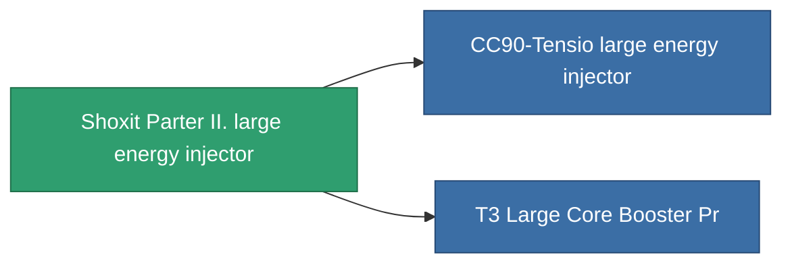

<!-- Generated by tools/generate from the live database (source: entitydefaults definition 828, aggregatevalues via aggregatefields).
     Do not edit by hand; regenerate instead. -->

# Shoxit Parter II. large energy injector

|  |  |
|---|---|
| 定义 | `def_named1_large_core_booster` |
| 阶级 | T2 |
| 耐久 | 100 |
| 容量 | 2 |
| 质量 | 1440 |
| 分类 | Modules / Enhancements |
| Tier line | [Standard large energy injector](/zh-CN/content/items/standard-large-core-booster/) (T1) → **Shoxit Parter II. large energy injector** (T2) → [CC90-Tensio large energy injector](/zh-CN/content/items/named2-large-core-booster/) (T3) → [Rymur DTTO large energy injector](/zh-CN/content/items/named3-large-core-booster/) (T4) |

## 统计

| 字段 | 值 |
|---|---|
| core_usage | 0 |
| cpu_usage | 345 |
| cycle_time | 6.05k |
| powergrid_usage | 1.125k |

<!-- production:generated -->
## 生产

**由组件 5个生产** — 组装组件来制造它（完整列表见[配方](/zh-CN/content/recipes/)）:

**蓝图:** [T2 Large Core Booster Cprg](/content/items/named1-large-core-booster-cprg/)

<svg class="prod-card-icon" aria-hidden="true"><use href="#mi-grid"/></svg><a class="prod-card-name" href="/zh-CN/content/items/axicol/">Cryoperine</a>

需要: <b>600</b>

<svg class="prod-card-icon" aria-hidden="true"><use href="#mi-crystal"/></svg><a class="prod-card-name" href="/zh-CN/content/items/robotshard-common-basic/">Damaged common fragment</a>

需要: <b>90</b>

<svg class="prod-card-icon" aria-hidden="true"><use href="#mi-grid"/></svg><a class="prod-card-name" href="/zh-CN/content/items/specimen-sap-item-flux/">Specimen Sap Item Flux</a>

需要: <b>5</b>

<svg class="prod-card-icon" aria-hidden="true"><use href="#mi-grid"/></svg><a class="prod-card-name" href="/zh-CN/content/items/standard-large-core-booster/">Standard large energy injector</a>

需要: <b>1</b>

<svg class="prod-card-icon" aria-hidden="true"><use href="#mi-grid"/></svg><a class="prod-card-name" href="/zh-CN/content/items/titanium/">Titanium</a>

需要: <b>300</b>

## 用于生产

**2个物品的组件** — 所有在制造中使用它的物品:

