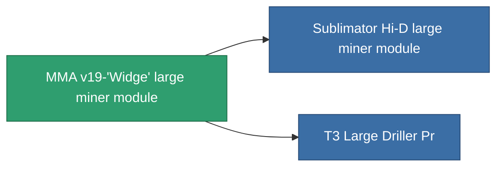

<!-- Generated by tools/generate from the live database (source: entitydefaults definition 8680, aggregatevalues via aggregatefields).
     Do not edit by hand; regenerate instead. -->

# MMA v19-'Widge' large miner module

|  |  |
|---|---|
| 定义 | `def_named1_large_driller` |
| 阶级 | T2 |
| 耐久 | 100 |
| 容量 | 2.5 |
| 质量 | 1500 |
| 分类 | Modules / Enhancements |
| Tier line | [Standard large miner module](/zh-CN/content/items/standard-large-driller/) (T1) → **MMA v19-'Widge' large miner module** (T2) → [Sublimator Hi-D large miner module](/zh-CN/content/items/named2-large-driller/) (T3) → [Pellex large miner module](/zh-CN/content/items/named3-large-driller/) (T4) |

## 统计

| 字段 | 值 |
|---|---|
| core_usage | 135 |
| cpu_usage | 432 |
| cycle_time | 12k |
| powergrid_usage | 1.215k |

<!-- production:generated -->
## 生产

**由组件 4个生产** — 组装组件来制造它（完整列表见[配方](/zh-CN/content/recipes/)）:

**蓝图:** [T2 Large Driller Cprg](/zh-CN/content/items/named1-large-driller-cprg/)

<svg class="prod-card-icon" aria-hidden="true"><use href="#mi-grid"/></svg><a class="prod-card-name" href="/zh-CN/content/items/axicol/">Cryoperine</a>

需要: <b>600</b>

<svg class="prod-card-icon" aria-hidden="true"><use href="#mi-crystal"/></svg><a class="prod-card-name" href="/zh-CN/content/items/robotshard-common-basic/">Damaged common fragment</a>

需要: <b>120</b>

<svg class="prod-card-icon" aria-hidden="true"><use href="#mi-panel"/></svg><a class="prod-card-name" href="/zh-CN/content/items/standard-large-driller/">Standard large miner module</a>

需要: <b>1</b>

<svg class="prod-card-icon" aria-hidden="true"><use href="#mi-grid"/></svg><a class="prod-card-name" href="/zh-CN/content/items/titanium/">Titanium</a>

需要: <b>2.4k</b>

## 用于生产

**2个物品的组件** — 所有在制造中使用它的物品:

