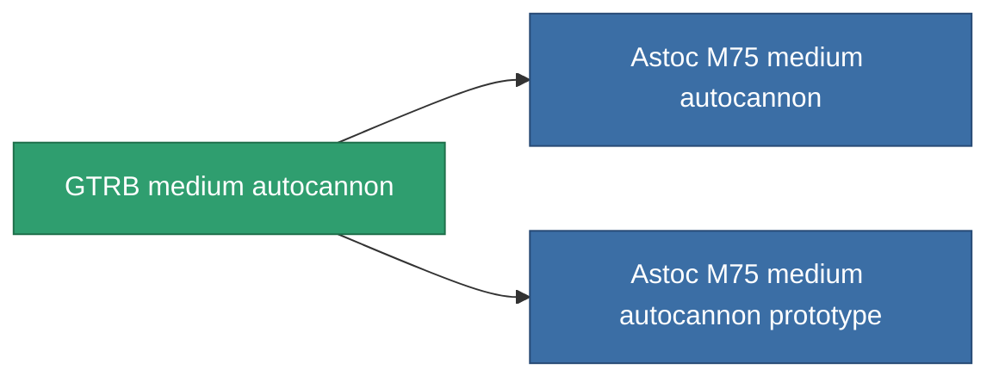

<!-- Generated by tools/generate from the live database (source: entitydefaults definition 1030, aggregatevalues via aggregatefields).
     Do not edit by hand; regenerate instead. -->

# GTRB medium autocannon

|  |  |
|---|---|
| 定义 | `def_named1_longrange_medium_autocannon` |
| 阶级 | T2 |
| 耐久 | 100 |
| 容量 | 1.2 |
| 质量 | 585 |
| 分类 | Modules / Weapons |
| Tier line | **GTRB medium autocannon** (T2) → [Astoc M75 medium autocannon](/zh-CN/content/items/named2-longrange-medium-autocannon/) (T3) → [Znatvoy-Berjiar-IA medium autocannon](/zh-CN/content/items/named3-longrange-medium-autocannon/) (T4) |

## 统计

| 字段 | 值 |
|---|---|
| accuracy | 18 |
| core_usage | 1 |
| cpu_usage | 12 |
| cycle_time | 8k |
| damage_modifier | 2 |
| falloff | 28 |
| least_optimal | 5 |
| optimal_range | 22 |
| powergrid_usage | 130 |

<!-- production:generated -->
## 生产

**由组件 4个生产 ，研究等级 4** — 组装组件来制造它（完整列表见[配方](/zh-CN/content/recipes/)）:

**蓝图:** [GTRB medium autocannon CT](/content/items/named1-longrange-medium-autocannon-cprg/)

<svg class="prod-card-icon" aria-hidden="true"><use href="#mi-grid"/></svg><a class="prod-card-name" href="/zh-CN/content/items/axicol/">Cryoperine</a>

需要: <b>100</b>

<svg class="prod-card-icon" aria-hidden="true"><use href="#mi-grid"/></svg><a class="prod-card-name" href="/zh-CN/content/items/axicoline/">Axicoline</a>

需要: <b>200</b>

<svg class="prod-card-icon" aria-hidden="true"><use href="#mi-robots"/></svg><a class="prod-card-name" href="/zh-CN/content/items/longrange-standard-medium-autocannon/">Standard medium autocannon</a>

需要: <b>1</b>

<svg class="prod-card-icon" aria-hidden="true"><use href="#mi-grid"/></svg><a class="prod-card-name" href="/zh-CN/content/items/titanium/">Titanium</a>

需要: <b>100</b>

## 用于生产

**2个物品的组件** — 所有在制造中使用它的物品:

