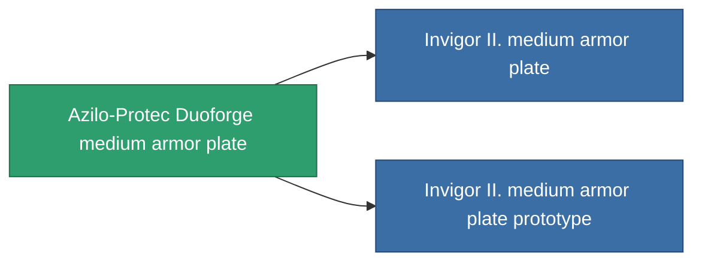

<!-- Generated by tools/generate from the live database (source: entitydefaults definition 687, aggregatevalues via aggregatefields).
     Do not edit by hand; regenerate instead. -->

# Azilo-Protec Duoforge medium armor plate

|  |  |
|---|---|
| 定义 | `def_named1_medium_armor_plate` |
| 阶级 | T2 |
| 耐久 | 100 |
| 容量 | 2 |
| 质量 | 2400 |
| 分类 | Modules / Armor |
| Tier line | [Standard medium armor plate](/zh-CN/content/items/standard-medium-armor-plate/) (T1) → **Azilo-Protec Duoforge medium armor plate** (T2) → [Invigor II. medium armor plate](/zh-CN/content/items/named2-medium-armor-plate/) (T3) → [THL-Testudo medium armor plate](/zh-CN/content/items/named3-medium-armor-plate/) (T4) |

## 统计

| 字段 | 值 |
|---|---|
| armor_max | 1.35k |
| cpu_usage | 2 |
| massiveness | 0.12 |
| powergrid_usage | 60 |
| signature_radius | 1 |

<!-- production:generated -->
## 生产

**由组件 4个生产 ，研究等级 4** — 组装组件来制造它（完整列表见[配方](/zh-CN/content/recipes/)）:

**蓝图:** [Azilo-Protec Duoforge medium armor plate CT](/zh-CN/content/items/named1-medium-armor-plate-cprg/)

<svg class="prod-card-icon" aria-hidden="true"><use href="#mi-grid"/></svg><a class="prod-card-name" href="/zh-CN/content/items/plasteosine/">Plasteosine</a>

需要: <b>700</b>

<svg class="prod-card-icon" aria-hidden="true"><use href="#mi-crystal"/></svg><a class="prod-card-name" href="/zh-CN/content/items/robotshard-common-basic/">Damaged common fragment</a>

需要: <b>60</b>

<svg class="prod-card-icon" aria-hidden="true"><use href="#mi-tree"/></svg><a class="prod-card-name" href="/zh-CN/content/items/standard-medium-armor-plate/">Standard medium armor plate</a>

需要: <b>1</b>

<svg class="prod-card-icon" aria-hidden="true"><use href="#mi-grid"/></svg><a class="prod-card-name" href="/zh-CN/content/items/titanium/">Titanium</a>

需要: <b>500</b>

## 用于生产

**2个物品的组件** — 所有在制造中使用它的物品:

