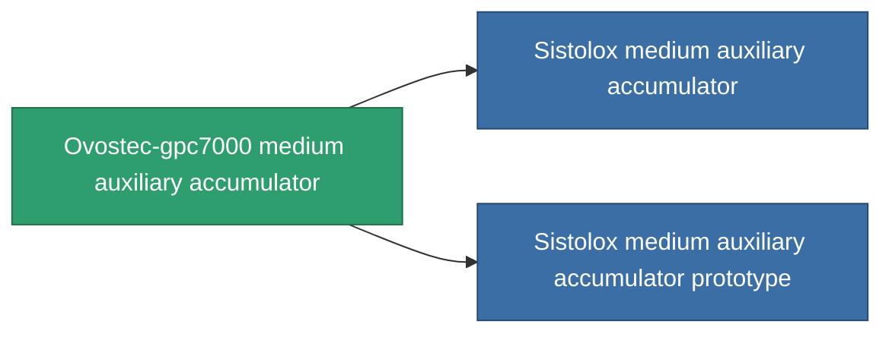

<!-- Generated by tools/generate from the live database (source: entitydefaults definition 816, aggregatevalues via aggregatefields).
     Do not edit by hand; regenerate instead. -->

# Ovostec-gpc7000 medium auxiliary accumulator

|  |  |
|---|---|
| 定义 | `def_named1_medium_core_battery` |
| 阶级 | T2 |
| 耐久 | 100 |
| 容量 | 1 |
| 质量 | 1350 |
| 分类 | Modules / Power |
| Tier line | [Standard medium auxiliary accumulator](/zh-CN/content/items/standard-medium-core-battery/) (T1) → **Ovostec-gpc7000 medium auxiliary accumulator** (T2) → [Sistolox medium auxiliary accumulator](/zh-CN/content/items/named2-medium-core-battery/) (T3) → [Pheter Charge-M medium auxiliary accumulator](/zh-CN/content/items/named3-medium-core-battery/) (T4) |

## 统计

| 字段 | 值 |
|---|---|
| core_max | 375 |
| cpu_usage | 36 |
| powergrid_usage | 100 |

<!-- production:generated -->
## 生产

**由组件 4个生产 ，研究等级 5** — 组装组件来制造它（完整列表见[配方](/zh-CN/content/recipes/)）:

**蓝图:** [Ovostec-gpc7000 medium auxiliary accumulator CT](/zh-CN/content/items/named1-medium-core-battery-cprg/)

<svg class="prod-card-icon" aria-hidden="true"><use href="#mi-grid"/></svg><a class="prod-card-name" href="/zh-CN/content/items/axicol/">Cryoperine</a>

需要: <b>400</b>

<svg class="prod-card-icon" aria-hidden="true"><use href="#mi-crystal"/></svg><a class="prod-card-name" href="/zh-CN/content/items/robotshard-common-basic/">Damaged common fragment</a>

需要: <b>60</b>

<svg class="prod-card-icon" aria-hidden="true"><use href="#mi-grid"/></svg><a class="prod-card-name" href="/zh-CN/content/items/standard-medium-core-battery/">Standard medium auxiliary accumulator</a>

需要: <b>1</b>

<svg class="prod-card-icon" aria-hidden="true"><use href="#mi-grid"/></svg><a class="prod-card-name" href="/zh-CN/content/items/titanium/">Titanium</a>

需要: <b>200</b>

## 用于生产

**2个物品的组件** — 所有在制造中使用它的物品:

