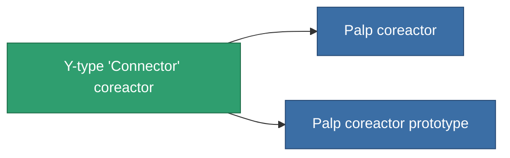

<!-- Generated by tools/generate from the live database (source: entitydefaults definition 765, aggregatevalues via aggregatefields).
     Do not edit by hand; regenerate instead. -->

# Y-type 'Connector' coreactor

|  |  |
|---|---|
| 定义 | `def_named1_powergrid_upgrades` |
| 阶级 | T2 |
| 耐久 | 100 |
| 容量 | 0.5 |
| 质量 | 90 |
| 分类 | Modules / Power |
| Tier line | [Standard coreactor](/zh-CN/content/items/standard-powergrid-upgrades/) (T1) → **Y-type 'Connector' coreactor** (T2) → [Palp coreactor](/zh-CN/content/items/named2-powergrid-upgrades/) (T3) → [E-set 15VaW coreactor](/zh-CN/content/items/named3-powergrid-upgrades/) (T4) |

## 统计

| 字段 | 值 |
|---|---|
| cpu_usage | 30 |
| powergrid_max_modifier | 1.1 |

<!-- production:generated -->
## 生产

**由组件 4个生产 ，研究等级 4** — 组装组件来制造它（完整列表见[配方](/zh-CN/content/recipes/)）:

**蓝图:** [Y-type 'Connector' coreactor CT](/zh-CN/content/items/named1-powergrid-upgrades-cprg/)

<svg class="prod-card-icon" aria-hidden="true"><use href="#mi-grid"/></svg><a class="prod-card-name" href="/zh-CN/content/items/axicol/">Cryoperine</a>

需要: <b>300</b>

<svg class="prod-card-icon" aria-hidden="true"><use href="#mi-crystal"/></svg><a class="prod-card-name" href="/zh-CN/content/items/robotshard-common-basic/">Damaged common fragment</a>

需要: <b>30</b>

<svg class="prod-card-icon" aria-hidden="true"><use href="#mi-crystal"/></svg><a class="prod-card-name" href="/zh-CN/content/items/standard-powergrid-upgrades/">Standard coreactor</a>

需要: <b>1</b>

<svg class="prod-card-icon" aria-hidden="true"><use href="#mi-grid"/></svg><a class="prod-card-name" href="/zh-CN/content/items/titanium/">Titanium</a>

需要: <b>200</b>

## 用于生产

**2个物品的组件** — 所有在制造中使用它的物品:

