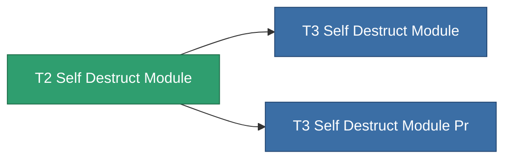

<!-- Generated by tools/generate from the live database (source: entitydefaults definition 8980, aggregatevalues via aggregatefields).
     Do not edit by hand; regenerate instead. -->

# T2 Self Destruct Module

|  |  |
|---|---|
| 定义 | `def_named1_self_destruct_module` |
| 阶级 | T2 |
| 耐久 | 100 |
| 容量 | 100 |
| 质量 | 450 |
| 分类 | Modules / Enhancements |
| Tier line | [Standard Self Destruct Module](/zh-CN/content/items/standard-self-destruct-module/) (T1) → **T2 Self Destruct Module** (T2) → [T3 Self Destruct Module](/zh-CN/content/items/named2-self-destruct-module/) (T3) → [T4 Self Destruct Module](/zh-CN/content/items/named3-self-destruct-module/) (T4) |
| 备注 | Kamikaze self-destruct module: arms an un-cancellable delayed detonation that kills the owner. |

## 统计

| 字段 | 值 |
|---|---|
| core_usage | 55 |
| cpu_usage | 45 |
| powergrid_usage | 22 |

<!-- production:generated -->
## 生产

**由组件 5个生产** — 组装组件来制造它（完整列表见[配方](/zh-CN/content/recipes/)）:

**蓝图:** [T2 Self Destruct Module Cprg](/zh-CN/content/items/named1-self-destruct-module-cprg/)

<svg class="prod-card-icon" aria-hidden="true"><use href="#mi-grid"/></svg><a class="prod-card-name" href="/zh-CN/content/items/axicol/">Cryoperine</a>

需要: <b>250</b>

<svg class="prod-card-icon" aria-hidden="true"><use href="#mi-grid"/></svg><a class="prod-card-name" href="/zh-CN/content/items/axicoline/">Axicoline</a>

需要: <b>200</b>

<svg class="prod-card-icon" aria-hidden="true"><use href="#mi-grid"/></svg><a class="prod-card-name" href="/zh-CN/content/items/espitium/">Espitium</a>

需要: <b>200</b>

<svg class="prod-card-icon" aria-hidden="true"><use href="#mi-panel"/></svg><a class="prod-card-name" href="/zh-CN/content/items/standard-self-destruct-module/">Standard Self Destruct Module</a>

需要: <b>1</b>

<svg class="prod-card-icon" aria-hidden="true"><use href="#mi-grid"/></svg><a class="prod-card-name" href="/zh-CN/content/items/titanium/">Titanium</a>

需要: <b>200</b>

## 用于生产

**2个物品的组件** — 所有在制造中使用它的物品:

