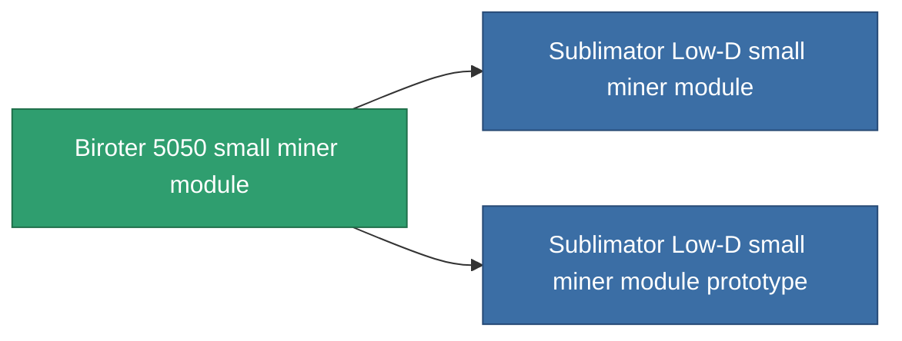

<!-- Generated by tools/generate from the live database (source: entitydefaults definition 798, aggregatevalues via aggregatefields).
     Do not edit by hand; regenerate instead. -->

# Biroter 5050 small miner module

|  |  |
|---|---|
| 定义 | `def_named1_small_driller` |
| 阶级 | T2 |
| 耐久 | 100 |
| 容量 | 1 |
| 质量 | 360 |
| 分类 | Modules / Enhancements |
| Tier line | [Standard small miner module](/zh-CN/content/items/standard-small-driller/) (T1) → **Biroter 5050 small miner module** (T2) → [Sublimator Low-D small miner module](/zh-CN/content/items/named2-small-driller/) (T3) → [Scraper-990 small miner module](/zh-CN/content/items/named3-small-driller/) (T4) |

## 统计

| 字段 | 值 |
|---|---|
| core_usage | 15 |
| cpu_usage | 37 |
| cycle_time | 15.5k |
| optimal_range | 3 |
| powergrid_usage | 28 |

<!-- production:generated -->
## 生产

**由组件 4个生产 ，研究等级 2** — 组装组件来制造它（完整列表见[配方](/zh-CN/content/recipes/)）:

**蓝图:** [Biroter 5050 small miner module CT](/zh-CN/content/items/named1-small-driller-cprg/)

<svg class="prod-card-icon" aria-hidden="true"><use href="#mi-grid"/></svg><a class="prod-card-name" href="/zh-CN/content/items/axicol/">Cryoperine</a>

需要: <b>50</b>

<svg class="prod-card-icon" aria-hidden="true"><use href="#mi-crystal"/></svg><a class="prod-card-name" href="/zh-CN/content/items/robotshard-common-basic/">Damaged common fragment</a>

需要: <b>30</b>

<svg class="prod-card-icon" aria-hidden="true"><use href="#mi-panel"/></svg><a class="prod-card-name" href="/zh-CN/content/items/standard-small-driller/">Standard small miner module</a>

需要: <b>1</b>

<svg class="prod-card-icon" aria-hidden="true"><use href="#mi-grid"/></svg><a class="prod-card-name" href="/zh-CN/content/items/titanium/">Titanium</a>

需要: <b>150</b>

## 用于生产

**2个物品的组件** — 所有在制造中使用它的物品:

