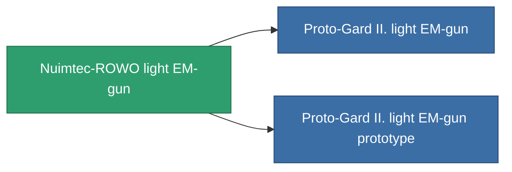

<!-- Generated by tools/generate from the live database (source: entitydefaults definition 858, aggregatevalues via aggregatefields).
     Do not edit by hand; regenerate instead. -->

# Nuimtec-ROWO light EM-gun

|  |  |
|---|---|
| 定义 | `def_named1_small_railgun` |
| 阶级 | T2 |
| 耐久 | 100 |
| 容量 | 0.5 |
| 质量 | 225 |
| 分类 | Modules / Weapons |
| Tier line | [Standard light EM-gun](/zh-CN/content/items/standard-small-railgun/) (T1) → **Nuimtec-ROWO light EM-gun** (T2) → [Proto-Gard II. light EM-gun](/zh-CN/content/items/named2-small-railgun/) (T3) → [Nuimtec-Inkandesk light EM-gun](/zh-CN/content/items/named3-small-railgun/) (T4) |

## 统计

| 字段 | 值 |
|---|---|
| accuracy | 5 |
| core_usage | 3 |
| cpu_usage | 23 |
| cycle_time | 5k |
| damage_modifier | 1.35 |
| falloff | 5 |
| least_optimal | 8 |
| optimal_range | 12 |
| powergrid_usage | 26 |

<!-- production:generated -->
## 生产

**由组件 6个生产 ，研究等级 3** — 组装组件来制造它（完整列表见[配方](/zh-CN/content/recipes/)）:

**蓝图:** [Nuimtec-ROWO light EM-gun CT](/zh-CN/content/items/named1-small-railgun-cprg/)

<svg class="prod-card-icon" aria-hidden="true"><use href="#mi-grid"/></svg><a class="prod-card-name" href="/zh-CN/content/items/axicoline/">Axicoline</a>

需要: <b>50</b>

<svg class="prod-card-icon" aria-hidden="true"><use href="#mi-grid"/></svg><a class="prod-card-name" href="/zh-CN/content/items/polynitrocol/">Polynitrocol</a>

需要: <b>50</b>

<svg class="prod-card-icon" aria-hidden="true"><use href="#mi-crystal"/></svg><a class="prod-card-name" href="/zh-CN/content/items/robotshard-common-basic/">Damaged common fragment</a>

需要: <b>15</b>

<svg class="prod-card-icon" aria-hidden="true"><use href="#mi-crystal"/></svg><a class="prod-card-name" href="/zh-CN/content/items/robotshard-nuimqol-basic/">Damaged nuimqol fragment</a>

需要: <b>15</b>

<svg class="prod-card-icon" aria-hidden="true"><use href="#mi-grid"/></svg><a class="prod-card-name" href="/zh-CN/content/items/standard-small-railgun/">Standard light EM-gun</a>

需要: <b>1</b>

<svg class="prod-card-icon" aria-hidden="true"><use href="#mi-grid"/></svg><a class="prod-card-name" href="/zh-CN/content/items/titanium/">Titanium</a>

需要: <b>50</b>

## 用于生产

**2个物品的组件** — 所有在制造中使用它的物品:

