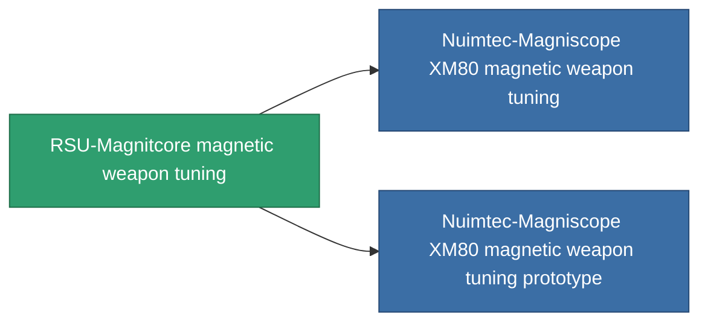

<!-- Generated by tools/generate from the live database (source: entitydefaults definition 925, aggregatevalues via aggregatefields).
     Do not edit by hand; regenerate instead. -->

# RSU-Magnitcore magnetic weapon tuning

|  |  |
|---|---|
| 定义 | `def_named2_damage_mod_railgun` |
| 阶级 | T3 |
| 耐久 | 100 |
| 容量 | 0.5 |
| 质量 | 100 |
| 分类 | Modules / Weapons |
| Tier line | [Standard magnetic weapon tuning](/zh-CN/content/items/standard-damage-mod-railgun/) (T1) → [Nuimtec-Spilster magnetic weapon tuning](/zh-CN/content/items/named1-damage-mod-railgun/) (T2) → **RSU-Magnitcore magnetic weapon tuning** (T3) → [Nuimtec-Magniscope XM80 magnetic weapon tuning](/zh-CN/content/items/named3-damage-mod-railgun/) (T4) |

## 统计

| 字段 | 值 |
|---|---|
| cpu_usage | 27 |
| damage_railgun_modifier | 0.2 |
| powergrid_usage | 5 |

<!-- production:generated -->
## 生产

**由组件 10个生产 ，研究等级 5** — 组装组件来制造它（完整列表见[配方](/zh-CN/content/recipes/)）:

**蓝图:** [RSU-Magnitcore magnetic weapon tuning CT](/zh-CN/content/items/named2-damage-mod-railgun-cprg/)

<svg class="prod-card-icon" aria-hidden="true"><use href="#mi-grid"/></svg><a class="prod-card-name" href="/zh-CN/content/items/chollonin/">Chollonin</a>

需要: <b>100</b>

<svg class="prod-card-icon" aria-hidden="true"><use href="#mi-grid"/></svg><a class="prod-card-name" href="/zh-CN/content/items/espitium/">Espitium</a>

需要: <b>100</b>

<svg class="prod-card-icon" aria-hidden="true"><use href="#mi-grid"/></svg><a class="prod-card-name" href="/zh-CN/content/items/hydrobenol/">Hydrobenol</a>

需要: <b>50</b>

<svg class="prod-card-icon" aria-hidden="true"><use href="#mi-robots"/></svg><a class="prod-card-name" href="/zh-CN/content/items/named1-damage-mod-railgun/">Nuimtec-Spilster magnetic weapon tuning</a>

需要: <b>1</b>

<svg class="prod-card-icon" aria-hidden="true"><use href="#mi-grid"/></svg><a class="prod-card-name" href="/zh-CN/content/items/polynitrocol/">Polynitrocol</a>

需要: <b>50</b>

<svg class="prod-card-icon" aria-hidden="true"><use href="#mi-crystal"/></svg><a class="prod-card-name" href="/zh-CN/content/items/robotshard-common-advanced/">Functional common fragment</a>

需要: <b>10</b>

<svg class="prod-card-icon" aria-hidden="true"><use href="#mi-crystal"/></svg><a class="prod-card-name" href="/zh-CN/content/items/robotshard-common-basic/">Damaged common fragment</a>

需要: <b>10</b>

<svg class="prod-card-icon" aria-hidden="true"><use href="#mi-crystal"/></svg><a class="prod-card-name" href="/zh-CN/content/items/robotshard-nuimqol-advanced/">Functional nuimqol fragment</a>

需要: <b>10</b>

<svg class="prod-card-icon" aria-hidden="true"><use href="#mi-crystal"/></svg><a class="prod-card-name" href="/zh-CN/content/items/robotshard-nuimqol-basic/">Damaged nuimqol fragment</a>

需要: <b>10</b>

<svg class="prod-card-icon" aria-hidden="true"><use href="#mi-grid"/></svg><a class="prod-card-name" href="/zh-CN/content/items/titanium/">Titanium</a>

需要: <b>50</b>

## 用于生产

**2个物品的组件** — 所有在制造中使用它的物品:

