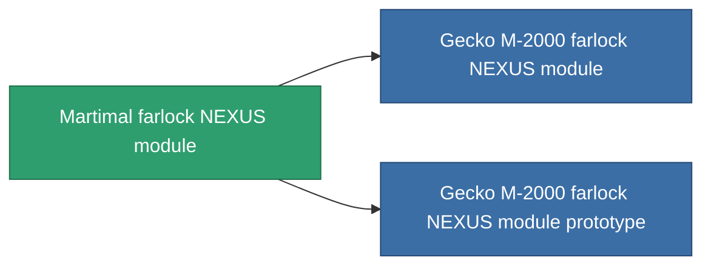

<!-- Generated by tools/generate from the live database (source: entitydefaults definition 2572, aggregatevalues via aggregatefields).
     Do not edit by hand; regenerate instead. -->

# Martimal farlock NEXUS module

|  |  |
|---|---|
| 定义 | `def_named2_gang_assist_information_module` |
| 阶级 | T3 |
| 耐久 | 100 |
| 容量 | 0.2 |
| 质量 | 10 |
| 分类 | Modules / Enhancements |
| Tier line | [Standard farlock NEXUS module](/zh-CN/content/items/standard-gang-assist-information-module/) (T1) → [Gecko D-1500 farlock NEXUS module](/zh-CN/content/items/named1-gang-assist-information-module/) (T2) → **Martimal farlock NEXUS module** (T3) → [Gecko M-2000 farlock NEXUS module](/zh-CN/content/items/named3-gang-assist-information-module/) (T4) |
| 备注 | locking range 1.0%  /ext lvl |

## 统计

| 字段 | 值 |
|---|---|
| core_usage | 36 |
| cpu_usage | 88 |
| cycle_time | 10k |
| default_effect_range | 100 |
| effect_locking_range_modifier | 1.05 |
| powergrid_usage | 36 |

<!-- production:generated -->
## 生产

**由组件 6个生产 ，研究等级 6** — 组装组件来制造它（完整列表见[配方](/zh-CN/content/recipes/)）:

**蓝图:** [Martimal farlock NEXUS module CT](/zh-CN/content/items/named2-gang-assist-information-module-cprg/)

<svg class="prod-card-icon" aria-hidden="true"><use href="#mi-grid"/></svg><a class="prod-card-name" href="/zh-CN/content/items/espitium/">Espitium</a>

需要: <b>300</b>

<svg class="prod-card-icon" aria-hidden="true"><use href="#mi-panel"/></svg><a class="prod-card-name" href="/zh-CN/content/items/named1-gang-assist-information-module/">Gecko D-1500 farlock NEXUS module</a>

需要: <b>1</b>

<svg class="prod-card-icon" aria-hidden="true"><use href="#mi-grid"/></svg><a class="prod-card-name" href="/zh-CN/content/items/prilumium/">Prilumium</a>

需要: <b>300</b>

<svg class="prod-card-icon" aria-hidden="true"><use href="#mi-crystal"/></svg><a class="prod-card-name" href="/zh-CN/content/items/robotshard-common-advanced/">Functional common fragment</a>

需要: <b>20</b>

<svg class="prod-card-icon" aria-hidden="true"><use href="#mi-crystal"/></svg><a class="prod-card-name" href="/zh-CN/content/items/robotshard-common-basic/">Damaged common fragment</a>

需要: <b>20</b>

<svg class="prod-card-icon" aria-hidden="true"><use href="#mi-grid"/></svg><a class="prod-card-name" href="/zh-CN/content/items/titanium/">Titanium</a>

需要: <b>50</b>

## 用于生产

**2个物品的组件** — 所有在制造中使用它的物品:

