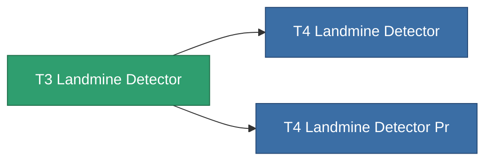

<!-- Generated by tools/generate from the live database (source: entitydefaults definition 8316, aggregatevalues via aggregatefields).
     Do not edit by hand; regenerate instead. -->

# T3 Landmine Detector

|  |  |
|---|---|
| 定义 | `def_named2_landmine_detector` |
| 阶级 | T3 |
| 耐久 | 100 |
| 容量 | 1.5 |
| 质量 | 1000 |
| 分类 | Modules / Enhancements |
| Tier line | [T2 Landmine Detector](/zh-CN/content/items/named1-landmine-detector/) (T2) → **T3 Landmine Detector** (T3) → [T4 Landmine Detector](/zh-CN/content/items/named3-landmine-detector/) (T4) |

## 统计

| 字段 | 值 |
|---|---|
| core_usage | 14 |
| cpu_usage | 23 |
| cycle_time | 10k |
| effect_mine_detection_range_modifier | 1.4 |
| powergrid_usage | 7 |

<!-- production:generated -->
## 生产

**由组件 6个生产** — 组装组件来制造它（完整列表见[配方](/zh-CN/content/recipes/)）:

**蓝图:** [T3 Landmine Detector Cprg](/zh-CN/content/items/named2-landmine-detector-cprg/)

<svg class="prod-card-icon" aria-hidden="true"><use href="#mi-grid"/></svg><a class="prod-card-name" href="/zh-CN/content/items/axicol/">Cryoperine</a>

需要: <b>200</b>

<svg class="prod-card-icon" aria-hidden="true"><use href="#mi-grid"/></svg><a class="prod-card-name" href="/zh-CN/content/items/espitium/">Espitium</a>

需要: <b>200</b>

<svg class="prod-card-icon" aria-hidden="true"><use href="#mi-grid"/></svg><a class="prod-card-name" href="/zh-CN/content/items/named1-landmine-detector/">T2 Landmine Detector</a>

需要: <b>1</b>

<svg class="prod-card-icon" aria-hidden="true"><use href="#mi-crystal"/></svg><a class="prod-card-name" href="/zh-CN/content/items/robotshard-common-advanced/">Functional common fragment</a>

需要: <b>20</b>

<svg class="prod-card-icon" aria-hidden="true"><use href="#mi-crystal"/></svg><a class="prod-card-name" href="/zh-CN/content/items/robotshard-common-basic/">Damaged common fragment</a>

需要: <b>20</b>

<svg class="prod-card-icon" aria-hidden="true"><use href="#mi-grid"/></svg><a class="prod-card-name" href="/zh-CN/content/items/titanium/">Titanium</a>

需要: <b>100</b>

## 用于生产

**2个物品的组件** — 所有在制造中使用它的物品:

