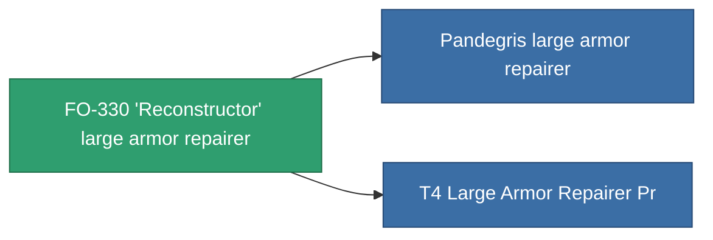

<!-- Generated by tools/generate from the live database (source: entitydefaults definition 700, aggregatevalues via aggregatefields).
     Do not edit by hand; regenerate instead. -->

# FO-330 'Reconstructor' large armor repairer

|  |  |
|---|---|
| 定义 | `def_named2_large_armor_repairer` |
| 阶级 | T3 |
| 耐久 | 100 |
| 容量 | 3 |
| 质量 | 1500 |
| 分类 | Modules / Repair |
| Tier line | [Standard large armor repairer](/zh-CN/content/items/standard-large-armor-repairer/) (T1) → [Stesodenn large armor repairer](/zh-CN/content/items/named1-large-armor-repairer/) (T2) → **FO-330 'Reconstructor' large armor repairer** (T3) → [Pandegris large armor repairer](/zh-CN/content/items/named3-large-armor-repairer/) (T4) |

## 统计

| 字段 | 值 |
|---|---|
| armor_repair_amount | 410 |
| core_usage | 478.5 |
| cpu_usage | 440 |
| cycle_time | 13.5k |
| powergrid_usage | 1.1k |

<!-- production:generated -->
## 生产

**由组件 9个生产** — 组装组件来制造它（完整列表见[配方](/zh-CN/content/recipes/)）:

**蓝图:** [T3 Large Armor Repairer Cprg](/content/items/named2-large-armor-repairer-cprg/)

<svg class="prod-card-icon" aria-hidden="true"><use href="#mi-grid"/></svg><a class="prod-card-name" href="/zh-CN/content/items/alligior/">Alligior</a>

需要: <b>300</b>

<svg class="prod-card-icon" aria-hidden="true"><use href="#mi-grid"/></svg><a class="prod-card-name" href="/zh-CN/content/items/chollonin/">Chollonin</a>

需要: <b>75</b>

<svg class="prod-card-icon" aria-hidden="true"><use href="#mi-grid"/></svg><a class="prod-card-name" href="/zh-CN/content/items/espitium/">Espitium</a>

需要: <b>75</b>

<svg class="prod-card-icon" aria-hidden="true"><use href="#mi-tree"/></svg><a class="prod-card-name" href="/zh-CN/content/items/named1-large-armor-repairer/">Stesodenn large armor repairer</a>

需要: <b>1</b>

<svg class="prod-card-icon" aria-hidden="true"><use href="#mi-crystal"/></svg><a class="prod-card-name" href="/zh-CN/content/items/robotshard-common-advanced/">Functional common fragment</a>

需要: <b>60</b>

<svg class="prod-card-icon" aria-hidden="true"><use href="#mi-crystal"/></svg><a class="prod-card-name" href="/zh-CN/content/items/robotshard-common-basic/">Damaged common fragment</a>

需要: <b>60</b>

<svg class="prod-card-icon" aria-hidden="true"><use href="#mi-grid"/></svg><a class="prod-card-name" href="/zh-CN/content/items/specimen-sap-item-flux/">Specimen Sap Item Flux</a>

需要: <b>30</b>

<svg class="prod-card-icon" aria-hidden="true"><use href="#mi-grid"/></svg><a class="prod-card-name" href="/zh-CN/content/items/statichnol/">Statichnol</a>

需要: <b>300</b>

<svg class="prod-card-icon" aria-hidden="true"><use href="#mi-grid"/></svg><a class="prod-card-name" href="/zh-CN/content/items/titanium/">Titanium</a>

需要: <b>150</b>

## 用于生产

**2个物品的组件** — 所有在制造中使用它的物品:

